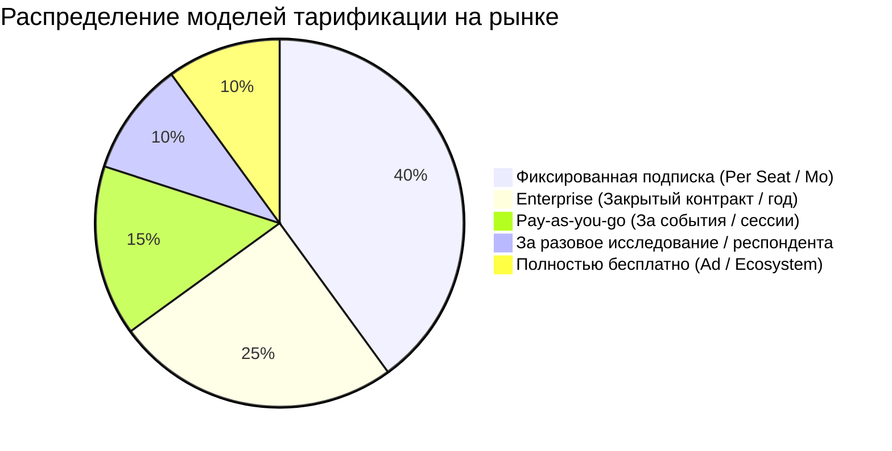

# Анализ конкурентов: Сервисы опросов, UX-исследований, A/B-тестирования и тепловых карт

> **Дата актуализации:** Октябрь 2026 г.  
> **Целевая аудитория отчёта:** Продуктовые менеджеры (CPO / PM), продуктовые дизайнеры (Product / UX / UI Designers), UX-исследователи (UXR), маркетологи и команды оптимизации конверсий (CRO).

---

## 1. Введение и классификация ландшафта

В современном продуктовом цикле инструменты проверки гипотез и изучения пользователей делятся на 4 ключевых кластера в зависимости от стадии зрелости продукта:

```mermaid
flowchart LR
    subgraph Discovery["1. Discovery & Customer Research"]
        A1["Глубинные интервью"]
        A2["Анкеты и опросы"]
        A3["Оценка рынка и концепций"]
    end

    subgraph Prototype["2. Прототипирование и UX"]
        B1["Немодерируемые тесты Figma"]
        B2["Первый клик / 5 секунд"]
        B3["Карточная сортировка / Дерево"]
    end

    subgraph Analytics["3. Поведенческий аудит (Live)"]
        C1["Тепловые карты кликов и скролла"]
        C2["Записи сессий (Session Replay)"]
        C3["In-product микроопросы (NPS/CSAT)"]
    end

    subgraph CRO["4. Эксперименты и Оптимизация"]
        D1["Визуальные A/B тесты"]
        D2["Feature Flags / Сплит-тесты"]
        D3["Мультивариантные тесты"]
    end

    Discovery --> Prototype --> Analytics --> CRO
```

Ниже представлен детальный разбор ведущих международных платформ и ключевых российских альтернатив с разбором плюсов, минусов, моделей тарификации и ценообразования.

---

## 2. Сводная сравнительная таблица

| Инструмент | Категория | Тесты прототипов (Figma) | Опросы и анкеты | Тепловые карты / Сессии | A/B тестирование | Своя панель респондентов | Доступность в РФ (Оплата/Язык) | Ориентировочная стоимость |
| :--- | :--- | :---: | :---: | :---: | :---: | :---: | :---: | :--- |
| **Maze** | UX / Прототипы | Да (Эталон) | Да | Базовые клики | Нет | Да (5M+ респондентов) | Зарубежные карты / EN | Free; от $99/мес; Enterprise |
| **Lyssna** (UsabilityHub) | UX / Экспресс-тесты | Базовый | Да | Клики | Базовый (Preference) | Да | Зарубежные карты / EN | Free; от $89/мес + панель |
| **UXtweak** | UX-комбайн | Да | Да | Да | Нет | Да | Зарубежные карты / EN | Free; от €92/мес |
| **UserTesting** | Качественный UX / Видео | Да | Да | Нет | Нет | Да (Премиум) | Зарубежные карты / EN | Enterprise ($15k–$50k+/год) |
| **Sprig** | In-Product UX + AI | Нет | Да (Микро) | Да (Replays) | Нет | Нет (свои юзеры) | Зарубежные карты / EN | Enterprise (от $1 000/мес) |
| **Fastuna** (Tiburon) | Экспресс-маркетинг | Базовый | Да (Шаблоны) | Нет | Концепт-сплиты | Да (РФ/СНГ) | РФ карты, СБП, Безнал / RU | Бесплатно (своя база); проекты от ~10–40 тыс. ₽; подписка от 500 тыс. ₽/год |
| **Oprosso** | CX / UX Enterprise | Базовый (клики) | Да (Глубокие) | Да (Клики) | Нет | Через партнеров | РФ карты, Безнал / RU (152-ФЗ) | От 130 000 ₽/год |
| **AskUsers** | Юзабилити-аудит | Да (по ссылке) | Да (Анкеты) | Нет | Нет | Да (Живые асессоры) | РФ карты, Безнал / RU | От 8 300 ₽ за исследование |
| **UXpresso** | Удаленные UX-тесты | Да (Figma) | Да | Нет | Нет | Своя база / Панели | РФ карты, Безнал / RU | От ~15 000 – 30 000 ₽/мес |
| **Typeform** | Конверсионные опросы | Нет | Да (Эталон UI) | Нет | Нет | Нет | Зарубежные карты / EN | Free (10 ответов); от $29/мес |
| **WebAsk / Анкетолог** | Конструкторы опросов | Нет | Да | Нет | Нет | Да (у Анкетолога) | РФ карты, Безнал / RU | От 1 790 ₽/мес (WebAsk); от 690 ₽/мес (Анкетолог) |
| **Hotjar** | Поведенческая аналитика | Нет | Да (Виджеты) | Да (Эталон) | Нет | Нет | Зарубежные карты / EN | Free (35 сессий/день); от €39/мес |
| **Microsoft Clarity** | Поведенческая аналитика | Нет | Нет | Да | Нет | Нет | Бесплатно глобально | **100% Free** (Без ограничений) |
| **Яндекс Метрика (Вебвизор)** | Поведенческая аналитика | Нет | Нет (только Я.Формы) | Да (Вебвизор, скролл, клики) | Эксперименты через Вариокуб | Нет | Бесплатно в РФ (152-ФЗ) | **100% Free** |
| **PostHog** | Product OS (All-in-one) | Нет | Да (In-app) | Да (Replay + карты) | Да (Флаги и A/B) | Нет | Зарубежные карты / Self-host | Щедро Free (1M событий); далее Pay-as-you-go |
| **VWO** | CRO и A/B тестирование | Нет | Да (Фидбек) | Да | Да (Эталон No-code) | Нет | Зарубежные карты / EN | От ~$199/мес; Enterprise |

---

## 3. Детальный разбор категорий и сервисов

### Категория 1: UX-исследования и тестирование прототипов (Figma / Usability)

#### 1. Maze (maze.co)
Мировой лидер и золотой стандарт для продуктовых дизайнеров. Позволяет загружать прототип из Figma и тестировать выполнение сценариев сотнями немодерируемых пользователей.

* **Ключевые возможности:**
  * Бесшовная синхронизация с Figma, Adobe XD, Sketch.
  * Автоматический расчет метрик юзабилити: *Task Success Rate*, *Misclick Rate* (процент ошибочных кликов), *Time on Task*, карты путей прохождения (Paths).
  * Тепловые карты кликов прямо по экранам прототипа Figma.
  * Встроенные опросные блоки (шкалы, открытые ответы, множественный выбор).
  * AI-модуль для суммаризации свободных ответов и автоматической генерации отчетов.
  * Встроенная международная панель респондентов (>5 млн чел.).
* **Плюсы:**
  * Идеальная интеграция с дизайн-процессом: дизайнер настраивает сценарий кликами за 10 минут.
  * Наглядные количественные отчеты, понятные стейкхолдерам.
  * Большой пул качественных респондентов по всему миру.
* **Минусы:**
  * Сложная разветвленная логика анкет уступает классическим опросникам.
  * Высокая цена для небольших команд; панель респондентов оплачивается отдельно и стоит дорого.
  * Не работает напрямую с российскими картами; российская панель респондентов слабая.
* **Стоимость:**
  * **Free:** 1 активный проект, до 7 ответов в месяц (хватит только на ознакомление).
  * **Starter:** от ~$99/мес (при годовой оплате ~$79/мес) — до 15 ответов респондентов платформы или ограниченное число своих.
  * **Team / Pro:** от $1 200/год за рабочее место.
  * **Панель:** ~$3 – $5 за респондента.

---

#### 2. Lyssna (бывший UsabilityHub — lyssna.com)
Платформа для быстрого количественного UX-тестирования концепций, первых впечатлений и информационной архитектуры.

* **Ключевые возможности:**
  * **Five-second test:** тест первого впечатления за 5 секунд (пользователю показывают экран и проверяют, что он запомнил).
  * **First-click test:** проверка, куда пользователь кликнет в первую очередь для решения задачи.
  * **Preference test:** A/B тест предпочтений (какой из двух макетов понятнее/красивее).
  * **Card sorting & Tree testing:** карточная сортировка и проверка древовидной структуры каталогов/меню.
* **Плюсы:**
  * Идеально для проверки гипотез на ранних стадиях (до сложного интерактивного прототипа).
  * Очень понятный и прозрачный интерфейс без перегрузки.
  * Предсказуемая и прозрачная модель ценообразования.
* **Минусы:**
  * Не позволяет проходить длинные интерактивные цепочки в прототипе (для этого лучше Maze).
  * Нет сессионных видеозаписей экрана с живым голосом.
* **Стоимость:**
  * **Free:** тесты длительностью до 2 минут, до 3 коллег в аккаунте.
  * **Basic:** от $89/мес (при годовой оплате $75/мес) — безлимитные тесты со своей аудиторией.
  * **Pro:** ~$199/мес — расширенная логика, таргетинг, кастомизация брендинга.
  * **Панель:** от $1 за короткий тест, $3–$5 за развернутый.

---

#### 3. UXtweak (uxtweak.com)
Европейский «комбайн», объединяющий в одной подписке почти все существующие методики UX-исследований.

* **Ключевые возможности:**
  * Тестирование прототипов (Figma, InVision, Axure).
  * Тестирование боевых сайтов и мобильных приложений (iOS/Android SDK).
  * Карточная сортировка, Tree Testing.
  * Запись экрана, веб-камеры и кликов респондента.
  * Встроенные виджеты перехвата посетителей на боевом сайте (On-site recruitment).
* **Плюсы:**
  * Максимальная широта инструментов в рамках одного тарифа (не нужно покупать 3 разных сервиса).
  * Возможность тестировать не только прототипы, но и нативные мобильные приложения.
* **Минусы:**
  * Интерфейс менее интуитивный и более перегруженный, чем у Maze.
  * Кривая обучения выше.
* **Стоимость:**
  * **Free:** базовый аккаунт для 1 активного исследования (до 30 ответов).
  * **Plus / Professional:** от €92 до €144/мес за рабочее место.
  * **Enterprise:** по запросу (от €3 000+/год).

---

#### 4. UserTesting (usertesting.com)
Тяжелый корпоративный стандарт качественных исследований (недавно объединился с UserZoom).

* **Ключевые возможности:**
  * Видеозапись прохождения интерфейса пользователем в высоком разрешении с комментариями голосом вслух (Think Aloud).
  * Проведение как немодерируемых тестов, так и модерируемых живых интервью 1-на-1 (Live Conversations).
  * ИИ-распознавание речи, транскрибация, автоматический поиск цитат и создание хайлайтов (нарезок видео).
  * Премиальная база проверенных респондентов с жестким фильтром по B2B-должностям, демографии и странам.
* **Плюсы:**
  * Непревзойденная глубина качественного понимания мотивации («почему пользователь так поступил»).
  * Высочайшее качество пула респондентов (B2B и B2C).
* **Минусы:**
  * Экстремально высокая стоимость (недоступно стартапам и малому бизнесу).
  * Закрытые enterprise-продажи через менеджеров.
* **Стоимость:**
  * Нет публичных тарифов и бесплатных планов.
  * Годовые контракты начинаются в среднем **от $15 000 – $40 000 в год** и могут доходить до $100 000+ для больших корпораций.

---

#### 5. AskUsers (askusers.ru) — *Российская альтернатива*
Отечественный сервис UX-аудита и юзабилити-тестирования силами реальных пользователей-асессоров.

* **Ключевые возможности:**
  * Тестирование сайтов, интернет-магазинов, мобильных интерфейсов по сценариям заказчика.
  * Респонденты отбираются из собственной базы (по возрасту, городу, доходу, интересам).
  * На выходе заказчик получает анкеты с ответами на вопросы и видеозаписи экранов с аудиокомментариями.
  * Возможность заказать экспертный аудит сертифицированными UX-специалистами.
* **Плюсы:**
  * Доступность в РФ: оплата рублями, работа по договору с юрлицами, закрывающие документы.
  * Не нужно иметь свою базу пользователей: асессоры уже готовы к тестированию.
  * Формат оплаты за единичные исследования (нет обязательной подписки на год).
* **Минусы:**
  * Модель «асессоров»: иногда респонденты дают шаблонные ответы ради вознаграждения.
  * Менее приспособлен для постоянных быстрых тестов Figma-прототипов дизайнерами.
* **Стоимость:**
  * **Базовый тест:** от ~8 300 ₽ за исследование (обычно 10–15 респондентов).
  * **Стандарт / Профи:** от 16 500 до 45 000+ ₽ (с подключением UX-аналитиков и детальным разбором барьеров).

---

#### 6. UXpresso (uxpresso.ru) — *Российская альтернатива*
Специализированная российская платформа для удаленного юзабилити-тестирования интерфейсов и прототипов.

* **Ключевые возможности:**
  * Тестирование ссылок на Figma, боевых сайтов и веб-сервисов.
  * Видеофиксация пути пользователя: запись экрана, трекинг кликов, аудиозапись мыслей вслух.
  * Таймкоды, разметка проблемных зон в сценарии.
* **Плюсы:**
  * Прямая замена зарубежным инструментам качественного UX-тестирования в РФ.
  * Подходит для дизайнеров, проверяющих интерактивные макеты на русскоязычной аудитории.
* **Минусы:**
  * Молодой продукт, менее отточенная автоматика и AI-аналитика по сравнению с Maze.
* **Стоимость:**
  * По запросу или помесячная подписка (в среднем от 15 000 – 30 000 ₽/мес в зависимости от числа сессий).

---

### Категория 2: Опросы, сбор фидбека и исследование концепций

#### 7. Fastuna (fastuna.ru / fastuna.com)
Автоматизированный сервис экспресс-тестирования от исследовательской компании *Tiburon Research*.

* **Ключевые возможности:**
  * Готовые валидированные методики («магазин тестов»):
    * Тест креативов / рекламных баннеров / видеороликов.
    * Тест концепций продукта (Product Concept Test).
    * Тест названий, нейминга, логотипов и элементов айдентики.
    * Тест цены (Van Westendorp / PSM).
  * Собственная гигантская верифицированная онлайн-панель респондентов в России и СНГ.
  * Скорость: готовый количественный аналитический отчет за 24–48 часов.
* **Плюсы:**
  * Методологическая строгость: анкеты составлены профессиональными социологами.
  * Не нужно думать над структурой вопросов — выбираешь готовый шаблон и загружаешь макет.
  * Полностью официально в РФ, безналичный расчет.
* **Минусы:**
  * Жесткие рамки: нельзя произвольно поменять логику или структуру теста.
  * Не подходит для глубокого юзабилити-тестирования прототипов (это именно маркетинговый экспресс-тест).
  * Дорого для частых мелких продуктовых гипотез.
* **Стоимость:**
  * **Тариф «Старт»:** бесплатно (до 500 интервью в месяц по собственной базе клиентов).
  * **Тесты по панели:** разовый тест на выборку из 100–300 респондентов обходится в среднем в **15 000 – 60 000 ₽** за запуск.
  * **Тариф «Команда»:** ~500 000 ₽/год (для регулярных исследований с повышенными лимитами и AI-аналитикой).

---

#### 8. Oprosso (oprosso.ru)
Профессиональная российская платформа для CX/UX исследований, замера лояльности и обратной связи.

* **Ключевые возможности:**
  * Конструктор опросов с любой ветвящейся логикой, квотами, рандомизацией и переменными.
  * Специальные UX-модули: **тест первого клика**, **карточная сортировка**, **шкала Кано (Kano Model)**, **MaxDiff**.
  * Омниканальность: виджеты на сайте, SDK в мобильном приложении, email-рассылки, QR-коды, Telegram.
  * Триггерные опросы (всплывающие после определенных действий пользователя).
  * Полное соответствие 152-ФЗ, сервера в РФ.
* **Плюсы:**
  * Самый мощный отечественный аналог Qualtrics и SurveyMonkey.
  * Наличие редких профессиональных методик (Кано, первый клик, карточки).
  * Отличная безопасность и энтерпрайз-функционал (SSO, роли, аудит).
* **Минусы:**
  * Высокий порог входа по цене для стартапов и фрилансеров.
  * Закрытое ценообразование (продажи через демо-звонки).
* **Стоимость:**
  * Годовая лицензия: от **130 000 ₽ в год** (базовый тариф) до **500 000+ ₽/год** для Enterprise.
  * Для малого бизнеса создатели Oprosso предлагают упрощенный конструктор **WebAsk** (от 1 790 ₽/мес).

---

#### 9. Typeform (typeform.com)
Мировой бенчмарк в области интерактивных диалоговых форм и опросов.

* **Ключевые возможности:**
  * Формат «Один вопрос за один экран»: максимальная концентрация респондента и минимальный дропофф.
  * Эстетичный адаптивный дизайн, плавная анимация, мультимедиа-вставки.
  * Условная логика перехода (Logic Jumps), расчет баллов (Calculators / Quiz).
  * Богатая интеграция (Notion, Airtable, HubSpot, Zapier, Slack, Make).
* **Плюсы:**
  * Самая высокая конверсия прохождения опросов в индустрии благодаря UI/UX.
  * Простой в освоении визуальный редактор.
* **Минусы:**
  * Нет функционала юзабилити-тестирования прототипов Figma или тепловых карт.
  * Резкий рост цены при увеличении числа ответов (responses).
  * Не принимает карты банков РФ.
* **Стоимость:**
  * **Free:** до 10 ответов в месяц (де-факто только триал).
  * **Basic:** $29/мес (до 100 ответов).
  * **Plus:** $59/мес (до 1 000 ответов, брендинг Typeform можно скрыть).
  * **Business:** $99/мес (до 3 500 ответов, расширенная аналитика конверсий).

---

#### 10. Sprig (sprig.com)
Инновационная AI-платформа для непрерывных продуктовых исследований и контекстного фидбека в реальном времени.

* **Ключевые возможности:**
  * Микроопросы, встроенные нативно в веб- и мобильные приложения через SDK.
  * Привязка опроса к действию пользователя (например, показ опроса сразу после того, как пользователь нажал «Отменить подписку»).
  * Сессионный повтор (Session Replay), привязанный именно к моменту ответа на опрос.
  * AI-агенты: автоматически формулируют follow-up вопросы на основе того, что только что ответил пользователь, и кластеризуют темы.
* **Плюсы:**
  * Получение контекстной обратной связи «в моменте», а не задним числом по почте.
  * Связка качественного ответа с видеозаписью того, что делал пользователь перед этим.
* **Минусы:**
  * Требует интеграции разработчиками (установка SDK в кодовую базу).
  * Очень дорогой продукт, ориентированный исключительно на венчурные компании и Enterprise.
* **Стоимость:**
  * Премиальное ценообразование по запросу (обычно от $1 000 – $2 500/мес при оплате за год).

---

#### 11. Анкетолог (anketolog.ru) и WebAsk (webask.io) — *Масс-маркет РФ*
Популярные российские конструкторы для повседневных опросов и исследований.

* **Ключевые возможности:**
  * Конструктор анкет с десятками типов вопросов (матрицы, шкалы, семантический дифференциал).
  * У Анкетолога есть собственная панель респондентов («Анкетер», >150 000 участников в РФ).
  * Выгрузка отчетов в Excel, SPSS, PDF, Word.
* **Плюсы:**
  * Оплата в рублях, физическими и юридическими лицами.
  * Доступная цена для студентов, частных исследователей и небольших компаний.
* **Минусы:**
  * Устаревший классический интерфейс анкет (длинные списки вопросов снижают доходимость).
  * Нет инструментов тестирования интерфейсов и тепловых карт.
* **Стоимость:**
  * **Анкетолог:** от 690 ₽/мес (тариф «Базовый») до 3 990 ₽/мес («Профи»). Покупка ответов респондентов панели — от 40–90 ₽ за анкету.
  * **WebAsk:** от 1 790 ₽/мес (до 5 000 ответов) до 4 990 ₽/мес.

---

### Категория 3: Тепловые карты и поведенческая аналитика

#### 12. Hotjar (hotjar.com)
Самый известный в мире инструмент визуального анализа поведения посетителей на сайтах (входит в состав Contentsquare).

* **Ключевые возможности:**
  * **Heatmaps:** тепловые карты кликов (Click maps), движений курсора (Move maps) и глубины скролла (Scroll maps).
  * **Session Recordings:** непрерывная запись сессий реальных пользователей с возможностью перемотки, фильтрации по действиям и пропуска пауз.
  * **Feedback Widgets:** плавающие виджеты оценки страниц (эмодзи, звездочки, сбор баг-репортов со скриншотами).
  * **Surveys:** встроенные попап-опросы с таргетингом по URL и действиям.
* **Плюсы:**
  * Интуитивно понятный интерфейс, не требующий технических навыков.
  * Мгновенное нахождение UX-проблем (например, некликабельные элементы, на которые кликают).
* **Минусы:**
  * Модульная оплата: модуль *Observe* (карты/записи) и модуль *Ask* (опросы) оплачиваются раздельно!
  * Нет продуктовой аналитики (сложных воронок, когорт, retention) — для этого нужен PostHog или Mixpanel.
  * Жесткие лимиты на число сессий в день на дешевых тарифах.
* **Стоимость:**
  * **Free:** 35 сессий в день (хватит только на лендинг с микро-трафиком).
  * **Observe Plus:** от €39/мес (до 100 сессий/день).
  * **Observe Business:** от €99 до €219+/мес (от 500 до 2 500 сессий/день).
  * **Ask (Surveys):** бесплатно до 20 ответов; от €48/мес за базовый тариф.

---

#### 13. Microsoft Clarity (clarity.microsoft.com)
Главный "убийца" платных сервисов тепловых карт от корпорации Microsoft.

* **Ключевые возможности:**
  * Тепловые карты кликов, зон, скролла для десктопа, планшетов и смартфонов.
  * Запись сессий пользователей в реальном времени.
  * Детекция поведенческих аномалий и фрустрации пользователей:
    * **Rage Clicks:** яростные клики по неработающим элементам.
    * **Dead Clicks:** клики в пустоту (пользователь думал, что элемент интерактивен).
    * **Excessive Scrolling:** лихорадочный скролл в поисках информации.
    * **Quick Backs:** быстрый возврат назад (пользователь не нашел того, что ожидал).
  * Глубокая интеграция с Google Analytics 4.
* **Плюсы:**
  * **100% БЕСПЛАТНО НАВСЕГДА.** Нет никаких ограничений на трафик, количество сайтов или число записей сессий.
  * Отличная производительность скрипта (не замедляет загрузку сайта).
  * Автоматическое маскирование персональных данных (GDPR / безопасность).
* **Минусы:**
  * Нет модуля опросов и сбора фидбека (нужно подключать сторонний опросник).
  * Нет A/B тестирования.
* **Стоимость:**
  * **0 $ (Абсолютно бесплатно).**

---

#### 14. Яндекс Метрика (Вебвизор 2.0) — *Бесплатный стандарт в РФ*
Отечественный инструмент веб-аналитики с глубоким функционалом записи поведения.

* **Ключевые возможности:**
  * **Вебвизор 2.0:** видеозапись экранов посещений реальных пользователей (движения мыши, клики, выделения текста, заполнение полей).
  * Карта кликов, карта скролла, карта кликов по ссылкам.
  * Аналитика форм: конверсия каждого поля формы, выявление полей, на которых пользователи "отваливаются".
  * С 2024–2026 гг. внедрен модуль **Яндекс Вариокуб** для проведения визуальных A/B тестов.
* **Плюсы:**
  * Полностью бесплатно без ограничений на объем трафика.
  * Серверы в РФ, полное соответствие российскому законодательству (152-ФЗ).
  * Аналитика форм из коробки — редкая и полезная функция для оптимизации лидогенерации.
* **Минусы:**
  * Интерфейс тепловых карт и Вебвизора морально устарел по сравнению с Hotjar/Clarity.
  * Нет встроенного конструктора интерактивных опросов внутри сайта (приходится интегрировать Яндекс Формы в iframe).
* **Стоимость:**
  * **0 ₽ (Абсолютно бесплатно).**

---

### Категория 4: Эксперименты, A/B тестирование и All-in-One платформы

#### 15. PostHog (posthog.com)
Современная платформа с открытым исходным кодом ("Product Operating System"), объединившая продуктовую аналитику, эксперименты и поведенческие инструменты.

* **Ключевые возможности:**
  * **A/B тестирование и Feature Flags:** запуск сплит-экспериментов, управление фича-флагами, байесовский статистический движок.
  * **Product Analytics:** воронки, retention-таблицы, пути пользователей (User Paths), когортный анализ.
  * **Session Replay & Heatmaps:** запись сессий с логированием консоли браузера и сетевых запросов (Network tab) + тепловые карты кликов.
  * **User Surveys:** встроенные микроопросы (попапы, фидбек-кнопки), привязанные к конкретным когортам и событиям.
  * Возможность развернуть на собственных серверах (**Self-hosted**).
* **Плюсы:**
  * Заменяет собой связку из 4 инструментов: Mixpanel + Hotjar + LaunchDarkly + Typeform.
  * Идеальная связка данных: можно кликнуть на шаг отвала в воронке A/B теста и сразу посмотреть видеозаписи сессий именно этих пользователей.
  * Очень щедрый бесплатный уровень (Free tier).
* **Минусы:**
  * Требует разработчиков для качественной разметки событий и настройки флагов.
  * Сложен для чисто дизайнерских задач (это инструмент для продуктово-инженерных команд).
* **Стоимость:**
  * **Free Cloud:** бесплатно каждый месяц: 1 млн событий аналитики, 5 000 записей сессий, 1 млн запросов фича-флагов, 250 ответов на опросы.
  * **Pay-as-you-go:** оплата строго за перерасход (например, ~$0.005 за запись сессии, ~$0.20 за ответ на опрос).

---

#### 16. VWO (Visual Website Optimizer — vwo.com)
Один из мировых лидеров среди платформ для A/B тестирования и оптимизации конверсии (CRO).

* **Ключевые возможности:**
  * Визуальный WYSIWYG No-Code редактор: маркетолог или дизайнер может поменять текст, цвет кнопки или скрыть блок на сайте без единой строчки кода.
  * A/B тесты, сплит-тесты URL, мультивариантное тестирование (MVT).
  * Встроенные тепловые карты кликов, скролла и аналитика воронки форм под каждый вариант теста.
  * Триггерные опросы для выявления причин отказов.
* **Плюсы:**
  * Не требует разработчиков для запуска простых визуальных тестов на лендингах.
  * Мощный статистический движок SmartStats (минимизирует риск ложноположительных результатов).
* **Минусы:**
  * Высокая цена, ориентированная на развитый e-commerce и корпорации.
  * Может влиять на скорость загрузки сайта (эффект мелькания — FOOC), если скрипт настроен некорректно.
* **Стоимость:**
  * Бесплатный триал до 50 000 посетителей (ограниченный функционал).
  * Платные пакеты начинаются в среднем от **$199 – $399 в месяц** и масштабируются в зависимости от трафика.

---

## 4. Сравнительный анализ по типам ценовых моделей

1. **Freemium с ограничениями по ответам (Maze, Typeform, WebAsk):**
   * *Как работает:* Бесплатно дается 10–50 ответов в месяц. За превышение — переход на подписку ($29–$99/мес).
   * *Для кого:* Идеально для старта и первого знакомства, но для продакшна бесплатного тарифа никогда не хватает.
2. **Usage-Based / Pay-as-you-go (PostHog):**
   * *Как работает:* Щедрый бесплатный лимит ежемесячно, далее микроплатежи за каждый факт использования (событие, видеозапись, ответ).
   * *Для кого:* Самая справедливая модель для растущих стартапов с неравномерным трафиком.
3. **Оплата за респондента / исследование (Fastuna, AskUsers):**
   * *Как работает:* Платформа берет плату за факт предоставления респондента нужной целевой аудитории (от 50 до 800 ₽ за человека).
   * *Для кого:* Команды, у которых нет своего трафика, но нужно быстро проверить концепт на рынке.
4. **Бесплатные экосистемные решения (Microsoft Clarity, Яндекс Метрика):**
   * *Как работает:* Монетизируются через облачные платформы (Azure) или рекламный инвентарь (Директ).
   * *Для кого:* Всем, кому нужны тепловые карты и сессии без затрат бюджета.

---

## 5. Специфика рынка РФ (Импортозамещение и ограничения)

При выборе инструмента для российской продуктовой команды критичны три фактора:

1. **Способ оплаты:**
   * Зарубежные сервисы (*Maze, Hotjar, Lyssna, Typeform, VWO*) **не принимают карты банков РФ** и не работают по безналичному расчету с российскими юрлицами (требуются посредники или зарубежные юрлица).
   * Сервисы *Fastuna, Oprosso, AskUsers, Анкетолог, WebAsk, UXpresso* **полностью поддерживают оплату в рублях (карты, СБП, счета с НДС/без НДС)**.
2. **Законодательство (152-ФЗ о персональных данных):**
   * Если в опросах собираются персональные данные граждан РФ (ФИО, телефоны, email, адреса), использование серверов за рубежом несет юридические риски.
   * *Oprosso, Fastuna, Яндекс Метрика, Анкетолог* размещают базы данных в реестровых дата-центрах РФ.
3. **Респонденты и менталитет:**
   * Международные панели (в Maze, Lyssna) практически не имеют качественной русскоязычной аудитории (выборки либо малы, либо состоят из ботов и релокантов).
   * Для исследований на аудиторию РФ необходимы локальные панели: **Tiburon Research (Fastuna)**, **Анкетер (Анкетолог)** или краудсорсинг через **AskUsers**.

---

## 6. Рекомендации по выбору стека инструментов

### Вариант А: «Стартап / Ограниченный бюджет» (Максимум пользы за 0–3 000 ₽/мес)
* **Тепловые карты и записи сессий:** **Microsoft Clarity** (Бесплатно, без лимитов).
* **Поведение на боевом сайте РФ:** **Яндекс Метрика** (Бесплатно, Вебвизор + воронки форм).
* **Опросы клиентов и сбор гипотез:** **СВОД «Опросы» / WebAsk / Tally** (Низкая стоимость, неограниченные базовые опросы).
* **Тесты концептов:** Опросы в собственных Telegram-каналах / соцсетях или точечный запуск в **AskUsers** (разово под спринт).

### Вариант Б: «Продуктовая команда / Дизайн-лаборатория» ($100–$300/мес)
* **Тестирование прототипов Figma:** **Maze** или **Lyssna** (Оплата через зарубежную карту).
* **Аналитика продукта + A/B тесты + In-app опросы:** **PostHog Cloud** (Покрывает большинство нужд за счет бесплатного пакета и pay-as-you-go).
* **Быстрые тесты на РФ-рынке:** **Fastuna** (пакет на 5–10 тестов под ключевые релизы).

### Вариант В: «Корпоративный Enterprise РФ» (Полный комплаенс 152-ФЗ)
* **CX/UX исследования и опросы:** **Oprosso** (Корпоративная годовая лицензия).
* **Быстрая проверка рекламы и концептов:** **Fastuna Team**.
* **Аудит интерфейсов живыми людьми:** **AskUsers** / **UXpresso**.
* **Аналитика и A/B на проде:** **Яндекс Метрика (Вариокуб)** + собственная DWH / аналитическая платформа.

---

## 7. Выводы и возможности для развития отечественных продуктов (В т.ч. СВОД)

1. **Пустующая ниша "Figma-first UX тестов" в РФ:**  
   После ухода и блокировки платежей зарубежных платформ (Maze, Useberry, Lyssna) в России практически нет удобного и доступного сервиса, куда продуктовый дизайнер может просто вставить ссылку на Figma-прототип и получить тепловую карту кликов и процент успешных прохождений сценария.
2. **Синергия опросов и ИИ-аналитики:**  
   Пользователи устали вручную читать сотни текстовых ответов. Сервисы, предлагающие автоматическую саммаризацию открытых ответов с помощью LLM (выделение ключевых болей, тональности, группировка гипотез), получают решающее преимущество.
3. **Ценовой барьер конкурентов:**  
   Большинство сильных российских инструментов (*Oprosso, Fastuna*) целятся в Enterprise с чеками от 130 000 до 500 000+ ₽/год. Для инди-разработчиков, студентов, дизайнеров и небольших команд нет доступного инструмента ценой 500–1 500 ₽/мес с современным UI уровня Typeform и встроенным AI-помощником. Это открывает отличный потенциал для платформ с демократичной ценовой моделью.
