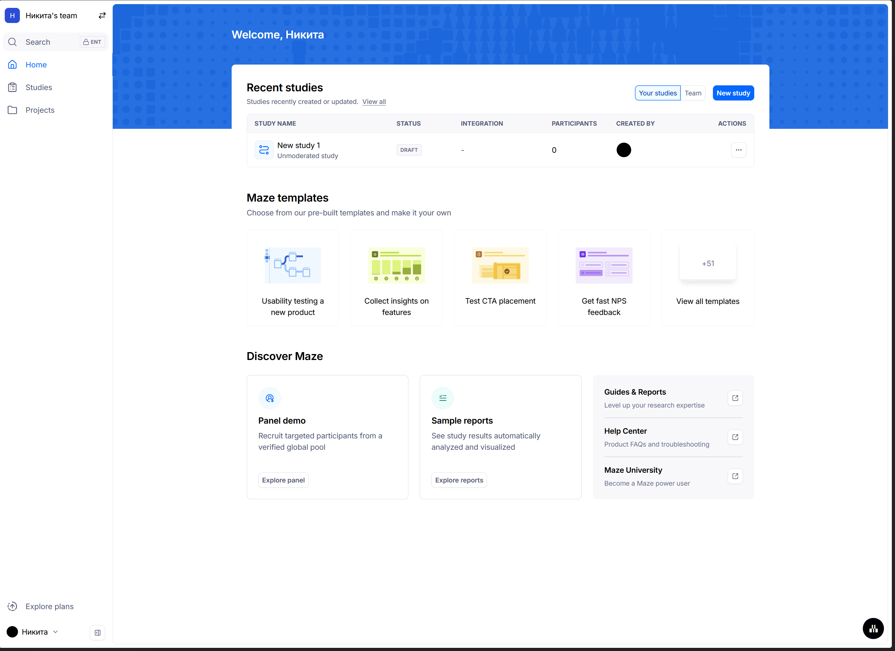

# ТЗ: рефакторинг главной страницы СВОД Опросы

Дата: 11 ноября 2026 года. Решения согласованы с владельцем продукта.

Визуальный референс, предоставленный пользователем:

## 1. Цель и границы

Перестроить самостоятельный сервис опросов по композиции приложенного скриншота Maze: боковая навигация, приветственный баннер, недавние исследования, готовые анкеты и материалы СВОД.

Максимально точно передать расположение, пропорции, плотность и визуальную иерархию референса. Сохранить логотип, текущую оранжевую палитру, шрифты и семантические токены СВОД. Тексты — русские. Поддерживаются светлая и тёмная темы.

Включены главная, оболочка опросов, страницы исследований, проектов, шаблонов и материалов. Существующие конструктор, публикация и результаты сохраняются. Полная платформа сохраняет прежние страницы, навигацию и стартовый маршрут. Незакоммиченные изменения рабочей копии являются исходным состоянием и не откатываются.

## 2. Страницы и поведение

### Главная — `/surveys`

Порядок блоков: приветственный баннер → недавние исследования → готовые анкеты → материалы СВОД. Большое поле ИИ и сетка проектов убираются с главной.

Приветствие: «Здравствуйте, {имя}», без имени — «Здравствуйте!». Баннер содержит неброский геометрический узор в палитре СВОД. Основная поверхность перекрывает его нижнюю часть. Отдельной шапки на главной нет.

Недавние исследования:

- Заголовок, пояснение «Недавно созданные или обновлённые исследования», ссылка «Все исследования».
- Справа: «Мои / Команда» и «Новое исследование».
- По умолчанию «Мои»: созданные текущим пользователем. «Команда»: все доступные исследования активной команды, включая собственные.
- До пяти записей по убыванию `updated_at`, затем по `id` для стабильного порядка; архив исключён.
- «Все исследования» переносит выбранный режим в полный список.
- Столбцы: название с подписью «Опрос», статус, проект, фактическое число ответов, автор, действия.
- Проект и название исследования ведут на существующие страницы. Неизвестный автор обозначается явно.
- Действия: открыть, редактировать, переместить, архивировать с подтверждением. Доступность определяется текущими правами и состоянием. Дублирование и удаление исследований не добавляются.

«Новое исследование» открывает меню:

- «С помощью ИИ» → `/surveys/create`.
- «Вручную» → `/surveys/create?mode=manual`.
- «Из шаблона» → `/surveys/templates`.

### Исследования — `/surveys/studies`

- Полный список в том же табличном представлении.
- «Мои / Команда», поиск по названию, фильтры проекта и статуса.
- Начальное состояние: «Мои», все проекты, без архива, сортировка по обновлению.
- Архив доступен через явный фильтр.
- По 20 записей, обработка существующего API-массива на клиенте.
- Фильтры и страница сохраняются в query-параметрах; обновление и возврат назад их восстанавливают.
- Действия и создание совпадают с главной.

### Проекты — `/surveys/projects`

- Сетка проектов, поиск, загрузка, ошибка с повтором и пустое состояние.
- Создание и изменение проекта; удаление только пустого, включая отсутствие архивных исследований.
- Серверный отказ удаления показывается пользователю.
- Переход в `/surveys/projects/:projectId` сохраняется.
- Блок недавних исследований здесь не дублируется.

### Готовые анкеты — `/surveys/templates`

Стартовый набор: «Лояльность клиентов — NPS», «Удовлетворённость клиентов — CSAT», «Простота взаимодействия — CES», «Удобство продукта — SUS». На главной — четыре карточки и пятая «Все шаблоны». Каталог содержит те же четыре анкеты с назначением и числом вопросов, без вымышленных количеств.

Используются существующие серверные блоки `survey_templates.py`. Сохраняются формулировки, шкалы, обязательность, группировка, порядок и методологические метаданные. ИИ не вызывается.

Сценарий:

1. Выбор анкеты открывает предпросмотр назначения и всех вопросов.
2. Пользователь задаёт название и проект активной команды.
3. По умолчанию предлагается название анкеты и серверный проект по умолчанию.
4. «Создать черновик» сохраняет исследование со статусом `draft` и открывает существующий конструктор.

Просмотр и закрытие не создают данные. Повторное нажатие во время запроса блокируется. Ошибка не очищает введённые параметры. Каждый экземпляр получает новые идентификаторы страниц, полей и вариантов ответов. Наблюдатель просматривает анкеты без создания. Сохраняются серверная авторизация и действующие правила ручного создания и лимитов; квота ИИ не расходуется.

### Материалы — `/surveys/resources/:slug`

Две крупные карточки:

- «Создайте первый опрос» → `first-survey`.
- «Разберитесь в результатах» → `results`.

Три ссылки:

- «Публикация и ссылка для участников» → `publication`.
- «Работа в команде» → `team`.
- «Методики и показатели» → `methodologies`.

Пять коротких локальных инструкций описывают реальные возможности, без CMS, заглушек, обещаний рекрутинга, новых интеграций и методов.

## 3. Навигация, поиск и оформление

Сайдбар самостоятельного сервиса:

- Сверху существующий переключатель команды, затем поиск.
- «Главная», «Исследования», «Проекты» вместо дерева.
- Снизу тариф с учётом текущих прав, уведомления и профиль.
- Через существующие меню доступны участники, настройки, создание команды, обучение и выход.
- Во внутренних разделах компактная шапка с хлебными крошками и контекстными действиями, без дублирования команды и профиля.
- Сохраняются сворачивание и предупреждение о несохранённых изменениях при смене команды.

Поиск открывается в диалоге. Ищет подстроку без учёта регистра и краевых пробелов в названиях проектов и неархивных исследований активной команды. Результаты сгруппированы по типу, выбор открывает объект. Используются существующие API без нового индекса. Предусмотрены клавиатура, Escape, загрузка, ошибки с повтором, отсутствие совпадений. Смена команды очищает запрос; устаревшие ответы не отображаются.

Геометрия:

- Сайдбар 240 px, свёрнутый 72 px; контент до 1120 px, центрирован.
- Баннер около 260 px, поверхность начинается около середины баннера.
- Внутренний отступ 32 px, между разделами 40–48 px.
- Шаблоны: пять колонок на главной широкого экрана. Материалы: три колонки.
- Узор и иллюстрации — локальные SVG/CSS, без брендинга Maze и удалённых изображений.
- Цвета, шрифты и состояния — существующие токены. Геометрия ограничена оболочкой опросов.

Адаптация:

- От 1056 px постоянный сайдбар; ниже — выдвижной с кнопкой открытия.
- На планшете сетки в две колонки с переносом.
- Ниже 768 px таблица превращается в карточки со всеми данными и действиями, материалы — одна колонка.
- Шаблоны: одна колонка до 479 px, две от 480 px.
- Нет горизонтальной прокрутки страницы; длинные названия не вытесняют действия.
- Видимый фокус, подписи кнопок с иконками, клавиатурные диалоги и возврат фокуса.

## 4. Техническая реализация и интерфейсы

React, TypeScript, Ant Design и текущая архитектура сохраняются; новые UI-библиотеки не нужны. Общие компоненты обслуживают список исследований, анкеты, предпросмотр и поиск. HTTP только через `shared/api`. Статические маршруты учитывают `/surveys/:id/*`. Хлебные крошки, активная навигация и возвраты «К проектам» обновляются. Публичные и существующие адреса сохраняются. Новая оболочка включена только в сборке `surveys`.

Каталог сервера, без новых таблиц и миграций:

- `GET /survey-templates`: `id`, `name`, `description`, `methodology_id`, `questions_count`.
- `GET /survey-templates/{template_id}`: сведения, `pages`, `methodology_meta` для предпросмотра.
- `POST /surveys/from-template`: `template_id`, `organization_id`, необязательный `project_id`, `name`; ответ `SurveyDetail`.

Сервер получает идентификатор и строит анкету из доверенного каталога, не принимает вопросы клиента. Используются существующие создание, проверка прав, лимитов и принадлежности проекта. Неизвестный шаблон — 404. Статический маршрут не перехватывается маршрутом исследования. Контракты списка и поиска не меняются.

Состояния: skeleton, отдельные пустота и ошибка, повтор загрузки. Ошибка исследований не блокирует анкеты и материалы. При смене команды скрываются старые данные и игнорируются старые ответы запросов. Существующие состояния отсутствия и недоступности команды сохранены. Наблюдателю не предлагаются изменения, сервер проверяет права независимо от UI.

## 5. Этапы и приёмка

Этапы: маршруты и разделение страниц → оболочка → главная с реальными данными → каталог, предпросмотр и создание → материалы, адаптивность и темы → проверки.

Обязательные команды: `npm run build:surveys`, `npm run build`, `npm run test:research`, `npm run test:research:ui`, lint. Серверные тесты проверяют каталог, каждую анкету, структуру, метаданные, уникальность идентификаторов, отсутствие вызова ИИ, запрет создания без доступа и проект чужой команды.

Проверить вкладки, пять последних, исключение архива, фильтры и пагинацию, поиск, смену команды при незавершённом запросе, наблюдателя, способы создания, действия исследований, управление проектами, прямые адреса, перезагрузку и возврат назад. Не допустить регрессий конструктора, публикации, результатов и полной платформы.

Визуальная проверка: 1920, 1440, 1024, 768 и 390 px, обе темы. На десктопе композиция соответствует референсу с согласованной заменой бренда и содержания. На узких экранах все действия доступны без горизонтальной прокрутки.

Готовность: все четыре блока, три пункта навигации и дополнительные страницы работают на реальных данных; анкеты создаются после подтверждения; права и команды изолированы; темы, адаптивность и клавиатура работают; сборки и проверки задачи проходят. Посторонние существующие ошибки фиксируются отдельно. Несвязанные изменения сохраняются.

Ограничения первой версии: четыре анкеты, пять материалов; без новых методик, рекрутинга, интеграций, CMS и изменения тарифной модели.
