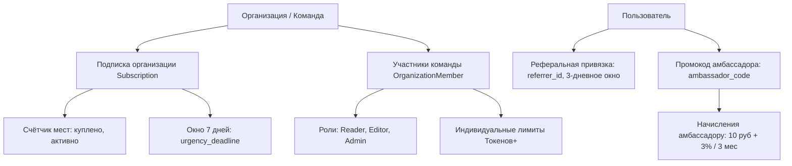

# Модель монетизации и финансовый план сервиса «СВОД»

**Концепция:** «Google/Яндекс Формы с ИИ-суперсилой аналитики».  
**Дата актуализации:** Ноябрь 2026 г.  
**Статус:** Согласованная рабочая модель (включает командные тарифы, токены+, реферальную программу и программу амбассадоров).

---

## 0. Зафиксированные решения (Ревизия ноябрь 2026)

1. **Базовый принцип сервиса:** Лимит на число опросов и ответов **не вводится ни на одном тарифе**. Сбор данных всегда бесплатен и неограничен. Если у пользователя или команды заканчиваются токены, сервис продолжает работать как полноценные Google/Яндекс Формы.
2. **Токены и Токены+:**
   - **Обычные (базовые) токены:** используются на бесплатном тарифе для базовых легковесных моделей (`glm-5.3-flash`) для типовых задач (стандартная генерация анкеты, базовое резюме).
   - **Токены+:** премиальный ресурс для работы с сильными моделями. Тратятся на **продвинутый анализ** (кластеризация ответов, кросс-сегментный анализ, поиск инсайтов) и **специализированные функции** (генерация интерактивных форм в Telegram-боте, глубокий аудит методологии).
   - **На платных тарифах Токены+ полностью заменяют собой обычные токены.** Пользователю платного тарифа не нужно следить за двумя балансами — все операции оплачиваются из единого баланса Токенов+.
3. **Командная модель (Teams / Workspaces):**
   - **Создание команды — бесплатное.**
   - **Бесплатная команда («Команда Старт»):** ограничена по функциям (доступны 5 базовых методик, базовая аналитика; закрыты экспорт CSV, кросс-таблицы, фильтр ботов и продвинутый ИИ-анализ).
   - **Повышение тарифа создателем команды (Owner):**
     1. *Месячная подписка:* полный доступ ко всем платным функциям + ежемесячный обновляемый пул Токенов+.
     2. *Разовый платёж за лимиты Токенов+ (пакет «Исследование»):* получение части платного функционала (экспорт данных, все методики) на срок действия пакета без оформления подписки.
   - **Распределение бонусов и прав:**
     - Бонусы от повышения тарифа даются **всей команде**, а не только создателю: каждый член команды по умолчанию получает доступ к платным возможностям.
     - Создатель команды имеет право **перераспределять бонусы** между участниками, ограничивая возможности конкретных пользователей.
     - В платную команду создатель может добавлять участников с назначением ролей:
       * **Читатель (Reader):** только просмотр опросов, сводок и результатов (не расходует квоты).
       * **Редактор (Editor):** создание/редактирование анкет, запуск сбора и аналитики.
       * **Администратор (Admin):** управление участниками, настройками пространства, опросами и лимитами.
     - Создатель может устанавливать **индивидуальные лимиты на Токены+** для каждого участника команды.
4. **Поведенческая экономика и управление местами (Seat Management):**
   - **Якорь на комплект:** по умолчанию при оформлении подписки выбран тариф с **3 местами** (Создатель + 2 участника). Чтобы заплатить меньше, создатель должен осознанно убрать лишние места (выбрав 2 или 1 место).
   - **Срочность (FOMO / Urgency):** владелец, уменьшивший количество мест, получает **неделю (7 дней)** на принятие окончательного решения. По истечении 7 дней стоимость добавления каждого места **подорожает на 40%**.
   - **Нет чувства потери (No Loss Aversion):** в течение этих 7 дней убранное место можно вернуть по первоначальной льготной цене комплекта. Это снимает психологический барьер «переплаты за лишнего человека» на этапе старта.
5. **Годовая подписка:**
   - Годовая оплата подписки дешевле помесячной: фиксированная **выгода 12%** от суммарной годовой стоимости (эквивалент оплаты за 10.56 месяцев вместо 12).
6. **Реферальная программа (P2P):**
   - Пользователь отправляет реферальную ссылку-приглашение другу.
   - При регистрации друга по ссылке: пригласившему начисляются **бонусные Токены+** и разовая **скидка 10%** на любую покупку в сервисе.
   - Альтернатива ссылке: в течение **3 дней** после регистрации друг может вручную ввести ID пригласившего пользователя в профиле в графу **«Меня пригласили»**.
   - При совершении другом первой покупки в сервисе: пригласивший получает **дополнительные Токены+**, объем которых пропорционален стоимости покупки друга.
7. **Программа амбассадоров (Affiliate):**
   - Согласованные разработчиками пользователи (амбассадоры) получают персональный промокод.
   - Новые пользователи при регистрации по промокоду получают **скидку 10% на первую покупку**.
   - Вознаграждение амбассадора:
     * **10 ₽** фиксированного денежного вознаграждения за каждого зарегистрированного пользователя.
     * **3%** денежного вознаграждения от суммы всех покупок привлеченных пользователей в течение **3 месяцев** (90 дней) с момента их регистрации.

---

## 1. Концепция и ключевое УТП

### 1.1. В чём проблема существующих решений?
1. **Google Формы и Яндекс Формы:**
   - *Плюсы:* Бесплатные, безлимитные по числу опросов и ответов.
   - *Минусы:* Нулевая аналитика. Исследователь получает сырую простыню текста и примитивные круговые диаграммы. Чтобы найти инсайты, приходится вручную перечитывать сотни открытых ответов или выгружать всё в Excel/Python.
2. **Традиционные конструкторы (Typeform, Анкетолог, Webask, Survio):**
   - *Плюсы:* Приятный UI, развитая логика ветвления.
   - *Минусы:* Агрессивная пейволл-модель. Блокируют сбор уже на 10–100 ответах или ограничивают число активных анкет (1–3 штуки), требуя от 1 500 до 5 000 ₽ в месяц. Для эпизодических и исследовательских задач это неприемлемо.

### 1.2. Позиционирование «СВОД»
* **Никаких искусственных ограничений на сбор данных:** число активных опросов и количество собираемых ответов **не ограничиваются ни на одном из тарифов**.
* Пользователь никогда не окажется в ситуации, когда его анкета перестала принимать ответы из-за превышения квоты посреди полевого этапа.
* **Что монетизируется:** **ИИ-аналитика, скорость получения инсайтов и совместная работа**. Платными являются действия ИИ (генерация структуры анкеты по цели, кластеризация текстовых ответов, кросс-сегментный анализ, Telegram-формы и диалог с результатами), а также инструменты профессиональной обработки данных (кросс-таблицы, фильтр ботов, полный экспорт).
* **Принцип исчерпания квоты:** если у пользователя или команды закончились токены, сервис **не блокируется**, а продолжает полноценно работать в режиме классических Google/Яндекс Форм.

---

## 2. Архитектура ресурсов: Токены, Токены+ и роли команды

### 2.1. Обычные токены vs Токены+

```
┌────────────────────────────────────────────────────────────────────────┐
│                        РЕСУРСНАЯ СЕТКА СВОД                            │
├──────────────────────────────────┬─────────────────────────────────────┤
│      ОБЫЧНЫЕ ТОКЕНЫ              │             ТОКЕНЫ+                 │
│      (Тариф «Старт»)             │       (Платные тарифы)              │
├──────────────────────────────────┼─────────────────────────────────────┤
│ • Базовая модель glm-5.3-flash   │ • Сильные модели (GLM-4 Plus /      │
│ • Быстрое создание анкеты        │   Claude 3.5 Sonnet / GPT-4o-class) │
│ • Стандартное ИИ-резюме ответов  │ • Продвинутый кросс-анализ          │
│ • Базовый контекст               │ • Кластеризация открытых ответов    │
│ • Выдаются 1 раз при регистрации │ • Генерация форм в Telegram-боте    │
│                                  │ • Полная замена обычных токенов     │
└──────────────────────────────────┴─────────────────────────────────────┘
```

* **Токены+ на платных тарифах заменяют собой обычные токены.** Пользователю не требуется выбирать, каким ресурсом платить: на тарифах с Токенами+ все ИИ-действия выполняются через сильные пайплайны.
* **Разовый пакет Токенов+:** позволяет исследователям и студентам под разовую задачу получить лимит Токенов+ и открыть часть платного функционала (экспорт CSV, все 16 методик) без оформления подписки.

### 2.2. Командные роли и разграничение доступа

Создатель команды (Owner) обладает полным контролем над биллингом и участниками. Внутри команды действуют 3 роли:

| Роль | Права в команде | Расход Токенов+ | Назначение |
| :--- | :--- | :--- | :--- |
| **Читатель (Reader)** | Просмотр опросов, отчётов, графиков и сводной аналитики. Запрещены редактирование и удаление. | 0 (не расходует лимиты) | Клиенты, стейкхолдеры, наблюдатели, студенты-соавторы. |
| **Редактор (Editor)** | Создание и редактирование форм, настройка логики, запуск сбора, запуск ИИ-анализа и генераций. | В пределах выделенного индивидуального лимита | Исследователи, маркетологи, аналитики, авторы анкет. |
| **Администратор (Admin)** | Все права редактора + приглашение/удаление участников, назначение ролей, распределение квот Токенов+. | В пределах выделенного индивидуального лимита | Тимлиды, руководители исследовательских групп. |

> **Индивидуальные лимиты:** Создатель команды может в явном виде задать квоту Токенов+ для каждого участника (например: Редактор А — 1 000 000 токенов+, Редактор Б — 500 000 токенов+), либо оставить общий командный баланс. Также создатель может отключить доступ к отдельным бонусам (например, запретить экспорт CSV конкретному участнику).

---

## 3. Поведенческая экономика мест: комплект, срочность, снятие потерь

### 3.1. Механика «Якорь на комплект» (3 места по умолчанию)
При переходе к оплате подписки в интерфейсе по умолчанию активирован **тариф с 3 местами** (Создатель + 2 участника).
* Исследования показывают, что подавляющее большинство пользователей сохраняют конфигурацию по умолчанию, если она выглядит сбалансированной.
* Чтобы заплатить меньше, создатель должен выполнить **осознанное действие** — нажать кнопку «Убрать место» (уменьшить до 2 или 1 места).

### 3.2. Механика «Срочность» (Окно 7 дней и подорожание на 40%)
Если создатель при оплате осознанно убрал места (оплатил тариф на 1 или 2 человек):
* Включается таймер на **7 календарных дней** (1 неделю).
* В течение этого срока в кабинете отображается статус льготного окна: *«Вы можете вернуть места по льготной цене комплекта ещё X дней»*.
* По истечении 7 дней стоимость добавления дополнительного места **увеличивается на 40%**.

### 3.3. Механика «Нет чувства потери» (No Loss Aversion)
* Клиенты часто боятся переплатить на старте за «мертвые души», если коллеги ещё не готовы подключиться.
* Возможность вернуть убранные места в течение 7 дней по первоначальной льготной цене комплекта устраняет страх переплаты: создатель смело берет тариф на 1–2 человек, зная, что цена защищена на неделю.

---

## 4. Тарифная сетка и цены

### 4.1. Сводная таблица тарифов

| Параметр | Бесплатный («Старт») | Разовый доступ («Исследование») | Командная подписка («Исследователь») |
| :--- | :--- | :--- | :--- |
| **Тип тарифа** | Индивидуальный / Команда Старт | Разовый пакет Токенов+ | Месячная / Годовая подписка |
| **Стоимость** | **0 ₽** | **250 ₽ разово** (без автопродления) | **От 600 ₽/мес** (базово 1 200 ₽/мес за 3 места) |
| **Места в команде** | Создание бесплатно, без платных мест | Доступно применение к команде | **3 места по умолчанию** (гибко: 1, 2 или 3+) |
| **Опросы и ответы** | **Без ограничений** | **Без ограничений** | **Без ограничений** |
| **Квота токенов** | **150 000 обычных токенов** (разово при регистрации) | **2 000 000 Токенов+** (срок 60 дней) | **6 000 000 Токенов+ в месяц** на команду (+расширение) |
| **Модели ИИ** | Базовая (`glm-5.3-flash`) | Сильные модели через Токены+ | Сильные модели через Токены+ |
| **Продвинутый анализ и TG-формы** | Недоступно | Доступно в рамках Токенов+ | **Включено в полном объёме** |
| **Методики опросов** | 5 базовых методик | Все 16 методик каталога | **Все 16 методик каталога** |
| **Аналитика и экспорт** | Базовые графики и таблицы | Полный экспорт Excel / CSV | **Экспорт Excel/CSV, кросс-таблицы, фильтр ботов** |
| **Роли и квоты** | Базовое участие | Назначение квот Токенов+ | **Читатель, Редактор, Администратор + лимиты** |
| **При исчерпании токенов** | Работает как Google Формы | Работает как Google Формы | Работает как Google Формы |

### 4.2. Конфигуратор мест подписки «Исследователь»

Базовая стоимость подписки на 1 пользователя (создателя) составляет **600 ₽/мес**. Льготная цена дополнительного места в комплекте составляет **300 ₽/мес**. При добавлении места после окончания 7-дневного окна цена места составляет $300 \times 1.4 = \mathbf{420 \text{ ₽/мес}}$ (+40%).

| Конфигурация | Количество мест | Цена в месяц | Годовая подписка (-12%) | Цена 1 места в месяц |
| :--- | :---: | :---: | :---: | :---: |
| **Комплект (по умолчанию)** | **3 места** | **1 200 ₽** | **12 672 ₽ / год** (1 056 ₽/мес) | 400 ₽ |
| **Убрано 1 место** | **2 места** | **900 ₽** | **9 504 ₽ / год** (792 ₽/мес) | 450 ₽ |
| **Только создатель** | **1 место** | **600 ₽** | **6 336 ₽ / год** (528 ₽/мес) | 600 ₽ |
| **Доп. место в течение 7 дней** | +1 место | **+300 ₽/мес** | **+3 168 ₽ / год** | 300 ₽ |
| **Доп. место через 7 дней (+40%)**| +1 место | **+420 ₽/мес** | **+4 435 ₽ / год** | 420 ₽ |

*(В международном эквиваленте для валютных платежей: комплект 3 места = 20 $/мес, 2 места = 15 $/мес, 1 место = 10 $/мес; льготное место = 5 $/мес, место через 7 дней = 7 $/мес).*

### 4.3. Годовая подписка (Выгода 12%)
* При единовременной оплате за 1 год предоставляется **фиксированная выгода 12%**.
* Расчёт: $\text{Цена за год} = \text{Цена за месяц} \times 12 \times (1 - 0.12) = \text{Цена за месяц} \times 10.56$.
* Пользователь оплачивает эквивалент ~10.5 месяцев вместо 12, экономя 12% бюджета.

### 4.4. Дополнительные пакеты Токенов+ (Add-on)
* **Пакет «+1 000 000 Токенов+» за 150 ₽** — доступен для пользователей с активной подпиской или разовым тарифом при исчерпании лимита до даты следующего обновления.

---

## 5. Программы привлечения: Реферальная и Амбассадорская

Сервис использует двухуровневую систему вирального роста: пользовательскую реферальную программу (P2P) и партнерскую программу амбассадоров (Affiliate/Influencer).

```
┌────────────────────────────────────────────────────────────────────────┐
│                      ПРОГРАММЫ ПРИВЛЕЧЕНИЯ СВОД                        │
├──────────────────────────────────┬─────────────────────────────────────┤
│    РЕФЕРАЛЬНАЯ ПРОГРАММА (P2P)   │   ПРОГРАММА АМБАССАДОРОВ (AFFILIATE)│
├──────────────────────────────────┼─────────────────────────────────────┤
│ • Для всех пользователей         │ • Только согласованные авторы       │
│ • Ссылка-инвайт или ввод ID      │ • Персональный промокод             │
│ • Срок ввода ID: 3 дня           │ • Скидка 10% новому пользователю    │
│ • Скидка 10% на любую покупку    │ • 10 ₽ за регистрацию пользователя  │
│ • Бонусные Токены+ за друга      │ • 3% от всех оплат в течение 3 мес. │
│ • Токены+ от первой покупки      │ • Денежный вывод на карту / самозан.│
└──────────────────────────────────┴─────────────────────────────────────┘
```

### 5.1. Реферальная программа (User Referral)

Механика направлена на органический обмен ссылками между студентами, коллегами и исследователями.

1. **Способы привязки:**
   * **Реферальная ссылка:** пользователь копирует инвайт-ссылку в личном кабинете. Друг переходит по ссылке и регистрируется.
   * **Ввод ID вручную (окно 3 дня):** если друг зарегистрировался напрямую без ссылки, в течение **3 дней** после регистрации он может открыть настройки профиля и указать ID пригласившего в поле **«Меня пригласили»**.
2. **Вознаграждение за регистрацию:**
   * Пригласившему пользователю начисляются **бонусные Токены+** (+100 000 Токенов+) и одноразовая **скидка 10%** на любую следующую покупку (подписку или разовый пакет).
   * Приглашённый друг получает стандартный стартовый набор и приветственный статус.
3. **Вознаграждение за первую покупку друга:**
   * Когда приглашённый друг совершает свою **первую оплату** в сервисе (разовый пакет или подписку), пригласившему пользователю начисляются **дополнительные Токены+ пропорционально сумме покупки**:
     - При покупке разового пакета (250 ₽): **+500 000 Токенов+**.
     - При покупке 1 месяца подписки (от 600 до 1 200 ₽): **+1 500 000 – 3 000 000 Токенов+**.
     - При годовой оплате: **+5 000 000 Токенов+**.
4. **Экономика реферальной программы:** прямые денежные выплаты отсутствуют. Токены+ имеют для сервиса пренебрежимо малую себестоимость (~27–60 ₽ за 1M), но обладают высокой воспринимаемой ценностью для активного пользователя.

### 5.2. Программа амбассадоров (Ambassador / Affiliate)

Программа предназначена для инфлюенсеров, авторов Telegram-каналов по социологии, маркетингу и продуктовому менеджменту, преподавателей вузов и лидеров профессиональных сообществ.

1. **Подключение:** статус амбассадора выдаётся **только после согласования разработчиками/командой сервиса** через заявку.
2. **Инструмент:** амбассадор получает именной промокод (например, `SOCIO_CLUB`, `PRODUCT_MIND`).
3. **Выгода для нового пользователя:**
   * Ввод промокода при регистрации даёт **скидку 10% на первую покупку** любого тарифа или пакета.
4. **Выгода для амбассадора (Денежное вознаграждение):**
   * **10 ₽ за каждого зарегистрированного пользователя**, подтвердившего email.
   * **3% от всех покупок** привлечённых пользователей, совершённых ими **в течение 3 месяцев (90 дней)** с даты создания аккаунта.
5. **Антифрод и правила выплат:**
   * Выплата 10 ₽ за регистрацию активируется только после подтверждения электронной почты рефералом.
   * Минимальный порог вывода вознаграждения: **1 000 ₽**.
   * Выплаты производятся официально самозанятым, ИП или на банковские карты с удержанием соответствующих налогов/комиссий шлюза.

---

## 6. Юнит-экономика и себестоимость

### 6.1. Постоянные ежемесячные расходы (Fixed OpEx)

| Статья | Сумма в месяц | Назначение |
| :--- | :--- | :--- |
| **Основной сервер (VPS)** | 1 700 ₽ | API (FastAPI), Worker, PostgreSQL, Nginx, SPA фронтенд |
| **Прокси-сервер** | 600 ₽ | Защищённый стабильный шлюз к зарубежным API LLM (OpenRouter) |
| **Почтовый шлюз (SMTP)** | 200 ₽ | Транзакционные письма (верификация, сброс паролей, инвайты) |
| **Домен и безопасность** | ~50 ₽ | Домен `svodservice.ru`, сертификаты |
| **ИТОГО постоянные OpEx** | **~2 550 ₽ / мес** | **~30 600 ₽ в год** |

### 6.2. Переменные расходы (COGS)

1. **Эквайринг (ЮKassa):**
   - Банковские карты: **3.5%**.
   - СБП: **0.4% – 0.7%**.
   - *В расчётах закладывается консервативная ставка: **3.5%**.*
2. **Себестоимость ИИ-токенов:**
   - **Базовые токены (`glm-5.3-flash`):**
     * Вход: $0.17 / 1M токенов, Выход: $0.60 / 1M токенов.
     * При пропорции 75% вход / 25% выход и курсе 90 ₽/$ себестоимость 1M токенов составляет **~27.5 ₽**.
   - **Токены+ (Сильные модели уровня GLM-4 Plus / Claude 3.5 Sonnet / reasoning-пайплайны):**
     * Вход: $1.00 – $2.50 / 1M токенов, Выход: $3.00 – $10.00 / 1M токенов.
     * Средневзвешенная себестоимость 1M Токенов+ с учётом кэширования и прокси: **~120 – 180 ₽**.
   - Реальный процент выработки квоты пользователями (Utilisation Rate): в SaaS-сервисах клиенты в среднем вырабатывают **40–50%** от предельного включённого лимита.

### 6.3. Расчёт маржинальности тарифных планов

#### 1. Разовый пакет «Исследование» (250 ₽)
* Выручка: 250 ₽
* Эквайринг (3.5%): -8.75 ₽
* Налог (УСН 6% или самозанятость): -15.00 ₽
* Расход ИИ при выработке 50% квоты (1M Токенов+): ~35–60 ₽
* **Чистый маржинальный доход: ~166 – 191 ₽ (Маржинальность ~66–76%)**

#### 2. Командная подписка на 1 место (600 ₽/мес)
* Выручка: 600 ₽
* Эквайринг (3.5%): -21.00 ₽
* Налог (6%): -36.00 ₽
* Расход ИИ при среднем потреблении (3M Токенов+): ~120 ₽
* **Чистый маржинальный доход: ~423 ₽ (Маржинальность 70.5%)**

#### 3. Командная подписка на 3 места по умолчанию (1 200 ₽/мес)
* Выручка: 1 200 ₽
* Эквайринг (3.5%): -42.00 ₽
* Налог (6%): -72.00 ₽
* Выплаты амбассадору (3% при покупке по промокоду): -36.00 ₽
* Расход ИИ на команду при среднем потреблении: ~220 ₽
* **Чистый маржинальный доход: ~830 ₽ (Маржинальность 69.2%)**

#### 4. Годовая подписка на 3 места (12 672 ₽/год)
* Выручка: 12 672 ₽ (1 056 ₽/мес)
* Эквайринг (3.5%): -443.50 ₽
* Налог (6%): -760.30 ₽
* Расход ИИ в год: ~2 400 ₽
* **Чистый маржинальный доход в год: ~9 068 ₽ (~755 ₽ в месяц)**
* *LTV клиента при годовой подписке гарантирован на 12 месяцев без риска ежемесячного оттока (Churn).*

---

## 7. Точка безубыточности (Break-Even)

Постоянные расходы проекта составляют **2 550 ₽ в месяц**.

1. **Только на разовых пакетах (маржа ~170 ₽):**
   $$\frac{2\,550}{170} \approx \mathbf{15 \text{ разовых оплат в месяц}}$$
2. **Только на командных подписках по 3 места (маржа ~830 ₽):**
   $$\frac{2\,550}{830} \approx \mathbf{3.1 \implies 4 \text{ активные команды}}$$
3. **Только на одиночных подписках (маржа ~423 ₽):**
   $$\frac{2\,550}{423} \approx \mathbf{6 \text{ подписчиков}}$$

> **Вывод:** Проект выходит в операционную безубыточность всего при **4 активных командных подписках** или комбинации из 2 команд и 6 разовых пакетов в месяц.

---

## 8. Финансовые сценарии на 12 месяцев

### Сценарий 1: Консервативный (Органический старт)
* 10 командных подписок (средний чек 1 100 ₽ = 11 000 ₽/мес)
* 20 разовых пакетов (20 × 250 ₽ = 5 000 ₽/мес)
* 2 годовые подписки в месяц (2 × 12 672 / 12 = 2 112 ₽/мес)
* **Месячная выручка:** ~18 112 ₽ (~217 000 ₽/год)
* Расходы (инфраструктура 2 550 ₽, эквайринг 634 ₽, налог 1 087 ₽, ИИ ~2 800 ₽): -7 071 ₽
* **Чистая прибыль в месяц:** **~11 041 ₽ (~132 500 ₽/год)**

---

### Сценарий 2: Базовый (Включение рефералки и 5 амбассадоров)
* 45 командных подписок (45 × 1 150 ₽ = 51 750 ₽/мес)
* 60 разовых пакетов (15 000 ₽/мес)
* 6 годовых подписок (6 × 1 056 ₽/мес в расчёте выручки = 6 336 ₽/мес)
* **Месячная выручка:** ~73 086 ₽ (~877 000 ₽/год)
* Эквайринг (3.5%): -2 558 ₽
* Налог (6%): -4 385 ₽
* Выплаты амбассадорам (10 ₽ за регу + 3% с покупок): ~3 200 ₽
* Затраты на ИИ: ~9 500 ₽
* Инфраструктура: -2 550 ₽
* **Чистая прибыль в месяц:** **~50 893 ₽ (~610 000 ₽/год)**

---

### Сценарий 3: Масштабирование (Университеты + B2B-команды)
* 150 командных подписок (150 × 1 200 ₽ = 180 000 ₽/мес)
* 150 разовых пакетов (37 500 ₽/мес)
* 20 годовых контрактов (20 × 1 056 ₽/мес = 21 120 ₽/мес)
* **Месячная выручка:** ~238 620 ₽ (~2 863 000 ₽/год)
* Эквайринг (3.5%): -8 350 ₽
* Налог (6%): -14 317 ₽
* Выплаты амбассадорам: ~10 500 ₽
* Расходы на ИИ: ~28 000 ₽
* Инфраструктура (с масштабированием серверов и репликацией): -6 000 ₽
* **Чистая прибыль в месяц:** **~171 453 ₽ (~2 057 000 ₽/год)**

---

## 9. Техническая реализация в кодовой базе

Для поддержки актуализированной модели монетизации в архитектуре проекта реализуются следующие компоненты:



### 9.1. База данных и модели
1. **В таблице `organizations` / `subscriptions`:**
   - Перенос подписки с уровня пользователя на уровень команды/организации (`organization_id`).
   - Поля `seats_count: int` (количество оплаченных мест) и `urgency_deadline: datetime` (дедлайн 7-дневного льготного окна).
   - Поле `plan_code`: `start`, `pack`, `researcher`.
   - Поле `interval`: `month`, `year`, `one_off`.
2. **В таблице `organization_members`:**
   - Поле `role_tag`: `'reader' | 'editor' | 'admin'`.
   - Поле `token_plus_limit: int | None` — персональный лимит Токенов+ на участника (null = общий командный баланс).
   - Поле `token_plus_used: int` — персональный расход.
   - Поле `custom_permissions: jsonb` — переопределение прав (экспорт, фильтры).
3. **Реферальная и партнерская система:**
   - В `users`: `referrer_user_id: UUID | None`, `referral_registered_at: datetime`, `referral_claimed_at: datetime | None`, `ambassador_code_used: str | None`.
   - Таблица `ambassador_profiles`: `id`, `user_id`, `promo_code`, `status` (active/pending), `balance_kopecks`, `created_at`.
   - Таблица `ambassador_payouts` / `ambassador_accruals`: учет начислений (10 ₽ за регистрацию с подтвержденным email, 3% с покупок в течение 90 дней).

### 9.2. Сервисный слой
1. **`ai_meter.py`:**
   - Проверка баланса: для платных тарифов списываются `tokens_plus`.
   - Проверка лимитов: сначала проверяется индивидуальный лимит участника команды `member.token_plus_limit`, затем общий баланс команды.
2. **`billing_service.py` и `payment_service.py`:**
   - Расчёт корзины:
     * Если выбрана годовая подписка — применяется скидка 12%.
     * Если добавляются места после `urgency_deadline` — применяется надбавка +40%.
     * Если применён реферальный бонус или промокод амбассадора — скидка 10% на первую покупку.
   - Обработка вебхука успешной оплаты:
     * Начисление реферальных Токенов+ пригласившему.
     * Начисление 3% на баланс амбассадора (если прошло менее 90 дней с момента регистрации плательщика).

### 9.3. Пользовательский интерфейс (UI/UX)
1. **Страница тарифов (`/pricing` / `/plans`):**
   - Переключатель «Месяц / Год (выгода 12%)».
   - Интерактивный конфигуратор мест (по умолчанию 3 места, кнопки «− / +» с динамическим расчётом цены).
   - Плашка со срочностью: предупреждение о 7 днях льготного возврата места при уменьшении комплекта.
   - Поле ввода промокода амбассадора со скидкой 10%.
2. **Профиль и настройки команды:**
   - Вкладка «Участники и роли»: смена роли (Читатель, Редактор, Администратор).
   - Управление лимитами: ползунок или числовое поле для установки персональной квоты Токенов+ на участника.
   - Раздел «Реферальная программа»: ссылка-приглашение, статистика приглашённых, блок «Меня пригласили» (активен 3 дня после создания аккаунта).