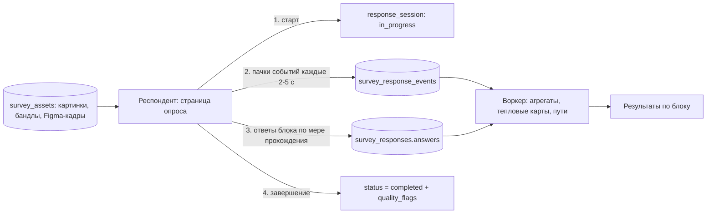
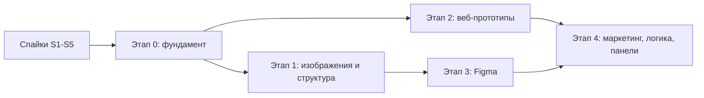

# План: из сервиса опросов — в платформу исследований

Дата: 2026-11-06. Статус: **черновик для решения владельца продукта**. Оценки трудозатрат грубые, уточнить после спайков (раздел 8).

Что в документе: где мы сейчас (по коду), чего не хватает относительно референсов Maze и российского конструктора со скриншотов, **узкие места с вариантами решения**, модель данных, порядок работ, спайки и открытые вопросы.

Связанные документы: [COMPETITORS_RESEARCH_EXPERIMENTS.md](./COMPETITORS_RESEARCH_EXPERIMENTS.md) (рынок), [METHODOLOGY_FORMS_PLAN.md](./METHODOLOGY_FORMS_PLAN.md) (социологические методики: NPS, SUS, conjoint; там тоже планируются новые типы полей `semanticDifferential`, `choiceTask`, `task` — реестр блоков из раздела 3 должен покрывать и их), [MONETIZATION_MODEL.md](./MONETIZATION_MODEL.md) (тарифы), [AGENT_MODE_DECISIONS.md](./AGENT_MODE_DECISIONS.md) (агентный режим).

---

## Решения владельца (2026-11-06)

1. **Респонденты российские.** Figma у них может быть недоступна без VPN (B5), поэтому Figma-встраивание не может быть основой продукта. Тесты не должны требовать от респондента ничего, что не открывается из РФ без VPN.
2. **Главный сценарий — прототип из нейросети** (Claude, Lovable, v0, Bolt). Хостинг веб-прототипов (B3, раздел 6.1) становится первым большим блоком после фундамента. Figma — второй вход, по итогам спайка S1.

Что это меняет в плане:

- Порядок: **спайки → фундамент → этап 2 (веб-прототипы) → этап 1 (изображения и структура) → Figma → этап 4.** Этап 1 уходит после веб-прототипов, но его общие части (файлы, события, тепловая карта) строятся в фундаменте и на веб-прототипах.
- Спайки S2 (песочница с реальными бандлами из нейросетей) и S3 (трекер) идут первыми; S1 (Figma из РФ) остаётся, но решает только форму Figma-блока, а не судьбу продукта.
- Для Figma по умолчанию берём вариант D (статичные кадры), встраивание A — только если S1 покажет стабильную работу из РФ без VPN.
- Остаются зависимости от отдельных решений: ответственный за жалобы на хостинг (вопрос 6) и юридическая проверка хостинга (B12) нужны **до** запуска этапа 2, а не после.

---

## 0. Резюме

1. **Идея «опросы как база, сверху методики» верна, но база сейчас не готова.** Весь бэкенд опросов устроен вокруг одного типа данных: ответ = плоский JSON `{id_поля: значение}` до 200 КБ, сохраняется один раз, на «Отправить». Для тестов прототипов нужны события (клики, переходы, время), частичные ответы и файлы. Без фундамента (раздел 3) каждый новый блок придётся вшивать минимум в 10 мест.
2. **Три самых тяжёлых риска — не в коде методик, а вокруг них:**
   - **Безопасность хостинга чужих прототипов.** JWT лежит в `localStorage`, домен один. Чужой HTML на нашем домене = кража сессий. Решается только отдельным доменом (B3).
   - **Figma из России.** С 29 мая 2026 пользователи массово сообщали о недоступности figma.com без VPN. Официального подтверждения блокировки не нашли, но для русскоязычных респондентов это главный риск всего Figma-блока (B5).
   - **Внешние сайты нельзя трекать из iframe.** Кросс-доменный iframe не отдаёт клики, а многие сайты вообще запрещают встраивание (B4).
3. **Рекомендованный порядок:** фундамент → методики на изображениях и структуре (первый клик, 5 секунд, карточки, дерево, матрица, ранжирование) → хостинг веб-прототипов → Figma. Методики первого шага дёшевы, не зависят от внешних сервисов и строят всё, что нужно прототипам (файлы, события, тепловая карта).
4. **Сильное позиционирование:** «Figma-first тесты в РФ» (вывод из анализа конкурентов) упирается в доступность Figma. А вот **«загрузи прототип, собранный в Claude / Lovable / v0, и протестируй его»** у зарубежных конкурентов из референсов не видно, и от Figma оно не зависит. Это стоит сделать лицом продукта, Figma — вторым входом.
5. **Не берём в первую очередь:** запись экрана и голоса, модерируемые интервью, нативные приложения, собственную панель респондентов (раздел 9).

---

## 1. Отправная точка: что есть в коде

| Область | Факт | Где |
|---|---|---|
| Структура опроса | `Survey.pages` — JSONB: страницы → поля (`type` + `config`); есть `methodology_meta` | `backend/app/models/survey.py` |
| Ответ | `SurveyResponse.answers` — JSONB `{field_id: value}`; в ответ копируется `schema_snapshot` (правка опроса не ломает старые ответы) | там же |
| Приём ответа | один запрос в конце прохождения; `validate_answers`, потолок `MAX_ANSWERS_BYTES = 200_000` | `survey_answers.py`, `survey_service.submit_public_response` |
| Типы полей | shortText, longText, radio, checkbox, dropdown, yesNo, number, fullName, phone, email, date/time/dateTime, address, location, file_*, rating (звёзды, шкала, слайдер, NPS), textBlock, group | `src/shared/formily/supportedTypes.ts` |
| Методики | каталог из 16: NPS, CSAT, CES, SUS, UEQ, Лайкерт, семантический дифференциал, JTBD, проверка внимания и др. | `backend/app/knowledge/methodologies.py` |
| Аналитика | агрегаты по видам `scale / choice / text`, кросс-таблицы, качество ответов (`quality_flags`), линтер анкеты, CSV, ИИ-резюме и ИИ-чат | `survey_results.py`, `survey_quality.py`, `survey_linter.py`, `survey_ai_analysis_service.py` |
| Тарифы | квота ответов: сверх лимита ответ принимается, но `locked` | `billing_guard.register_response` |
| Файлы | S3 через boto3, но ключи построены под заявки (`requests/{id}/...`); для опросов S3 «не нужен», стоят заглушки | `storage_service.py`, `DEPLOYMENT_SURVEYS.md` |
| Прохождение | `PublicSurveyPage` — пошаговый мастер страниц с полями | `src/pages/PublicSurveyPage.tsx` |
| Инфраструктура | один VPS (≈2 500 ₽/мес), nginx с `client_max_body_size 25m`, воркер на очереди в PostgreSQL | `deploy/nginx/`, `docs/PRICING_TARIFFS.md` |
| Чего нет | ветвления и пропусков, рандомизации, скрининга и квот, матрицы, частичных ответов, потока событий, numpy/scipy на бэкенде | проверено поиском по коду и `requirements.txt` |

Хорошо для нас: `schema_snapshot` уже решает половину проблемы версий; `@dnd-kit` уже в зависимостях (карточки и ранжирование строятся на нём); методики уже вынесены в отдельный слой знаний.

---

## 2. Что у конкурентов и где разрыв

Референсы: российский конструктор (скриншот 1) и Maze (скриншот 2). Сложность: **S** — до недели, **M** — 1–3 недели, **L** — больше месяца, **XL** — с серьёзным риском. Для одного-двух разработчиков, ориентир.

| Блок | У конкурентов | У нас | Сложность | Что нужно сверх базы |
|---|---|---|---|---|
| Открытый вопрос, выбор, шкала, ввод | да | **есть** | — | — |
| Матрица | да | нет | M | новый тип поля, агрегат по строкам |
| Контекст / Соглашение / Страница | да | частично (`textBlock`, `group`) | S | чекбокс-согласие с фиксацией |
| Предпочтение (2–5 картинок) | да | нет | S | файлы, рандом порядка |
| Ранжирование | да | нет | M | dnd-kit, агрегат «средний ранг» |
| Пять секунд | да | нет | M | файлы, таймер, предзагрузка |
| Первый клик | да | нет | M | файлы, координаты, тепловая карта |
| Сортировка карточек | да | нет | M–L | dnd-kit, матрица сходства, дендрограмма |
| Тестирование дерева | да | нет | M–L | дерево, путь, метрики успеха |
| NPS / CSAT / CES / SUS / UEQ | да | **есть** (как методики) | — | — |
| Модель Кано, MaxDiff | да (с замком в тарифе) | нет | M каждая | генерация наборов MaxDiff, подсчёт |
| Скрининг, сплит-блок, рандомизация | да | нет | M–L | логика маршрута (B9) |
| **Figma-прототип** | да (эталон — Maze) | нет | **XL** | B5 |
| **Веб-прототип / сайт** | да (замок: «Веб-прототип») | нет | **XL** | B3, B4 |
| ИИ-диалог (follow-up вопросы) | Maze: «AI Conversation» (beta) | есть ИИ-чат по результатам, но не в прохождении | L | ИИ в публичном потоке: квоты, модерация |
| Запись экрана и голоса | UserTesting, UXtweak | нет | XL | вне плана (раздел 9) |

Замки на скриншоте 1 (Ранжирование, NPS, Кано, MaxDiff, Веб-прототип, Рандомизация, Страница) — подсказка по монетизации: тяжёлые и аналитические блоки идут в платный тариф. Нам нужен механизм «блок доступен на тарифе» (B11).

---

## 3. Архитектурная основа

Одна идея, которая определяет всё остальное: **блок — это модуль с собственным контрактом**, а не ветка `if type == ...` в десятке файлов.

### 3.1. Реестр блоков

Сегодня тип поля «знают» (проверено): `survey_answers` (валидация), `survey_results` (агрегаты), `survey_quality` и `survey_linter` (проверки), `survey_demo_service` (демо-ответы), `survey_methodology_service`, `survey_ai_builder_service` (описание типов в промпте), CSV-экспорт; на фронте — `supportedTypes.ts`, `schemaMapper.ts`, `FieldRenderer.tsx`, `FieldPreview.tsx`, `surveyFormat.ts`, `formatFieldValue.ts`, `formRules.ts`, `form-builder.types.ts`.

Предлагается контракт блока (по одному модулю на тип):

```
Backend  block.validate(config, answer)      -> нормализованное значение
         block.aggregate(config, answers[])  -> структура результата (для UI и ИИ)
         block.export_columns(config, ans)   -> колонки CSV
         block.quality_flags(config, ans, events)
         block.describe_for_ai()             -> текст для промпта конструктора
Frontend block.Editor / block.Runner / block.Results / block.formatValue
```

Старые типы переводим на реестр постепенно (адаптер «по умолчанию» для текущей логики), новые пишем сразу в нём.

### 3.2. Данные



Что добавляем:

| Сущность | Зачем | Ключевые поля |
|---|---|---|
| `survey_responses` + `status`, `session_id` | частичные ответы; сегодня ответ рождается только на «Отправить», бросил на середине — потерян, воронки прохождения нет | `status: in_progress/completed/abandoned`, `last_seen_at` |
| `survey_response_events` | поток событий тестов, **не** в JSONB ответа | `response_id, field_id, seq, t_ms, type, payload JSONB`; партиционирование по месяцам, срок хранения по тарифу; потолок событий на сессию и размер пачки |
| `survey_assets` | картинки, бандлы прототипов, кадры Figma | `survey_id, kind, storage_key, size, sha256, version, moderation_status` |

Формы ответа новых блоков (значения в `answers`, всё компактно, без событий):

| Блок | Значение в `answers` |
|---|---|
| Матрица | `{row_id: col_id}` или `{row_id: [col_id]}` |
| Ранжирование | `[option_id, ...]` по порядку |
| Предпочтение | `option_id` (+ необязательное «почему») |
| Первый клик | `{x, y, t_ms, asset_id}` — нормированные 0..1 |
| Карточная сортировка | `{groups: [{name, cards: [card_id]}], unsorted: []}` |
| Дерево | `{path: [node_id], final: node_id, skipped: bool}` |
| Тест прототипа | `{completed: bool, reason, t_ms, last_node}`; **детальный путь и клики — в `events`** |

---

## 4. Узкие места и варианты решения

Серьёзность: 🔴 блокирует запуск блока, 🟠 серьёзно усложняет, 🟡 управляемо.

### B1. 🔴 Модель данных ответа не рассчитана на события и частичные ответы

**Суть.** Ответ — один JSON, создаётся при отправке, потолок 200 КБ. Тест прототипа даёт сотни событий на сессию; клики и путь нужны даже у тех, кто бросил задачу.

| Вариант | Плюсы | Минусы |
|---|---|---|
| **A. Таблица событий + частичные ответы (рекомендуется)** | чистая модель, события можно агрегировать и удалять отдельно | миграции, новый endpoint приёма, переработка потока прохождения |
| B. Складывать события в `answers` JSONB, поднять потолок | ничего нового | раздувает основную таблицу, ломает выборки и экспорт, потолок всё равно упрётся |
| C. Внешнее хранилище событий (ClickHouse, S3-логи) | масштаб | оверкилл для одного VPS; усложняет эксплуатацию |

**Рекомендация:** A. Переход на C — только если событий станет больше десятков миллионов в месяц. Приём — через `navigator.sendBeacon`/`fetch keepalive` пачками, чтобы не терять хвост при закрытии вкладки.

### B2. 🟠 Логика размазана по типам полей

**Суть.** Сейчас новый тип = правки в ~15 файлах (раздел 3.1). С 10 новыми блоками это 150 правок и гарантированные расхождения (например, блок есть в конструкторе, но нет в CSV и ИИ-анализе).

| Вариант | Плюсы | Минусы |
|---|---|---|
| **A. Реестр блоков, миграция старых типов постепенно (рекомендуется)** | один контракт, новые блоки автоматически попадают в экспорт, линтер, ИИ | 1–2 недели до первого блока |
| B. Добавлять `elif` как раньше | быстрый первый блок | долг растёт с каждым блоком |

**Рекомендация:** A, в рамках фундамента. Побочный выигрыш: ИИ-конструктор и ИИ-анализ получают описание блоков из реестра, а не из хардкода в промптах — это совпадает с агентным режимом.

### B3. 🔴 Хостинг чужого кода на нашем домене (безопасность)

**Суть.** Загруженный пользователем HTML/JS исполняется у респондента. Если он отдаётся с `surveys.svodservice.ru`, он живёт в том же origin, что и фронтенд с `localStorage.access_token` (JWT), и может украсть токен автора, открывшего предпросмотр. Плюс репутация домена: один фишинговый «прототип» — и домен в чёрных списках браузеров, а с ним весь сервис.

| Вариант | Плюсы | Минусы |
|---|---|---|
| **A. Отдельный домен-песочница, поддомен на прототип (рекомендуется)**, напр. `<id>.svod-proto.ru` | полная изоляция origin (и от основного сайта, и друг от друга), репутация основного домена защищена | отдельный домен и wildcard-сертификат (нужна DNS-проверка Let's Encrypt), настройка nginx |
| B. Один sandbox-домен, путь на прототип | проще сертификат | прототипы делят origin и могут читать друг у друга `localStorage`/cookies |
| C. `<iframe sandbox>` без `allow-same-origin` на нашем домене | без нового домена | сломает многие прототипы (нет `localStorage`, `fetch` с куками), и всё равно слабее изоляции |
| D. Не хостить, только внешние ссылки | нет риска | убирает ключевое отличие (прототипы из нейросетей) |

**Рекомендация:** A, плюс iframe с `sandbox`, CSP на ответах песочницы, запрет на куки родительского домена, иммутабельные версии бандлов (S3 + CDN). Дальше обязательный минимум: ToS и кнопка «Пожаловаться» (в футере опроса уже есть почта для жалоб), ручное снятие, проверка типов и размеров при загрузке, срок жизни после закрытия исследования.

**Компромисс CSP.** Прототипы из нейросетей часто тянут Tailwind/React с CDN и шрифты. Жёсткий `default-src 'self'` их сломает. Вариант: белый список популярных CDN, всё остальное блокируется. Решить на спайке на 5–10 реальных прототипах.

### B4. 🔴 Внешние веб-прототипы и сайты: iframe не даёт трекинга

**Суть.** Для чужого URL мы не можем читать клики внутри кросс-доменного iframe, а многие сайты шлют `X-Frame-Options`/`frame-ancestors` и не встраиваются вовсе. Это ограничение браузера, обойти его «аккуратно» нельзя.

| Вариант | Что получаем | Минусы |
|---|---|---|
| **A. Проверка заголовков при сохранении + встраивание без трекинга (рекомендуется для старта)** | работает для разрешающих сайтов; автору сразу понятно, получится ли | клики не видны |
| **B. Самоотчёт (рекомендуется вместе с A)**: «выполнил / не смог» + время + вопросы после задачи | работает с любым URL | субъективно |
| C. Сниппет, который автор ставит на свой сайт: респондент уходит на сайт, сниппет шлёт события к нам, возврат по ссылке | реальные клики и путь; Maze использует схему со сниппетом и редиректом с своего домена (heatmap и Sankey у них только со сниппетом) | автору нужен доступ к коду; не для чужих сайтов и конкурентов |
| D. Обратный прокси с подменой страницы | теоретически любой сайт | хрупко, юридически и технически рискованно, ломается на авторизации и защите от ботов — **отвергаем** |
| E. Расширение браузера у респондента | трекинг без доступа к сайту | огромное трение, респондент не установит — **отвергаем** |

**Рекомендация:** A+B в первой версии («Сайт»), C позже как платная опция. Для прототипов автора лучший ответ — B3: загрузить к нам, тогда трекинг есть без сниппета.

### B5. 🔴 Figma: доступность, события, регистрация приложения

Проверено по документации Figma Embed API (ссылки внизу).

**Что даёт встраивание.** `embed.figma.com/proto/...` в iframe отдаёт события через `postMessage`:
- `PRESENTED_NODE_CHANGED` — какой экран/оверлей сейчас показан;
- `MOUSE_PRESS_OR_RELEASE` — клик с флагом `handled` (попал ли по интерактивной зоне, то есть **промах = `handled: false`**), `targetNodeId`, `presentedNodeId`;
- `INITIAL_LOAD`, `NEW_STATE`, `LOGIN_SCREEN_SHOWN` и др.;
- управление: `NAVIGATE_TO_FRAME_AND_CLOSE_OVERLAYS`, `RESTART`, вперёд/назад.

**Ограничения, которые видны сразу:**
1. **Координаты кликов относительные**: от левого верхнего угла целевого слоя (`targetNodeMousePosition`) или прокручиваемого фрейма, а не от экрана. Чтобы нарисовать тепловую карту на кадре, нужно знать размеры кадра и картинку, а их встраивание не отдаёт.
2. **Нужны `embed-host` и `client-id`.** `client-id` — это OAuth-приложение СВОД на figma.com/developers/apps (имя, сайт, логотип) с белым списком origin'ов, откуда разрешён обмен сообщениями. Без него событий нет. Документация не говорит, нужна ли проверка приложения Figma и есть ли ограничения на коммерческое использование — **неизвестно, проверить спайком**.
3. **Список кадров встраивание не отдаёт.** Нужна цель задачи (какой кадр = успех), а узнать кадры можно только через REST API Figma с токеном автора.
4. **Приватные файлы** показывают в iframe экран входа в Figma (`LOGIN_SCREEN_SHOWN`) — респондент не пройдёт тест. Файл обязан быть открыт по ссылке.
5. **Доступность из РФ.** По сообщениям изданий, с 29 мая 2026 Figma массово недоступна из России без VPN; официальной блокировки РКН мы не нашли, причину нельзя считать установленной. Для русскоязычных респондентов это может обнулить весь блок. Документация Figma ничего не говорит про мобильные браузеры и лимиты.
6. Несколько прототипов на одной странице: сообщения не различимы по источнику; у нас на странице один прототип и проверка `event.source === iframe.contentWindow`, так что риск обходим.

| Вариант | Плюсы | Минусы |
|---|---|---|
| **A. Встраивание Figma + запись «эталонного пути» автором (рекомендуется, если спайк по РФ успешен)** | работает с настоящим прототипом со всеми анимациями; автору не нужен токен: он сам проходит прототип в конструкторе, а мы записываем последовательность `presentedNodeId` как цель | зависит от Figma, регистрации, доступности из РФ |
| B. A + подключение Figma автора (OAuth) для кадров и миниатюр | красивая тепловая карта поверх кадра, понятные названия кадров | ещё одна интеграция, хранение токенов, срок жизни ссылок на изображения |
| C. Свой плеер кадров («Figma-lite»): автор подключает файл, мы забираем кадры и зоны переходов и сами показываем кликабельный прототип | независимость от доступности Figma у респондента; точные координаты и тепловая карта «бесплатно»; нет `client-id` | не воспроизводит анимации, условия, переменные, Smart Animate; нужна поддержка структуры Figma; **L–XL** |
| D. Только статичные кадры (экспорт PNG автором) → тесты «первый клик», «5 секунд», предпочтение | работает сразу, не зависит от Figma у респондента | не многошаговые сценарии |
| E. Penpot (открытый аналог) | по одному источнику открывается из РФ без VPN | своё API событий не проверено; отдельная интеграция |

**Рекомендация.** Не принимать решение сейчас: **сделать спайк (раздел 8, S1)**. Развилка: если Figma из РФ открывается стабильно — A (+B позже); если нет — D сразу (он и так в плане), а C считать отдельным решением владельца. Положение дел с доступом из РФ меняется, поэтому вариант D — страховка в любом случае.

### B6. 🟠 Что считать «успехом» и как мерить

**Суть.** Метрики юзабилити (успех, прямое прохождение, промахи, время) нужно определить для каждого типа цели, иначе цифры нельзя сравнивать между исследованиями.

| Цель | Как задаётся автором | Метрики |
|---|---|---|
| Figma | эталонный путь, записанный в конструкторе (последовательность кадров); целевой кадр | успех, прямой/непрямой успех, промахи (`handled: false`), время на задачу, путь |
| Хостинг-прототип | URL-шаблон страницы, клик по селектору, или вызов `svod.done()` из кода | то же + переходы между страницами |
| Внешний сайт | самоотчёт | успех по самоотчёту, время |
| Дерево | один или несколько верных узлов | успех, прямота (без возвратов), время |
| Первый клик | зоны на изображении (AOI) | попадание в зону, время до клика |

Определения должны быть **записаны в интерфейсе рядом с цифрой** («Прямой успех = дошёл до цели без возвратов»). Это дешёвая защита от недоверия к метрикам.

### B7. 🟠 Визуализация и расчёты результатов

**Суть.** Нужны тепловая карта на изображении, дерево путей, матрица сходства и дендрограмма карточек, диаграмма «пирог» для дерева. `@ant-design/charts` этого не умеет, на бэкенде нет numpy/scipy.

| Вариант | Плюсы | Минусы |
|---|---|---|
| **A. Расчёт агрегатов в воркере чистым Python, рендер canvas/SVG на фронте (рекомендуется)** | без новых тяжёлых зависимостей; для сотен респондентов быстро; агрегаты можно отдавать ИИ | свой код кластеризации (~100 строк) и тепловой карты |
| B. Всё считать в браузере | ничего на сервере | тяжело на больших выборках, нельзя отдать ИИ и в экспорт |
| C. Подключить numpy/scipy | готовая иерархическая кластеризация | увеличивает образ и время сборки; нужен только для карточной сортировки |

**Рекомендация:** A. Если понадобится серьёзная статистика (MaxDiff с байесовской оценкой), добавить numpy в воркер отдельным решением.

### B8. 🟠 Респондентский рантайм

**Суть.** `PublicSurveyPage` — мастер страниц с полями. Тест прототипа — полноэкранный блок со своим состоянием: таймер, плавающая панель с заданием поверх прототипа, события, возврат к анкете. Плюс мобильные: прототип под телефон на десктопе в рамке, на телефоне во весь экран.

**Решение.** Отдельная оболочка «запуск задачи» (task runner), в которую блок встраивается; общие части — таймер, панель задания, кнопки «Выполнил / Не могу», приём событий. Проверка устройства: если прототип мобильный, а респондент на десктопе — показать рамку устройства; если десктопный, а респондент на телефоне — предупредить.

Частичные ответы (B1) решают и воронку: видно, на каком блоке бросают.

### B9. 🟠 Нет логики маршрута

**Суть.** Скрининг, сплит-блок, рандомизация и A/B двух прототипов требуют условий и назначения вариантов. Ветвления в конструкторе сейчас нет.

**Решение по ступеням:**
1. Без ветвления: **рандомизация порядка блоков/вариантов** и **равномерное назначение варианта респонденту** (хранится в сессии). Закрывает «Рандомизацию», «Сплит-блок», сравнение прототипов.
2. Скрининг: простое «если ответ X — завершить как не подошедший» + счётчик отсеянных. Закрывает большинство задач.
3. Полноценное ветвление «если ответ → перейти к странице» — отдельный проект, не блокирует методики.

### B10. 🟠 Откуда брать респондентов

**Суть.** У Maze и UserTesting есть панели респондентов, их цена — основная выручка. У нас панели нет, а на русскоязычную аудиторию зарубежные панели не работают.

| Вариант | Плюсы | Минусы |
|---|---|---|
| **A. Ссылка, QR, e-mail (рекомендуется для старта)** | у нас уже есть; своя аудитория автора — основной сценарий продуктовых команд | нет «купить 100 респондентов» |
| B. Интеграция с российскими панелями (возврат с кодами «завершил / не подошёл / квота») | даёт «купить респондентов» без своей панели | договорённости, интеграция на каждую панель; нужны статусы «завершил/не подошёл» в приёме ответа |
| C. Собственная панель | максимальная ценность | задача холодного старта, оплата респондентов, антифрод — вне плана |

**Рекомендация:** A сейчас; B — этап 4 (закладывать в приём ответа параметр внешнего ID респондента и статусы завершения заранее, это дёшево).

### B11. 🟠 Тарифы, затраты и ёмкость одного сервера

**Суть.** Квота считается в ответах. Тест прототипа дороже ответа на опрос: события, хранение бандла, трафик статики. Один VPS не рассчитан на раздачу прототипов и приём потоков событий.

**Решение:**
- Статика и изображения — из S3 + CDN, не из api (S3 для опросов сейчас «не нужен», станет обязательным; ключи объектов привязать к опросам, загрузка по presigned URL напрямую из браузера — иначе упрёмся в `client_max_body_size 25m`).
- Приём событий — отдельный лёгкий endpoint с лимитами, пачки, потолок на сессию; нагрузочный тест до запуска (в `PRICING_TARIFFS.md` предел сервера уже отмечен как неизмеренный).
- Учёт: «вес» ответа блока (простой = 1, тест прототипа = N), лимит хранилища на тариф, срок хранения событий.
- Доступность блока по тарифу (замочки как на скриншоте 1): флаг на тип блока в реестре.

### B12. 🟡 Юридическое: чужой контент и поведенческие данные

- **Хостинг пользовательского контента:** условия использования, процедура жалоб и снятия, ответственность автора за прототип. Футер опроса уже говорит, что сервис не организатор; расширить на хостинг и описать срок хранения.
- **152-ФЗ:** клики и пути без идентификаторов — не ПДн, но запись экрана, голоса, веб-камеры — отдельный режим с отдельным согласием, поэтому вне плана. Для текущих блоков — явное согласие (блок «Соглашение»).
- Юридическую часть перед запуском хостинга показать юристу: здесь не вывод, а список вопросов.

### B13. 🟡 Версии, ИИ и тестирование

- **Версии прототипа.** Бандл загружается как неизменяемая версия; опрос ссылается на версию; правка опроса с ответами идёт по уже принятому правилу `structure_conflicts` (см. решения агентного режима).
- **ИИ-слой** (конструктор, линтер, резюме) должен знать новые блоки — решается реестром (B2); ИИ-резюме юзабилити-результатов — после того как появятся метрики.
- **Тестирование.** Поведение Figma и сторонних прототипов в юнит-тестах не проверить; нужны контрактные тесты на записанных наборах сообщений и E2E на 5–10 эталонных прототипах (из Figma, Claude, Lovable, v0, статичный сайт).

---

## 5. Методики: что собирается, как считается, как показывается

| Блок | Респондент | Метрики и результат | Сложность |
|---|---|---|---|
| Матрица | строки × столбцы, один/несколько | распределение по строкам, кросс-таблицы (есть) | M |
| Ранжирование | перетаскивает варианты | средний ранг, матрица «вариант × место» | M |
| Предпочтение | выбирает из 2–5 картинок | доли, доверительный интервал, причины (текст) | S |
| Пять секунд | видит картинку N секунд, затем вопросы | ответы на вопросы о запомненном; ИИ-кластеризация текста | M |
| Первый клик | кликает по картинке на задание | тепловая карта, попадание в зоны, время до клика | M |
| Карточная сортировка (открытая/закрытая/гибрид) | раскладывает карточки по группам | матрица сходства, дендрограмма, стандартизация названий | M–L |
| Тест дерева | ищет пункт в дереве меню | успех, прямота, время, «пирог» по узлам | M–L |
| Кано | пары вопросов «есть / нет» | категория каждой функции, график | M |
| MaxDiff | выбирает «лучшее/худшее» в наборах | счёт по подсчёту (best − worst); сбалансированный план наборов | M |
| Тест веб-прототипа | задача + прототип | успех, время, промахи, путь, тепловая карта по страницам | XL |
| Тест Figma | задача + прототип | то же, по кадрам | XL |

Кано и MaxDiff ложатся в уже существующий слой методик (`methodology_meta`, `knowledge/methodologies.py`), а не в отдельную подсистему.

---

## 6. Тесты прототипов: целевое решение

### 6.1. Веб-прототип, загруженный к нам (главный сценарий «вайб-кодинг»)

1. Автор загружает zip, папку или один HTML. Принимаем только статику (HTML, CSS, JS, изображения, шрифты); серверный код и запросы к собственному бэкенду автора не поддерживаем и говорим об этом прямо.
2. Проверка: размер, число файлов, белый список расширений, неизменяемая версия.
3. Раздача — с отдельного домена-песочницы (B3), страницы SPA получают запасной `index.html`.
4. При раздаче в HTML подставляется наш **трекер** (клики с путём до элемента, навигация включая History API и hash, прокрутка, «ярость» кликов, ошибки скрипта). Трекер шлёт события родительскому окну через `postMessage`, а родитель — пачками на наш API (прототипу не нужен доступ к нашему API и токенам).
5. Цели: URL-шаблон, клик по элементу, ручной режим «Выполнил»; для разработчиков — вызов `svod.done()`.
6. Результаты: успех, время, промахи, путь по страницам, тепловая карта кликов по скриншоту страницы (скриншот делаем при первом заходе автора).

### 6.2. Внешний сайт / веб-прототип по ссылке

Первая версия — B4 A+B: проверка заголовков, встраивание без трекинга, самоотчёт. Сниппет (B4 C) — платная опция позже.

### 6.3. Figma

По итогам спайка S1 (B5). Заранее закладываем: интерфейс «цель задачи» и «события теста» общий для всех видов прототипов, чтобы результаты и метрики (B6) считались одним кодом независимо от источника.

---

## 7. Порядок работ



| Этап | Состав | Результат | Оценка* |
|---|---|---|---|
| **Спайки** | S1–S5 (раздел 8) | решения по Figma, CSP, нагрузке | 1–2 нед |
| **0. Фундамент** | реестр блоков (B2); частичные ответы + таблица событий + приём пачек (B1); `survey_assets` + S3 для опросов + presigned-загрузка (B11); оболочка запуска задач (B8); флаги тарифа и «вес» ответа (B11); каркас ToS и жалоб (B12) | новые блоки добавляются как модули | 3–5 нед |
| **1. Изображения и структура** | Матрица, Предпочтение, Ранжирование, Пять секунд, Первый клик, Карточная сортировка, Тест дерева; рандомизация порядка (B9.1) | первый платный «UX-пакет», общая тепловая карта и матрицы | 5–8 нед |
| **2. Веб-прототипы** | домен-песочница, загрузка и раздача, трекер, цели и метрики (B6), внешний сайт A+B, модерация | «загрузи прототип из нейросети» | 5–8 нед |
| **3. Figma** | по итогам S1: встраивание + эталонный путь, либо только статичные кадры; свой плеер — отдельное решение | Figma-тесты | 3–6 нед |
| **4. Маркетинг, логика, панели** | Кано, MaxDiff, скрининг (B9.2), сплит-блоки и сравнение прототипов, ИИ-диалог в прохождении, ИИ-резюме юзабилити-метрик, интеграции с панелями (B10.B) | полный набор как у референсов | 6–10 нед |

\* Грубо, для одного-двух разработчиков, без учёта ревью, дизайна и документов; пересмотреть после спайков.

**Порядок после решений владельца (2026-11-06):** спайки → этап 0 → **этап 2** → этап 1 → этап 3 → этап 4. Раньше рекомендовалось начать с этапа 1 как с дешёвого; при приоритете «прототип из нейросети» это меняется: этап 2 даёт ключевое отличие продукта и не зависит от Figma. Этап 1 при этом не пропадает: файлы, события и тепловая карта строятся в этапах 0 и 2, а сами блоки этапа 1 (первый клик, 5 секунд, карточки, дерево) добавляются на готовую базу быстрее. Если появится второй разработчик, этапы 1 и 2 можно вести параллельно.

---

## 8. Спайки: проверить до обязательств

| # | Вопрос | Как проверяем | Что решаем |
|---|---|---|---|
| **S1** | Figma-встраивание из РФ без VPN; `client-id`; события на реальном прототипе; мобильный браузер; проверка приложения Figma и условия коммерческого использования | OAuth-приложение, страница с iframe, 3 реальных прототипа, запись сообщений, проверка с российским IP и мобильного | A / D / C для Figma (B5) |
| **S2** | Песочница: бандлы из Claude, Lovable, v0, Bolt открываются с относительными путями и CDN | wildcard-сертификат на тестовом домене, CSP со списком CDN, 5–10 бандлов | схема CSP и домена (B3) |
| **S3** | Трекер: клики, SPA-навигация, `postMessage` родителю, потеря событий при закрытии вкладки | трекер на 5 прототипах, `sendBeacon` | формат событий (B1, B6) |
| **S4** | Нагрузка: приём событий и раздача на одном VPS | нагрузочный тест 100–500 одновременных сессий | выносить ли статику в CDN сразу (B11) |
| **S5** | Карточная сортировка и дерево на тач-устройствах | прототип на `@dnd-kit` с сенсорами, 30–60 карточек | UX мобильного прохождения |

---

## 9. Что намеренно не делаем

- Запись экрана, веб-камеры и голоса (отдельный режим, согласия, хранение видео, 152-ФЗ).
- Модерируемые интервью 1-на-1.
- Нативные мобильные приложения и SDK.
- Тепловые карты и записи боевых сайтов (это Clarity и Яндекс Метрика; интеграцию можно рассмотреть позже, она не нужна для исследований).
- Собственная панель респондентов.
- Подмена и проксирование чужих страниц.

---

## 10. Открытые вопросы владельцу продукта

1. **Решено: российские** (2026-11-06). Исходный вопрос: целевые респонденты — российские? От ответа зависит критичность S1 и приоритет «Figma-lite» (вариант C в B5). Если вы тестируете на своей аудитории по ссылке — доступность Figma менее остра, но всё равно влияет.
2. **Решено: прототип из нейросети** (2026-11-06). Исходный вопрос: что важнее на старте — «прототип из нейросети» или Figma? Рекомендовал первое как отличие продукта (B3 решает, Figma не нужна), но это ваша стратегия.
3. **Какие блоки платные?** Предложение: базовые (матрица, предпочтение, ранжирование, первый клик, пять секунд) в «Исследователе», хостинг прототипов и Кано/MaxDiff — по весу ответа или в отдельном пакете. Согласовать с [MONETIZATION_MODEL.md](./MONETIZATION_MODEL.md).
4. **Сколько стоит респондент-тест для нас?** Зависит от S4: если статика идёт из CDN, расходы малы; если с одного VPS — нужен лимит хранения.
5. **Нужен ли белый ярлык / свой домен у публичной страницы теста?** Влияет на регистрацию origin'ов у Figma (они ограничены списком) и на сертификаты.
6. **Кто проверяет жалобы на контент и как быстро** — нужен ответственный и срок реакции до запуска хостинга.

---

## Источники

- Figma Embed API, события и параметры: [embed-api](https://developers.figma.com/docs/embeds/embed-api), [Embed Kit 2.0](https://developers.figma.com/docs/embeds/embed-kit-2.0/), [встраивание прототипа](https://developers.figma.com/docs/embeds/embed-figma-prototype/), [доступ и безопасность](https://developers.figma.com/docs/embeds/security-access/)
- Maze, тест живого сайта (сниппет и редирект): [справка Maze](https://help.maze.co/hc/en-us/articles/9768967895059), [FAQ по безопасности](https://help.maze.co/articles/3136380208-website-test-security-and-performance-faqs)
- Сообщения о недоступности Figma в РФ (не официальное подтверждение блокировки): [Mentoday, 30.05.2026](https://www.mentoday.ru/life/news/30-05-2026/v-rossii-zablokirovali-figma-polzovateli-jaluyutsya-na-problemy-s-dostupom-k-servisu/), [VGTimes](https://vgtimes.ru/gaming-news/157066-figma-pohozhe-zablokirovali-v-rossii-polzovateli-massovo-zhaluyutsya-na-nedostupnost-servisa.html)
- Политика Figma для РФ (2022, возможно устарела): [Help Center](https://help.figma.com/hc/en-us/articles/4685987514519-FAQ-for-users-in-Russia-and-Belarus)
