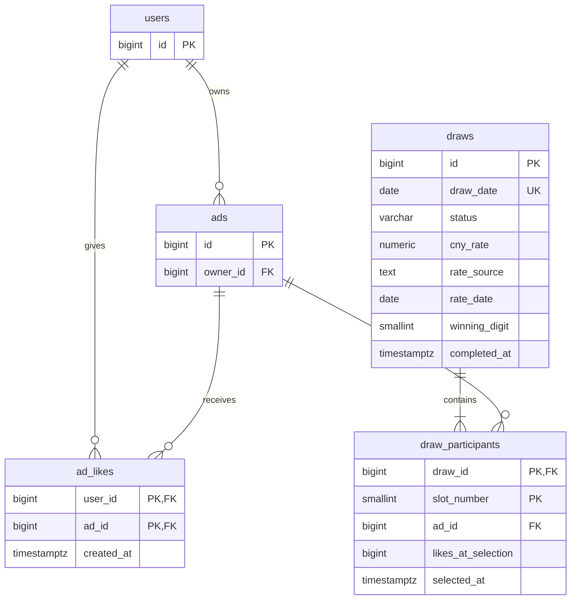

# Кейс «Выкуп авто за 3 млн рублей»

Материал для трёх пунктов практики: реляционная модель данных, OpenAPI 3.0 и модель безопасности. Это проектирование фичи для существующей площадки.

## Границы и допущения

- Пользователи `users` и объявления `ads` уже существуют. Для фичи добавляются ровно три таблицы. Создание объявлений, вход и модерация остаются функциями площадки.
- Публикация активного объявления делает его участником акции при соответствии её условиям. Отдельная заявка не требуется.
- Для учебной модели отбираются 10 подходящих объявлений с наибольшим количеством действующих лайков на момент отбора. При равенстве — по `ad_id` по возрастанию. Это допущение: в исходном кейсе алгоритм отбора не задан.
- Номера 0–9 назначаются в порядке отбора. Если подходящих объявлений меньше 10, отбор не завершается.
- Расписание работает с понедельника по пятницу в заранее настроенной временной зоне кампании. Учёт официальных праздничных дней потребует отдельного производственного календаря.
- Источник, дата курса и точность объявляются в правилах акции заранее. Для модели выбран курс RUB за 1 CNY с четырьмя знаками после запятой; последняя цифра — четвёртый знак, включая конечные нули. Например, «12.3450» даёт номер 0. Значение передаётся в API строкой, чтобы сохранить точность.
- Состав и номера претендентов фиксируются до публикации используемого курса. Если курс недоступен, розыгрыш остаётся в статусе `shortlisted`.
- Повторное участие и повторная победа разрешены для учебной модели: исходный кейс не задаёт ограничений.

## 1. Реляционная модель

PK — первичный ключ; FK — внешний ключ; UNIQUE — ограничение уникальности. Поля обязательны, если не указано NULL. Временные метки хранятся как TIMESTAMPTZ.

### ad_likes — лайки объявлений

| Поле | Тип PostgreSQL | Ограничения и назначение |
|---|---|---|
| user_id | BIGINT | FK → users.id; часть PK |
| ad_id | BIGINT | FK → ads.id; часть PK |
| created_at | TIMESTAMPTZ | Время установки лайка |

PK `(user_id, ad_id)` запрещает повторный лайк. Снятие лайка удаляет запись. Индекс `(ad_id)` ускоряет подсчёт лайков объявления. Лайк доступен авторизованному пользователю; лайк собственного объявления запрещён в этой учебной модели.

### draws — ежедневные розыгрыши

| Поле | Тип PostgreSQL | Ограничения и назначение |
|---|---|---|
| id | BIGINT | PK |
| draw_date | DATE | UNIQUE; дата розыгрыша в зоне кампании |
| status | VARCHAR(20) | CHECK: shortlisted / completed |
| cny_rate | NUMERIC(12,4) | NULL до завершения; положительный курс |
| rate_source | TEXT | NULL до завершения; идентификатор источника |
| rate_date | DATE | NULL до завершения; дата действия курса |
| winning_digit | SMALLINT | NULL до завершения; CHECK: 0–9 |
| completed_at | TIMESTAMPTZ | NULL до завершения; время завершения |

CHECK для статусов: при `shortlisted` все пять полей результата равны NULL; при `completed` все заполнены. Для завершённой записи `winning_digit = MOD(cny_rate * 10000, 10)` при принятом формате курса. Источник, дата и округление дополнительно проверяются по настройкам кампании.

### draw_participants — претенденты розыгрыша

| Поле | Тип PostgreSQL | Ограничения и назначение |
|---|---|---|
| draw_id | BIGINT | FK → draws.id; часть PK |
| slot_number | SMALLINT | CHECK: 0–9; часть PK |
| ad_id | BIGINT | FK → ads.id |
| likes_at_selection | BIGINT | CHECK: ≥ 0; снимок количества лайков |
| selected_at | TIMESTAMPTZ | Время фиксации отбора |

PK `(draw_id, slot_number)`; UNIQUE `(draw_id, ad_id)`. Одному номеру соответствует одно объявление, одно объявление встречается в розыгрыше один раз.

### ER-диаграмма



`users` и `ads` показаны только для связей. Точная кратность «10 претендентов» проверяется сервисом: обычная ER-нотация её не выражает.

### Целостность и сценарий работы

1. Установка и снятие лайка идемпотентны: повторный запрос не создаёт дубликат и не вызывает ошибку при отсутствии лайка.
2. Сервис отбора получает согласованный снимок данных, проверяет объявления, выбирает топ-10 и сохраняет розыгрыш вместе с участниками в одной транзакции. Все участники получают одно время отбора.
3. UNIQUE по дате защищает от двух розыгрышей в один день. Повторный запуск возвращает уже сохранённый розыгрыш.
4. Сервис завершения получает курс из настроенного источника. Проверяет, что участники были зафиксированы до публикации этого курса. Блокирует запись розыгрыша, проверяет 10 участников и сохраняет результат одной транзакцией.
5. После отбора менять состав и номера запрещено; после завершения результат неизменяем. Повторное завершение возвращает сохранённый результат без повторного выбора.
6. Победитель определяется условием `draw_participants.slot_number = draws.winning_digit` только для завершённого розыгрыша. Отдельная таблица победителей и флаг `is_winner` не нужны.
7. Удаление объявлений с историей участия — логическое; физическое удаление связанных записей блокируется FK. Публичный ответ не содержит персональных данных владельца.

## 2. API

Полный контракт находится в [openapi.json](openapi.json). JSON является допустимым форматом документа OpenAPI.

| Метод и путь | Назначение | Доступ |
|---|---|---|
| GET /ads/{adId}/likes | Количество лайков | Любой |
| PUT /ads/{adId}/likes/me | Поставить собственный лайк | Пользователь |
| DELETE /ads/{adId}/likes/me | Снять собственный лайк | Пользователь |
| GET /draws | Список розыгрышей, фильтр по дате, пагинация | Любой |
| GET /draws/{drawId} | Розыгрыш, претенденты и результат | Любой |
| POST /internal/draws/select | Отобрать 10 претендентов на указанную дату | Сервис отбора |
| POST /internal/draws/{drawId}/complete | Получить курс и завершить розыгрыш | Сервис завершения |

Список возвращается по дате убывания. GET списка принимает `date`, `limit` (1–100, по умолчанию 20), `offset` (от 0). PUT/DELETE лайка не принимают user_id: он определяется по токену.

Внутренний отбор принимает JSON `{"drawDate":"2026-10-14"}`. Завершение не принимает курс или номер победителя от клиента — сервис получает курс самостоятельно.

Пример ответа GET /draws/101:

```json
{
  "id": 101,
  "drawDate": "2026-10-14",
  "status": "completed",
  "participants": [
    {"adId": 501, "slotNumber": 0, "likesAtSelection": 1000, "selectedAt": "2026-10-14T06:00:00Z"},
    {"adId": 502, "slotNumber": 1, "likesAtSelection": 900, "selectedAt": "2026-10-14T06:00:00Z"},
    {"adId": 503, "slotNumber": 2, "likesAtSelection": 800, "selectedAt": "2026-10-14T06:00:00Z"},
    {"adId": 504, "slotNumber": 3, "likesAtSelection": 700, "selectedAt": "2026-10-14T06:00:00Z"},
    {"adId": 505, "slotNumber": 4, "likesAtSelection": 600, "selectedAt": "2026-10-14T06:00:00Z"},
    {"adId": 506, "slotNumber": 5, "likesAtSelection": 500, "selectedAt": "2026-10-14T06:00:00Z"},
    {"adId": 507, "slotNumber": 6, "likesAtSelection": 400, "selectedAt": "2026-10-14T06:00:00Z"},
    {"adId": 508, "slotNumber": 7, "likesAtSelection": 300, "selectedAt": "2026-10-14T06:00:00Z"},
    {"adId": 509, "slotNumber": 8, "likesAtSelection": 200, "selectedAt": "2026-10-14T06:00:00Z"},
    {"adId": 510, "slotNumber": 9, "likesAtSelection": 100, "selectedAt": "2026-10-14T06:00:00Z"}
  ],
  "result": {
    "cnyRate": "12.3450",
    "rateSource": "configured-provider",
    "rateDate": "2026-10-14",
    "winningDigit": 0,
    "winnerAdId": 501,
    "completedAt": "2026-10-14T08:00:00Z"
  }
}
```

Данные примера вымышлены. До завершения `result: null`.

Ошибки имеют единую структуру `{"code":"...", "message":"..."}`: 400 — неверные параметры; 401 — нет действительного токена; 403 — нет разрешения; 404 — объект отсутствует; 409 — нарушены условия операции; 429 — превышен лимит; 503 — источник курса недоступен.

## 3. Модель безопасности

### Аутентификация

Используется существующий вход площадки. Пользовательские методы принимают `Authorization: Bearer <access_token>`. Сервер проверяет подпись, разрешённый алгоритм, issuer, audience, срок действия и состояние аккаунта. `user_id` берётся из проверенного `sub`, а не из тела запроса.

Сервисы получают отдельные короткоживущие токены с техническими субъектами и разрешениями `draws:select` или `draws:complete`. Пользовательский токен не даёт доступа к внутренним операциям. Доступ к внутренним маршрутам дополнительно ограничивается инфраструктурой.

### Роли и разрешения

| Роль | Просмотр | Лайки | Отбор | Завершение |
|---|---|---|---|---|
| Гость | Да | Нет | Нет | Нет |
| Пользователь | Да | Только свои | Нет | Нет |
| Сервис отбора | Да | Нет | Да | Нет |
| Сервис завершения | Да | Нет | Нет | Да |

Роль администратора площадки сама по себе не даёт права выбирать победителя или менять завершённый розыгрыш. Модерация объявлений выполняется существующей системой площадки.

### Проверки и защита

- Авторизация выполняется сервером на каждом защищённом методе; проверяются тип субъекта и разрешение.
- PUT лайка проверяет активность и соответствие объявления условиям акции, блокировку пользователя и отсутствие самолайка.
- DELETE снимает только лайк текущего пользователя и разрешён даже после закрытия объявления.
- Все соединения используют HTTPS. Токены и персональные данные не записываются в журнал запросов.
- Ограничения частоты запросов применяются по аккаунту и IP. Уникальный ключ не защищает от множества поддельных аккаунтов; проверка подозрительной активности использует существующие механизмы площадки.
- Публичные ответы содержат идентификаторы объявлений и результаты, без телефонов, токенов и закрытых полей пользователя.
- События отбора, получения курса, завершения и отказов доступа записываются во внешний аудит: субъект, время, draw_id, источник курса и результат операции. Для этого не требуется четвёртая таблица предметной области.
- У сервиса API нет доступа суперпользователя БД. Изменение результатов разрешено только процессу завершения в пределах предусмотренной операции.

## Что проверить при реализации

- Повторный PUT создаёт один лайк; пользователь не может снять чужой лайк.
- Параллельные запуски не создают два розыгрыша на одну дату.
- Отбор сохраняет ровно 10 уникальных объявлений и номера 0–9.
- Изменение лайков после отбора не меняет сохранённые значения.
- До публикации подходящего курса завершение отклоняется; недоступность источника не меняет результат.
- Курс «12.3450» выбирает участника 0; повторное завершение сохраняет прежнего победителя.
- Пользовательские токены не допускаются к внутренним методам; разрешения двух сервисов разделены.

Источник формата контракта: [OpenAPI Specification 3.0.3](https://spec.openapis.org/oas/v3.0.3.html).

