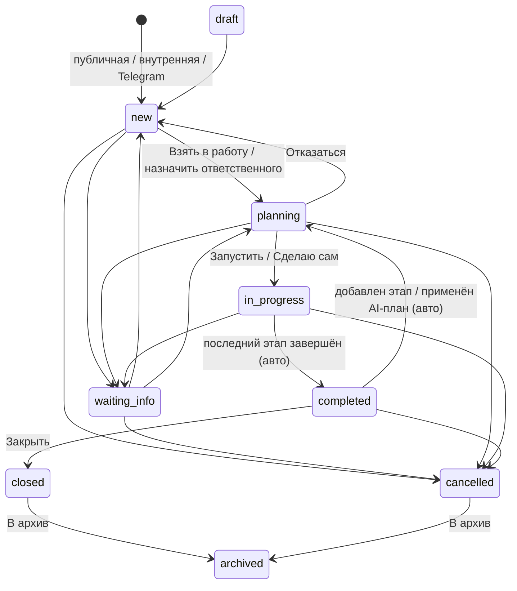

# СВОД — Product Screen Architecture: реестр экранов, иерархия, роли

Версия: 1.0 · Дата: 2026-10-21 · Статус: аналитический отчёт (исследование и планирование, код/спецификация/USM не менялись)

Файл — часть комплекта `docs/screen-architecture/`:

| Файл | Что внутри |
|---|---|
| **01-screen-inventory.md** (этот) | Ч.1 резюме, Ч.2 реестр экранов, Ч.3 иерархия, Ч.6 матрица ролей, справочники статусов, мультитенантность, состояния интерфейса |
| [02-user-flows.md](02-user-flows.md) | Ч.4 матрица покрытия USM, Ч.5 основные user flows |
| [03-figjam-plan.md](03-figjam-plan.md) | Ч.8 FigJam Design System, Ч.9 план сборки, Ч.10 Definition of Done, анализ Figma MCP |
| [04-gaps-and-questions.md](04-gaps-and-questions.md) | Ч.7 противоречия, пробелы, вопросы на согласование |
| [screens.json](screens.json) | Реестр узлов (экраны, модалки, состояния, Telegram, внешние системы), роли, статусы, US, расхождения |
| [transitions.json](transitions.json) | Рёбра переходов между узлами |

Таблицы в этом файле (реестр, иерархия, матрица доступа) **сгенерированы из `screens.json`** и совпадают с ним. При расхождении источник правды — JSON.

## 0. Источники и правила чтения

| Источник | Файлы | Что считается фактом |
|---|---|---|
| **A. Код** | `src/App.tsx`, `src/pages/*`, `src/components/**`, `src/shared/**`, `backend/app/**` | Текущая реализация. Берётся рабочее дерево на 2026-10-21, **не HEAD** (в `src/` 72 изменённых/новых файла: опросы, join/activate, Telegram, planner этапов; удалены `RequestTechnicalSpecPanel`, `RequestExecutionPanel`, `TzAssistantWidget`) |
| **B. Спецификация** | `docs/BUSINESS_REQUIREMENTS.md` v0.2 (BR-001…BR-090, NFR-01…09, G1/G2), `MVP_BRIEF.md`, `Бриф.md`, `METHODOLOGY_FORMS_PLAN.md`; `PROJECT_OVERVIEW.md` устарел (2026-06-15) | Заявленные требования |
| **C. USM** | `docs/USER_STORIES.md` v0.1 (US-01…US-38, карта историй §4) | Зафиксированные сценарии и приоритеты. **Допущение:** отдельного USM-артефакта в репозитории нет, USM = этот файл (вопрос Q-01) |

> **Решение 2026-10-22:** целевая модель продукта — **BR**; код считается «сырым» с точки зрения бизнес-процессов. Статусы реализации ниже описывают **код относительно BR**; доска FigJam: `https://www.figma.com/board/8Gcnd1KzEShqLXfmhTu0sV/`.

Правила: ни один источник автоматически не подменяет другие; факты о реализации подтверждаются путём файла (и строкой там, где она снималась); наличие компонента не считается доказательством законченного сценария (поэтому есть статус `code-orphan`); проектные предложения отделены от подтверждённого статусом `proposed`.

**Статусы реализации** (одинаковы в JSON и таблицах):

| Статус | Значение |
|---|---|
| ✅ `implemented` | есть в коде и подключено к UI |
| 🟡 `partial` | работает не полностью: заглушка, нет части действий или бэкенд-поддержки |
| ⚪ `code-orphan` | код есть, но к UI не подключён |
| 🔵 `planned-spec` | описано в BR/USM/планах, кода нет |
| 🟣 `proposed` | нужно по логике сценария, в источниках не описано — **проектное предложение** |
| ❓ `needs-clarification` | поведение нельзя определить по источникам |
| 🔴 `contradiction` | источники противоречат друг другу |

Приоритет релиза (`mvp / v1 / v2`) берётся из MoSCoW USM (Must/Should/Could) и **не смешивается** со статусом реализации.

---

## Часть 1. Резюме анализа

### 1.1 Общая оценка

СВОД — React SPA (Vite, React Router, Ant Design) + FastAPI + PostgreSQL, плюс второй интерфейс — Telegram-бот (aiogram) и очередь AI-задач (worker, OpenRouter). Пользовательская поверхность состоит из четырёх зон:

1. **Публичные потоки без аккаунта** — подача заявки (`/form/:token`), опрос (`/survey/:token`).
2. **Вход и онбоардинг** — `/auth`, `/activate/:token`, `/join/:token`.
3. **Рабочая оболочка** — сайдбар из 5 разделов, хедер (уведомления, профиль), переключатель организации.
4. **Telegram-канал** — привязка, `/new`, `/my`, `/free`, группы, уведомления с кнопками.

| Показатель | Значение |
|---|---|
| Узлов в `screens.json` | **109** |
| Экраны (`screen`) / вложенные экраны и вкладки (`subscreen`) | 26 / 15 |
| Модалки / drawer / popover / панели | 30 / 2 / 3 / 3 |
| Самостоятельные состояния (`state`) | 9 |
| Telegram-сценарии (`channel`) / внешние системы (`external`) / layout / редиректы | 12 / 5 / 1 / 3 |
| Статусы узлов | ✅ implemented: 76, 🟡 partial: 17, 🔵 planned-spec: 7, 🟣 proposed: 6, ⚪ code-orphan: 2, 🔴 contradiction: 1 |
| Переходов в `transitions.json` | **203** (route: 56, state: 49, modal: 46, auto: 19, external: 16, tab: 13, redirect: 4) |
| Расхождений (`GAP`) | 33 |
| User Stories Must/Should/Could с законченным маршрутом | 16 из 34 (частично — 7, не покрыты — 11) |

Архитектура зрелая в ядре «заявка → этапы → исполнитель» (реализована сильнее, чем в USM) и недозавершена на краях: у заявителя нет статуса, у куратора нет «ожидания уточнения» и истории, у владельца нет управления доступами и отключения AI.

### 1.2 Выявленные модули

| Модуль | Разделы / маршруты | Состояние |
|---|---|---|
| Вход и онбоардинг (AUTH) | `/auth`, `/activate/:token`, `/join/:token` | Работает; нет сброса пароля и подтверждения email |
| Публичные потоки (PUB) | `/form/:token`, `/form/:token/fill/:formId`, `/survey/:token`, редирект `/public/request/:token` | Работает; нет подсказок о пробелах до отправки и статуса для заявителя |
| Оболочка (SYS) | Sidebar, Header, переключатель организации, уведомления, профиль, `NoOrganizationState` | Работает; нет 404/403, заглушки (поиск, тариф) |
| Заявки (REQ) | `/requests`, `/requests/create`, `/requests/:id` (4 вкладки) | Ядро реализовано; недостаёт «уточнения», истории, «Мои задачи», блокировки этапа |
| Формы (FRM) | `/forms`, `/forms/create`, `/forms/:id`, `/forms/:id/edit` | Работает; описание формы теряется при редактировании, архив необратим |
| Опросы (SRV) | `/surveys`, `/surveys/create`, `/surveys/:id`, `/surveys/:id/edit` | Реализован, **в BR/USM отсутствует**; нет экрана результатов |
| Участники (PRT) | `/participants` (4 вкладки) | Работает; нет доступов по модулям; «Подрядчики» — вкладка, а не модуль |
| Настройки (ORG) | `/settings/organization` (3 вкладки) | Реально работает только профиль организации |
| Telegram (TG) | 12 сценариев канала | Реализован шире плана (групповой бот) |
| Служебное (DEV) | `/dev/formily-builder` | Доступен в production |

### 1.3 Главные архитектурные проблемы

Подробности и источники — в [04-gaps-and-questions.md](04-gaps-and-questions.md).

1. **Три модели статусов заявки** (BR / код / PROJECT_OVERVIEW) — GAP-01.
2. **Модель ролей: «доступы по модулям» (BR, USM) против `owner|member` (код)**, плюс два независимых источника «владельца» — GAP-02, GAP-08.
3. **Приоритеты релизов не согласованы** между BR, USM и MVP_BRIEF; реализация опережает USM — GAP-03.
4. **Must-истории без UI:** US-03 (доступы), US-08 (подсказки до отправки), US-13 (ожидание уточнения), US-17 (отключение AI) — GAP-07, 08, 10, 13.
5. **Тупики жизненного цикла:** `waiting_info` без выхода, план этапов переводит `new→planning` без ответственного — GAP-17.
6. **Мультитенантность только на клиенте**, детальные страницы не привязаны к активной организации, на backend формы/опросы без проверки tenant — GAP-18.
7. **Нет системных экранов:** 404, «нет доступа», сброс пароля — GAP-21, GAP-22.
8. **Дубликаты/мёртвый код** (подзадачи, история, ТЗ-панель) и заглушки в UI — GAP-14, 15, 24.
9. **Модуль «Опросы» вне продуктовых документов** — GAP-05.
10. **Устаревшие документы** (`PROJECT_OVERVIEW`) искажают картину — GAP-26.

### 1.4 Что вывести невозможно

- Реальный внешний вид, адаптив планшета/мобильного (проверялась структура кода, а не отрисовка в браузере).
- Поведение `DELETE /requests/{id}` при одновременном взятии заявки двумя участниками (сценарий Gherkin US-10): блокировки в коде есть для `take`, но текст сообщения второму участнику не найден.
- Какие точно ПДн уходят во внешний LLM (BR-078): в коде есть сервисы, но проверка redaction не выполнялась.
- Загружаются ли файлы на публичной форме (в UI не подтверждено).
- Целевое состояние (BR vs код) по статусам и ролям — требует решения владельца продукта (Q-02, Q-03).

---

## Часть 2. Реестр экранов

Колонки: `Screen ID | Модуль | Экран | Route | Роли | Назначение | Источник | Статус реализации | User Stories | Примечания`.
«Источник» = BR / документы / ключевой файл кода. Роли: `ANON` аноним, `USER` без организации, `MEMBER`, `OWNER`, `AUTHOR`, `RESP` ответственный (куратор), `ASSIGNEE` исполнитель этапа, `CONTRACTOR` подрядчик, `TGGROUP` участник TG-группы. Релиз: **MVP / v1 / v2** — из MoSCoW.

### AUTH · Вход и онбоардинг (5)

| Screen ID | Модуль | Экран | Route | Роли | Назначение | Источник | Статус реализации | User Stories | Примечания |
|---|---|---|---|---|---|---|---|---|---|
| `R-03` | AUTH | ↪ Перехват 401 → /auth | `(axios interceptor)` | USER, MEMBER, OWNER | При 401 на общем api-клиенте выполняет window.location.href='/auth'. Публичные клиенты (public.api, surveys.api public) не перехватывают. | код: src/shared/lib/api.ts:22-31 | ✅ implemented · — | — | Токен JWT 24 ч, refresh и logout на сервере нет. Join/activate идут через общий api — 401 там тоже перехватывается. [GAP-22] |
| `S-AUTH-01` | AUTH | Вход / Регистрация | `/auth` | ANON | Вход по email/паролю и регистрация. Залогиненный пользователь редиректится на /requests (PublicOnlyAuthPage). | BR-001; код: src/pages/AuthPage.tsx:24-100,115-119,236-243 | 🟡 partial · MVP | US-01 | Кнопки «Войти с Яндекс ID / VK ID» disabled (заглушки). Нет сброса пароля. После регистрации пользователь уже залогинен, redirectTo игнорируется. mapAuthError ловит строки Supabase, которых backend не отдаёт. [GAP-22, GAP-24] |
| `S-AUTH-02` | AUTH | Активация аккаунта по ссылке | `/activate/:token` | ANON | Владелец заранее создал аккаунт; пользователь задаёт пароль и профиль, попадает в организацию. | BR-002; код: src/pages/ActivateAccountPage.tsx:73,101 | ✅ implemented · MVP | US-02 | Нет гварда: работает и для залогиненного (перезапишет токен). Письмо отправляется, если настроен SMTP, иначе владелец копирует ссылку вручную. [GAP-22] |
| `S-AUTH-03` | AUTH | Вступление в организацию по ссылке | `/join/:token` | ANON, USER, MEMBER | Гость регистрируется и подаёт заявку; залогиненный подаёт заявку; владелец модерирует. | BR-003; код: src/pages/JoinOrganizationPage.tsx:69-81,117-257 | ✅ implemented · MVP | US-02 | После отправки решение приходит через S-SYS-01 и уведомления. |
| `S-AUTH-04` | AUTH | Восстановление пароля | — | ANON | Сброс пароля по email. | — | 🟣 proposed · — | — | Не описан ни в BR, ни в USM; необходим для завершённости сценария входа. Проектное предложение. [GAP-22] |

### PUB · Публичные потоки (без аккаунта) (13)

| Screen ID | Модуль | Экран | Route | Роли | Назначение | Источник | Статус реализации | User Stories | Примечания |
|---|---|---|---|---|---|---|---|---|---|
| `R-01` | PUB | ↪ Легаси-маршрут публичной заявки | `/public/request/:token` | ANON | Редирект на /form/:token; без токена — на /. | BR-012; код: src/pages/PublicRequestLegacyRedirect.tsx:6-7 | ✅ implemented · — | — | Единственный легаси-редирект. |
| `S-PUB-01` | PUB | Публичная страница организации: описать задачу | `/form/:token` | ANON | Заявитель описывает задачу своими словами (≥10 символов), система подбирает форму. | BR-012, BR-013, BR-072; MVP_BRIEF; код: src/pages/PublicFormLandingPage.tsx:135-142 | ✅ implemented · MVP | US-05, US-06 | Состояния хранятся в провайдере (память), а не в URL: шаги landing→suggestions не имеют отдельных URL. [GAP-12, GAP-31] |
| `S-PUB-01.1` | PUB | Подобранные формы / ручной список | `/form/:token (step=suggestions)` | ANON | Карточки подобранных форм (топ-3) или полный ручной список (без универсальных). | BR-013, BR-072; код: src/pages/PublicFormLandingPage.tsx:62 | ✅ implemented · MVP | US-06 | Gherkin US-06 «AI недоступен» реализуется как fallback на ручной список. popular_forms/universal_form_id приходят, но не используются. После ручного выбора и «Назад» пользователь попадает на suggestions с пустым результ… [GAP-31] |
| `S-PUB-01.2` | PUB | Заявка отправлена (PublicFormSuccessScreen) | `/form/:token (success)` | ANON | Подтверждение подачи; можно подать ещё одну. | BR-028; код: src/components/public/PublicFormSuccessScreen.tsx | 🟡 partial · MVP | US-08, US-24 | Показывает request_number ?? id. Заявитель не получает ни трекинга, ни письма (backend). [GAP-11, GAP-32] |
| `ST-PUB-01-error` | PUB | ◌ Публичная ссылка недоступна (PublicFormErrorScreen) | `/form/:token` | ANON | link_not_found (404) / link_inactive, organization_unavailable (410) / нет pageData. | BR-012; код: src/components/public/PublicFormErrorScreen.tsx:25 | 🟡 partial · MVP | US-05 | «Закрыть» ведёт на /, для анонима это в итоге /auth. [GAP-12] |
| `ST-PUB-01-suggesting` | PUB | ◌ Подбор формы (ожидание) | `/form/:token` | ANON | Состояние загрузки подсказок с искусственной задержкой не менее 1500 мс (SUGGEST_MIN_LOADING_MS). | BR-013; код: src/pages/PublicFormLandingPage.tsx | ✅ implemented · MVP | US-06 | — |
| `S-PUB-02` | PUB | Заполнение формы заявки (публично) | `/form/:token/fill/:formId` | ANON | Мастер по страницам формы; на последней странице — блок «Ваши контакты» (имя*, email*, телефон, организация). | BR-010, BR-015, BR-020; код: src/pages/PublicFormFillPage.tsx:148,225,252,404-419 | ✅ implemented · MVP | US-08 | Подсказок о недостающих данных ДО отправки нет (grep по pages/Public* пуст) — US-08 не реализована. Загрузка файлов на публичной форме по коду не подтверждена. Backend: нет rate limit на подачу, data/form_snapshot не ва… [GAP-13, GAP-31] |
| `ST-PUB-02-notfound` | PUB | ◌ Форма не найдена (публично) | `/form/:token/fill/:formId` | ANON | Inline Alert вместо PublicFormErrorScreen. | код: src/pages/PublicFormFillPage.tsx:252 | ✅ implemented · — | — | Разное оформление ошибок на S-PUB-01 и S-PUB-02. |
| `ST-PUB-02-gaps` | PUB | ◌ Подсказки о недостающих данных перед отправкой | `/form/:token/fill/:formId` | ANON | Шаг «Что стоит уточнить» перед отправкой: система показывает вероятные пробелы (размеры, срок, место) и предлагает дополнить заявку или отправить как есть. | BR-070, BR-078, NFR-08; USER_STORIES §3 (Gherkin US-08); код: src/pages/PublicFormFillPage.tsx (отправка идёт сразу, подсказок до отправки нет) | 🟣 proposed · MVP | US-08 | US-08 (★, Must) описана Gherkin-сценарием, но как экран нигде не спроектирована — проектное предложение. Нужно согласовать состав данных, уходящих в LLM (ПДн не передаются, BR-078), и поведение при отказе AI (NFR-08). [GAP-13] |
| `S-PUB-03` | PUB | Публичный опрос (респондент) | `/survey/:token` | ANON | Мастер по страницам опроса, отправка ответов. | METHODOLOGY_FORMS_PLAN §2.1; код: src/pages/PublicSurveyPage.tsx | ✅ implemented · — | — | Модуль «Опросы» не описан в BR/USM/MVP_BRIEF (GAP-05). [GAP-05] |
| `ST-PUB-03-closed` | PUB | ◌ Опрос завершён / недоступен | `/survey/:token` | ANON | closed (410 survey_closed) или draft/archived (404 survey_not_found). | код: src/pages/PublicSurveyPage.tsx | ✅ implemented · — | — | [GAP-05] |
| `ST-PUB-03-submitted` | PUB | ◌ Спасибо за участие (опрос) | `/survey/:token` | ANON | Экран после отправки ответов. | код: src/pages/PublicSurveyPage.tsx | ✅ implemented · — | — | [GAP-05] |
| `S-PUB-04` | PUB | Статус заявки для заявителя | — | ANON | Заявитель без аккаунта видит статус своей заявки. | BR-028 | 🔵 planned-spec · v1.0 | US-24 | UI в источниках не описан; нужен идентификатор/ссылка для заявителя (сейчас не выдаётся). [GAP-11] |

### SYS · Оболочка и системные состояния (12)

| Screen ID | Модуль | Экран | Route | Роли | Назначение | Источник | Статус реализации | User Stories | Примечания |
|---|---|---|---|---|---|---|---|---|---|
| `L-01` | SYS | ▣ Оболочка приложения (AppShell) | `/ (ProtectedLayout)` | USER, MEMBER, OWNER | Сайдбар (5 пунктов), хедер с крошками, уведомлениями и профилем, контент-область. Показывает NoOrganizationState вместо Outlet, если организаций нет. | BR-005; код: src/App.tsx:100-382 | ✅ implemented · — | — | Поиск в сайдбаре — заглушка без обработчика (AppSidebar.tsx:91-99). Пункты меню не фильтруются по ролям. Тариф «Бизнес» захардкожен (OrganizationSwitcher.tsx:6). Крошек нет у /requests, /forms, /surveys, /participants,… [GAP-24, GAP-18] |
| `S-SYS-01` | SYS | Нет организации (NoOrganizationState) | `(любой защищённый маршрут при organizations=[])` | USER | Заменяет Outlet. Показывает статус заявки на вступление или предлагает создать организацию. | BR-001, BR-003; код: src/components/layout/NoOrganizationState.tsx:8,42-46 | ✅ implemented · MVP | US-01, US-02 | Сайдбар остаётся кликабельным, но контент не меняется. Короткая вспышка этого экрана при загрузке: OrganizationProvider стартует с isLoading=false (GAP-18). [GAP-18] |
| `S-SYS-02` | SYS | Страница 404 / ошибка маршрута | `*` | ANON, USER, MEMBER, OWNER | Универсальная страница для неизвестного URL и непойманной ошибки роутера. | код: src/App.tsx:448-514 (catch-all и errorElement отсутствуют) | 🟣 proposed · — | — | Сейчас показывается дефолтная страница ошибки react-router. Проектное предложение. [GAP-21] |
| `ST-SYS-denied` | SYS | ◌ Состояние «Нет доступа» (403) | — | MEMBER, OWNER | Единое состояние вместо «Ошибка загрузки» для деталей заявки/формы/опроса, когда backend вернул 403/404 из-за чужой организации. | NFR-03; код: src/pages/RequestViewPage.tsx (любая ошибка → «Ошибка загрузки») | 🟣 proposed · — | — | Нужно для детальных страниц при смене организации (GAP-18). [GAP-21, GAP-18] |
| `M-SYS-01` | SYS | ▢ Создание организации | — | USER, MEMBER, OWNER | Создаёт организацию, делает её активной. | BR-001; код: src/components/layout/CreateOrganizationModal.tsx:36-37 | ✅ implemented · MVP | US-01 | Открывается из S-SYS-01 и M-SYS-04. |
| `M-SYS-02` | SYS | ▢ Подключение Telegram (TelegramLinkModal) | — | MEMBER, OWNER | Привязка/отвязка Telegram-аккаунта: deep-link t.me/<bot>?start=<token>, TTL 10 мин, polling статуса 3 с. | BR-060; PROJECT_OVERVIEW §11a; код: src/components/layout/TelegramLinkModal.tsx:20-169 | ✅ implemented · MVP | US-07 | Открывается из popover профиля. В Настройках организации Telegram показан как «Скоро» (дублирование). [GAP-24] |
| `M-SYS-03` | SYS | ▢ Ссылка-приглашение в организацию (JoinLinkModal) | — | OWNER | Включить/выключить ссылку вступления, скопировать, перевыпустить. | BR-003; код: src/components/layout/JoinLinkModal.tsx | ✅ implemented · MVP | US-02 | Открывается из сайдбара и из S-PRT-01. Не путать с публичной ссылкой на заявки (US-05). [GAP-12] |
| `M-SYS-04` | SYS | ▢ Меню профиля | — | USER, MEMBER, OWNER | Имя/email, создание организации, Telegram, тёмная тема, выход. | код: src/components/layout/ProfileBlock.tsx | 🟡 partial · — | — | Нет редактирования профиля (ФИО, пароль, аватар); upsertProfile — заглушка. Выход только чистит токен, редирект делает ProtectedLayout. [GAP-22] |
| `M-SYS-05` | SYS | ▢ Уведомления и приглашения (колокольчик) | — | MEMBER, OWNER | Входящие приглашения в организации (принять/отклонить) и workflow-уведомления; клик ведёт к заявке/участникам. | BR-050; код: src/components/organization/NotificationsPanel.tsx:98-121 | ✅ implemented · MVP | US-16 | Обновляется на смене pathname и при открытии, polling по таймеру нет. Клик по уведомлению с request_id не переключает активную организацию. Действий из уведомления (кроме открытия) в приложении нет. [GAP-18] |
| `M-SYS-06` | SYS | ▢ Переключатель организации (OrganizationSwitcher) | — | MEMBER, OWNER | Выбор активной организации; значение хранится в localStorage['active_organization_id'] и передаётся как ?organization_id=. | BR-005, NFR-03; код: src/shared/context/organization.provider.tsx:17-102 | ✅ implemented · — | — | BR-005 — Should. Активная организация только на клиенте, в JWT её нет. [GAP-18] |
| `M-SYS-07` | SYS | ▢ Мобильное меню (выезжающий сайдбар) | — | MEMBER, OWNER | Навигация на экранах <1056px. | код: src/App.tsx:294-308 | ✅ implemented · — | — | — |
| `R-02` | SYS | ↪ Индекс → Заявки | `/` | MEMBER, OWNER | Navigate to /requests. | код: src/App.tsx:480 | ✅ implemented · — | — | — |

### REQ · Заявки (28)

| Screen ID | Модуль | Экран | Route | Роли | Назначение | Источник | Статус реализации | User Stories | Примечания |
|---|---|---|---|---|---|---|---|---|---|
| `S-REQ-01` | REQ | Реестр заявок | `/requests` | MEMBER, OWNER | Таблица заявок активной организации по табам; точка входа после входа. | BR-025, BR-022; код: src/pages/RequestsPage.tsx:52-72,91-113,163,221,321,350 | 🟡 partial · MVP | US-09, US-10 | Нет поиска и фильтров (BR-025/US-09 требуют). Нет счётчиков в табах (getRequestsCounts не вызывается). Колонка «Номер» = UUID. Из архива восстановить нельзя. [GAP-33, GAP-32] |
| `ST-REQ-01-empty` | REQ | ◌ Реестр заявок: пустой таб | `/requests` | MEMBER, OWNER | emptyText на каждый из 6 табов. | код: src/pages/RequestsPage.tsx | ✅ implemented · — | — | — |
| `S-REQ-02` | REQ | Создание заявки (внутренняя) | `/requests/create` | MEMBER, OWNER | Шаг 0: название и выбор формы; далее мастер по страницам формы; сохранение отправляет заявку (status=open → new). | BR-020; код: src/pages/CreateRequestPage.tsx:172,245 | ✅ implemented · — | — | Нет сохранения черновика (статус draft из web не создаётся). После успеха — inline-уведомление и переход в реестр. Не привязан к US напрямую — внутренняя подача явно описана только в BR-020 (источник «внутренняя»). |
| `S-REQ-03` | REQ | Карточка заявки | `/requests/:id` | MEMBER, OWNER, AUTHOR, RESP, ASSIGNEE | Рабочее место: паспорт (статус, ответственный, приоритет, срок, прогресс), краткое AI-резюме, действия по статусу, 4 вкладки. | BR-021, BR-022, BR-023, BR-026; код: src/pages/RequestViewPage.tsx:109-111,173,329-419 | 🟡 partial · MVP | US-10, US-11, US-12, US-15, US-30 | Кнопки показываются по серверным permissions (13 флагов; can_block_active_stage не читается). Прямого выбора статуса нет — только действия. Нет UI для waiting_info. [GAP-10, GAP-17, GAP-14] |
| `ST-REQ-03-error` | REQ | ◌ Карточка заявки: ошибка загрузки | `/requests/:id` | MEMBER, OWNER | Alert «Ошибка загрузки» для любых ошибок (404, 403, сеть) без различения. | код: src/pages/RequestViewPage.tsx | 🟡 partial · — | — | Состояния «не найдено» и «нет доступа» не различаются. [GAP-21] |
| `S-REQ-03.1` | REQ | Вкладка «Описание» | `/requests/:id (tab=info)` | MEMBER, OWNER | Поля формы (Descriptions), вложения, блок «Из Telegram». | BR-020, BR-061; код: src/pages/RequestViewPage.tsx | ✅ implemented · — | US-07, US-31 | — |
| `S-REQ-03.2` | REQ | Вкладка «Этапы» (RequestStagePlanner) | `/requests/:id (tab=stages)` | RESP, OWNER, ASSIGNEE, MEMBER | Последовательные этапы: исполнитель, сроки, результат; планирование (RequestPlanningPanel) и AI-план. | BR-030, BR-031, BR-032, BR-034; код: src/components/request/RequestStagePlanner.tsx | ✅ implemented · v1.0 | US-18, US-21, US-28 | Реализовано раньше плана (BR: Must, USM: Should/v1). Блокировки этапа и ввода входных материалов в UI нет. Версии ТЗ и handoff загружаются, но не рисуются. [GAP-03, GAP-15, GAP-16] |
| `S-REQ-03.3` | REQ | Вкладка «Файлы» | `/requests/:id (tab=files)` | MEMBER, OWNER | Вложения формы, входные материалы и результаты по этапам (только скачивание). | BR-035, BR-016; код: src/components/request/RequestFilesPanel.tsx | 🟡 partial · — | — | Нельзя загрузить входной материал и удалить артефакт из UI (API есть). [GAP-16] |
| `S-REQ-03.4` | REQ | Вкладка «Участники» | `/requests/:id (tab=people)` | MEMBER, OWNER | Read-only список ролей по заявке (автор, ответственный, исполнители). | код: src/pages/RequestViewPage.tsx | ✅ implemented · — | — | Подсказка отправляет на вкладку «Этапы» для назначения. |
| `S-REQ-03.5` | REQ | Вкладка «История» (RequestHistoryTimeline) | `/requests/:id (tab=history)` | MEMBER, OWNER | Журнал изменений заявки: статус, ответственный, срок, приоритет, этапы. | BR-023; код: src/components/request/RequestHistoryTimeline.tsx (не импортируется) | ⚪ code-orphan · MVP | US-14, US-10 | В HEAD вкладка history была; в рабочем дереве удалена. Есть только «История этапа» внутри StageDetails. Два журнала на backend (history vs execution events). [GAP-14] |
| `S-REQ-03.6` | REQ | Вкладка «Подзадачи» (RequestTasksPanel, deprecated) | `/requests/:id (tab=tasks)` | OWNER, ASSIGNEE | Подзадачи заявки с ручной сменой статуса. | BR-032, BR-034; PROJECT_OVERVIEW §6.2; код: src/components/request/RequestTasksPanel.tsx (не импортируется) | ⚪ code-orphan · — | US-18 | Модель «подзадача» заменена моделью «этап + исполнитель». В BR «задача» создаётся на основании этапа (BR-032) — терминологическая неоднозначность. [GAP-14, GAP-29] |
| `S-REQ-04` | REQ | Мои задачи (список задач сотрудника) | — | ASSIGNEE, MEMBER | Задачи/этапы, назначенные на меня, по всем заявкам. | BR-033 | 🔵 planned-spec · v1.0 | US-19 | Заменяемый вариант: таб «Мои в работе» в S-REQ-01 покрывает только ответственного, не исполнителя этапа. [GAP-09] |
| `M-REQ-01` | REQ | ▢ Закрыть заявку (подтверждение) | — | RESP, OWNER | completed → closed. | BR-021; код: src/pages/RequestViewPage.tsx:352-408 | ✅ implemented · MVP | US-15 | Статус closed отсутствует в BR (GAP-01). [GAP-01] |
| `M-REQ-02` | REQ | ▢ Отмена заявки (обязательная причина) | — | RESP, OWNER | → cancelled; все нетерминальные этапы отменяются. | BR-026; код: src/pages/RequestViewPage.tsx | ✅ implemented · MVP | US-15 | — |
| `M-REQ-03` | REQ | ▢ Переместить заявку в архив | — | RESP, OWNER | closed\|cancelled → archived (DELETE /requests/{id} архивирует, не удаляет). | BR-021; код: src/pages/RequestsPage.tsx | ✅ implemented · MVP | US-15 | Восстановить из архива нельзя. [GAP-01] |
| `M-REQ-04` | REQ | ▢ «Сделаю сам» | — | MEMBER, RESP | take (если нужно) + один этап на себя + старт → in_progress. | BR-022; код: src/components/request/RequestPlanningPanel.tsx | ✅ implemented · — | US-10 | В BR/USM отсутствует как сценарий. |
| `M-REQ-05` | REQ | ▢ Отказаться от заявки (причина) | — | RESP | planning → new, сбрасывает ответственного. | код: src/components/request/RequestPlanningPanel.tsx:334 | ✅ implemented · — | US-10 | В BR/USM как сценарий отсутствует. |
| `M-REQ-06` | REQ | ▢ Назначить ответственного | — | OWNER | Выбор из участников организации; из new автоматически ставит planning. | BR-022; код: src/components/request/RequestResponsibilityControl.tsx | ✅ implemented · MVP | US-11 | Доступно только role_tag=owner (BR: «владелец назначает»; согласуется). [GAP-02] |
| `M-REQ-07` | REQ | ▢ Этап: создать / редактировать / порядок | — | RESP, OWNER | Название*, что сделать, ожидаемый результат, рекомендуемая роль, срок; «Порядок выполнения» для pending-этапов. | BR-030; код: src/components/request/RequestStagePlanner.tsx | ✅ implemented · v1.0 | US-18 | Удаление этапа из UI отсутствует (deleteRequestStage не используется). |
| `M-REQ-08` | REQ | ▢ Завершить этап (результат) | — | ASSIGNEE, RESP, OWNER | Нужно «Что сделано» и/или ссылка и/или файлы (до 10); при последнем этапе заявка → completed. | BR-035, BR-045; код: src/components/request/RequestStagePlanner.tsx | ✅ implemented · v1.0 | US-18 | За внешнего подрядчика результат вносит ответственный (соответствует BR-045). |
| `M-REQ-09` | REQ | ▢ Назначить исполнителя этапа (AssignPerformerModal) | — | RESP, OWNER | Выбор из рекомендаций (балл), участников и подрядчиков; для подрядчика — предупреждение «не входит в сервис». | BR-031, BR-037, BR-040, BR-041; код: src/components/request/AssignPerformerModal.tsx | 🟡 partial · v1.0 | US-21, US-20 | Всегда send_tz=false, contact_method=auto; отправка требований подрядчику — заглушка (send_technical_spec_stub). [GAP-06] |
| `M-REQ-10` | REQ | ▢ Черновик AI-плана этапов | — | RESP, OWNER | Редактирование предложенных этапов и применение («Создать этапы»); применение заменяет существующие этапы. | BR-073, BR-077; код: src/components/request/AiStagePlanAssistant.tsx | ✅ implemented · v2.0 | US-28 | Не зависит от флага requestAssistant, не отключается на уровне организации. Применение из new переводит в planning без ответственного (GAP-17). [GAP-07, GAP-17] |
| `M-REQ-11` | REQ | ▢ Помощник (узкий экран) | — | MEMBER, OWNER | Drawer с RequestAssistantSidebar на экранах <1100px (FloatButton). | BR-070; код: src/pages/RequestViewPage.tsx | ✅ implemented · — | — | Флаг VITE_ENABLE_REQUEST_ASSISTANT (opt-out); в prod-примере выключен. [GAP-07] |
| `M-REQ-12` | REQ | ▢ Боковая панель ассистента (качество заявки) | — | MEMBER, OWNER | «Качество заявки»: можно брать в работу / недостаточно данных; запуск анализа (can_manage_plan). | BR-070; код: src/components/request/assistant/AiReadinessAssistant.tsx | 🟡 partial · MVP | US-08 | Анализ полноты доступен куратору ПОСЛЕ создания; US-08 требует показ заявителю ДО отправки. Полная AiAnalysisPanel — orphan. [GAP-13] |
| `M-REQ-13` | REQ | ▢ Запрос уточнения у заявителя / «Ожидание уточнения» | — | RESP, OWNER | Перевод в waiting_info с комментарием; для заявителя без аккаунта нужен канал ответа. | BR-026; MVP_BRIEF §2 п.2; код: backend/app/api/routes/requests.py:461 (request-info есть) | 🟣 proposed · MVP | US-13, US-26 | US-13 — Must/MVP. Backend готов, UI-триггера и выхода из waiting_info нет. Канал связи с анонимным заявителем не определён (открытый вопрос MVP_BRIEF). [GAP-10, GAP-17] |
| `M-REQ-14` | REQ | ▢ Заблокировать этап (причина) | — | ASSIGNEE, RESP, OWNER | stage → blocked с причиной. | BR-034; код: backend/app/api/routes/requests.py:651 | 🟣 proposed · v1.0 | US-18 | Статус blocked в BR-034 есть, возможность его выставить в UI — нет. [GAP-16] |
| `M-REQ-15` | REQ | ▢ ТЗ этапа: версии и подтверждение | — | RESP, OWNER | Генерация/правка/подтверждение версии ТЗ; передача исполнителю только после подтверждения. | BR-036, BR-074; код: backend/app/api/routes/requests.py:564-601 | 🔵 planned-spec · v2.0 | US-29 | Backend и API есть, UI удалён. В прошлом работала RequestTechnicalSpecPanel. [GAP-15] |
| `M-REQ-16` | REQ | ▢ Передача требований подрядчику | — | RESP, OWNER | Пакет требований: открыть почту/мессенджер, копировать, скачать; отметка «передано» с фиксацией в истории. | BR-041, BR-042, BR-043, BR-044; код: backend/app/services/performer_selection_service.py:419-432 (stub, только лог) | 🔵 planned-spec · v1.0 | US-20 | UI в BR не детализирован (формат пакета — открытый вопрос). [GAP-06] |

### FRM · Формы (8)

| Screen ID | Модуль | Экран | Route | Роли | Назначение | Источник | Статус реализации | User Stories | Примечания |
|---|---|---|---|---|---|---|---|---|---|
| `S-FRM-01` | FRM | Реестр форм | `/forms` | MEMBER, OWNER | Таблица форм организации. | BR-010, BR-014; код: src/pages/FormsPage.tsx:158,188,195,222 | ✅ implemented · MVP | US-04 | Нет проверок прав в UI. Из архива восстановить нельзя. Backend GET /forms без organization_id возвращает формы всех организаций. [GAP-18, GAP-23] |
| `S-FRM-02` | FRM | Создание формы (конструктор) | `/forms/create` | MEMBER, OWNER | FormEditor: панель инструментов (19 пунктов), canvas по страницам, AI-панель, предпросмотр. | BR-010, BR-011; FORM_BUILDER_SPIKE; код: src/pages/CreateFormPage.tsx:17,25 | ✅ implemented · MVP | US-04, US-22 | После сохранения → /forms. Нет предупреждения о несохранённых изменениях. 21 тип поля (docs называют 18–19). [GAP-23] |
| `S-FRM-03` | FRM | Просмотр формы | `/forms/:id` | MEMBER, OWNER | Проход по форме как заявитель; «Отправить» — заглушка. | BR-010; код: src/pages/FormViewPage.tsx:116,179,193,213-224,256-266 | 🟡 partial · MVP | US-04 | Модалка «Удалить форму? Это действие нельзя отменить» вызывает DELETE, который на backend только ставит archived=true. Текст «публичный просмотр» на внутренней странице. [GAP-23] |
| `S-FRM-04` | FRM | Редактирование формы | `/forms/:id/edit` | MEMBER, OWNER | FormEditor в режиме edit. | BR-010; код: src/pages/EditFormPage.tsx:106-116,150,174 | 🟡 partial · MVP | US-04 | Сохранение не передаёт description, а backend update_form присваивает form.description = payload.description (None) → описание формы стирается. В редакторе нет поля описания и переключателя is_universal. [GAP-23] |
| `M-FRM-01` | FRM | ▢ AI-конструктор формы / опроса (AiFormBuilderPanel) | — | MEMBER, OWNER | Чат-построение/правка формы, примеры запросов, откат шага; в режиме опроса — карточка методик. | BR-011, BR-071; METHODOLOGY_FORMS_PLAN; код: src/shared/ui/form-builder/AiFormBuilderPanel.tsx | ✅ implemented · v1.0 | US-22 | BR-011/071 — Must, US-22 — Should. По умолчанию панель открыта. Общая для S-FRM-02/04 и S-SRV-02/04. [GAP-03, GAP-07] |
| `M-FRM-02` | FRM | ▢ Предпросмотр формы в редакторе (InlinePreview) | — | MEMBER, OWNER | Прогон формы по страницам; «Отправить» — фейк на 500 мс. | код: src/shared/ui/form-builder/FormEditor.tsx:298-417 | ✅ implemented · — | — | — |
| `M-FRM-03` | FRM | ▢ Подтверждения в конструкторе (поле / группа / страница) | — | MEMBER, OWNER | «Удалить поле?», «Удалить группу?», «Удалить страницу». | код: src/shared/ui/form-builder/FormEditor.tsx | ✅ implemented · — | — | — |
| `M-FRM-04` | FRM | ▢ Архивировать форму / удалить форму (подтверждение) | — | MEMBER, OWNER | Один backend-вызов (archived=true), два разных текста: «Переместить в архив» в реестре и «Удалить форму? … нельзя отменить» в просмотре. | BR-014; код: src/pages/FormsPage.tsx | 🔴 contradiction · v1.0 | — | BR-014 — архивирование без потери заявок (Should); восстановления нет. [GAP-23] |

### SRV · Опросы (8)

| Screen ID | Модуль | Экран | Route | Роли | Назначение | Источник | Статус реализации | User Stories | Примечания |
|---|---|---|---|---|---|---|---|---|---|
| `S-SRV-01` | SRV | Реестр опросов | `/surveys` | MEMBER, OWNER | Таблица опросов организации. | METHODOLOGY_FORMS_PLAN §2.1; код: src/pages/SurveysPage.tsx:138,205,212,239 | ✅ implemented · — | — | Модуль в BR/USM/MVP_BRIEF отсутствует; любой member может править/архивировать чужие опросы. [GAP-05] |
| `S-SRV-02` | SRV | Создание опроса | `/surveys/create` | MEMBER, OWNER | FormEditor mode=survey + AI-конструктор с методиками. | METHODOLOGY_FORMS_PLAN; код: src/pages/CreateSurveyPage.tsx:33,42 | ✅ implemented · — | — | anonymous: true по умолчанию (API-слой). [GAP-05] |
| `S-SRV-03` | SRV | Опрос: обзор и управление | `/surveys/:id` | MEMBER, OWNER | Статус, ссылка для респондентов, карточка методологии, таблица ответов (метаданные), CSV. | METHODOLOGY_FORMS_PLAN; код: src/pages/SurveyViewPage.tsx:118,204,213 | 🟡 partial · — | — | Максимум 50 ответов; содержимое ответов не просматривается; отдельного экрана результатов нет. [GAP-05] |
| `S-SRV-04` | SRV | Редактирование опроса | `/surveys/:id/edit` | MEMBER, OWNER | FormEditor mode=survey (edit). | код: src/pages/EditSurveyPage.tsx:87,100 | ✅ implemented · — | — | description/anonymous/closes_at не редактируются в UI. [GAP-05] |
| `S-SRV-05` | SRV | Результаты опроса (метрики, ответы) | `/surveys/:id/responses` | MEMBER, OWNER | Счётчик, сводка, NPS/CSAT/CES/SUS, CSV. | METHODOLOGY_FORMS_PLAN §2.1, §10 | 🔵 planned-spec · — | — | Маршрут запланирован в METHODOLOGY_FORMS_PLAN, в App.tsx отсутствует; подсчёт метрик отмечен как не сделанный. [GAP-05] |
| `M-SRV-01` | SRV | ▢ Обзор методологии (MethodologyReportModal) | — | MEMBER, OWNER | Текст методологии, библиография, копирование, экспорт Word/Markdown. | METHODOLOGY_FORMS_PLAN §2.1; код: src/shared/ui/survey/* | ✅ implemented · — | — | Доступен также из S-SRV-02/04 через M-FRM-01. [GAP-05] |
| `M-SRV-02` | SRV | ▢ Набор методик (MethodologyPickerModal) | — | MEMBER, OWNER | Выбор методик и «Применить и перестроить». | код: src/shared/ui/survey/* | ✅ implemented · — | — | [GAP-05] |
| `M-SRV-03` | SRV | ▢ Архивировать опрос | — | MEMBER, OWNER | Подтверждение архивации. | код: src/pages/SurveysPage.tsx | ✅ implemented · — | — | Восстановления из архива нет. [GAP-05] |

### PRT · Участники и подрядчики (11)

| Screen ID | Модуль | Экран | Route | Роли | Назначение | Источник | Статус реализации | User Stories | Примечания |
|---|---|---|---|---|---|---|---|---|---|
| `S-PRT-01` | PRT | Участники и подрядчики | `/participants` | MEMBER, OWNER | Состав организации, справочник подрядчиков; для владельца — заявки на вступление и приглашения. | BR-002, BR-003, BR-004, BR-040; код: src/pages/ParticipantsPage.tsx:60-65,98-100,393-420 | ✅ implemented · MVP | US-02 | Нет назначения доступов по модулям и выхода участника из организации (leaveOrganization не используется). [GAP-08, GAP-22, GAP-06] |
| `S-PRT-01.1` | PRT | Вкладка «В организации» | `/participants (tab)` | MEMBER, OWNER | Таблица участников: ФИО, должность, роль, дата вступления. | BR-004, BR-007; код: src/pages/ParticipantsPage.tsx:168-203,205 | ✅ implemented · MVP | US-02 | — |
| `S-PRT-01.2` | PRT | Вкладка «Подрядчики» | `/participants (tab)` | MEMBER, OWNER | Справочник внешних подрядчиков. | BR-040; код: src/pages/ParticipantsPage.tsx:228-273 | 🟡 partial · v1.0 | US-20 | В BR «Подрядчики» — отдельный модуль (§3.2); в UI — вкладка. Рейтинг есть на backend, в таблице не подтверждён. [GAP-06] |
| `S-PRT-01.3` | PRT | Вкладка «Заявки на вступление» | `/participants (tab)` | OWNER | Модерация заявок (JoinRequestsTable) с Badge. | BR-003; код: src/pages/ParticipantsPage.tsx:98-100 | ✅ implemented · MVP | US-02 | — |
| `S-PRT-01.4` | PRT | Вкладка «Приглашения» | `/participants (tab)` | OWNER | Отправленные приглашения и их статусы. | BR-002; код: src/pages/ParticipantsPage.tsx:307-348 | ✅ implemented · MVP | US-02 | — |
| `M-PRT-01` | PRT | ▢ Добавить участника вручную (InviteMemberModal) | — | OWNER | Lookup email → существующий аккаунт или создание нового; результат со ссылкой активации и статусом письма. | BR-002; код: src/components/organization/InviteMemberModal.tsx | ✅ implemented · MVP | US-02 | Письмо уходит только при настроенном SMTP. |
| `M-PRT-02` | PRT | ▢ Подрядчик: создать / редактировать (ContractorModal) | — | OWNER | ФИО*, компания, сфера, должность, география, тип и значение контакта. | BR-040; код: src/components/organization/ContractorModal.tsx | ✅ implemented · v1.0 | — | — |
| `M-PRT-03` | PRT | ▢ Принять заявку на вступление | — | OWNER | Правка должности и специализации перед одобрением. | BR-003, BR-004; код: src/components/organization/JoinRequestsTable.tsx | ✅ implemented · MVP | US-02 | — |
| `M-PRT-04` | PRT | ▢ Отклонить заявку на вступление (причина) | — | OWNER | Отклонение с причиной. | BR-003; код: src/components/organization/JoinRequestsTable.tsx | ✅ implemented · MVP | US-02 | — |
| `M-PRT-05` | PRT | ▢ Исключить участника | — | OWNER | Подтверждение исключения (нельзя себя и владельца). | BR-008; код: src/pages/ParticipantsPage.tsx:205 | ✅ implemented · — | — | — |
| `M-PRT-06` | PRT | ▢ Доступ к модулям и уровни доступа | — | OWNER | Включать/отзывать доступ участника к модулям (Заявки, Формы, Подрядчики, Участники, Настройки); позже — уровни просмотр/изменение и шаблоны по должностям. | BR-006, BR-007, BR-008; код: backend/app/models/organization.py (role_tag owner\|member, модель доступов отсутствует) | 🔵 planned-spec · MVP | US-03, US-23, US-33 | US-03 — Must/MVP. Фактическая модель: owner\|member; role_tag принимает любую строку (PATCH …/role) без смысла. [GAP-08, GAP-02] |

### ORG · Настройки организации (6)

| Screen ID | Модуль | Экран | Route | Роли | Назначение | Источник | Статус реализации | User Stories | Примечания |
|---|---|---|---|---|---|---|---|---|---|
| `S-ORG-01` | ORG | Настройки организации | `/settings/organization` | MEMBER, OWNER | Профиль организации; для остальных вкладок — заглушки. | BR-077; код: src/pages/OrganizationSettingsPage.tsx:13 | 🟡 partial · MVP | US-17 | После refreshOrganizations оболочка заменяет Outlet на Spin и размонтирует страницу — состояние «Изменения сохранены» теряется. [GAP-07, GAP-18] |
| `S-ORG-01.1` | ORG | Вкладка «Организация» | `/settings/organization (tab)` | MEMBER, OWNER | Название, описание; владельцу — смена владельца и удаление организации. | код: src/components/organization/OrganizationSettingsSection.tsx | ✅ implemented · — | — | — |
| `S-ORG-01.2` | ORG | Вкладка «Подключения» (заглушка) | `/settings/organization (tab)` | MEMBER, OWNER | 6 карточек «Скоро»: Yandex Mail, Telegram, MAX, Calendar, Yandex Forms, Google Forms. | BR-090; код: src/components/organization/OrganizationSettingsSection.tsx:194 | 🟡 partial · v2.0 | US-32 | Реальная привязка Telegram — в профиле (M-SYS-02). [GAP-24] |
| `S-ORG-01.3` | ORG | Вкладка «ИИ и лимиты» (заглушка) | `/settings/organization (tab)` | MEMBER, OWNER | Прогресс 0%, «Данные появятся после подключения тарифа», Switch checked disabled. | BR-077, BR-079; код: src/components/organization/OrganizationSettingsSection.tsx:195 | 🟡 partial · MVP | US-17 | Переключатель отключения AI на уровне организации (US-17, Must) нерабочий. [GAP-07] |
| `M-ORG-01` | ORG | ▢ Передать владение | — | OWNER | Выбор нового владельца; синхронизирует owner_user_id и role_tag. | код: backend/app/api/routes/organizations.py:86 | ✅ implemented · — | — | [GAP-02] |
| `M-ORG-02` | ORG | ▢ Удалить организацию | — | OWNER | Каскадное удаление организации; затем переход на /requests. | NFR-04; код: src/pages/OrganizationSettingsPage.tsx:13 | ✅ implemented · — | — | — |

### TG · Telegram-канал (12)

| Screen ID | Модуль | Экран | Route | Роли | Назначение | Источник | Статус реализации | User Stories | Примечания |
|---|---|---|---|---|---|---|---|---|---|
| `TG-01` | TG | ✈ Привязка Telegram: /start <token> | `t.me/<bot>?start=<token>` | MEMBER, OWNER | Одноразовый токен (sha256, TTL 10 мин) связывает Telegram и аккаунт 1:1. | BR-060; PROJECT_OVERVIEW §11a; код: backend/app/telegram/handlers/private.py | ✅ implemented · MVP | US-07 | Веб-часть — M-SYS-02. |
| `TG-02` | TG | ✈ Выбор организации: /org | `/org` | MEMBER, OWNER | Выбор текущей организации в боте (хранится в TelegramAccount.current_organization_id). | BR-005; код: backend/app/telegram/handlers/private.py | ✅ implemented · — | — | Независим от активной организации в вебе. [GAP-18] |
| `TG-03` | TG | ✈ Создание заявки: /new | `/new` | MEMBER, OWNER | Описание текстом (+фото/документ) → LLM подбирает форму и поля → TG-04. FSM в памяти (теряется при рестарте). | BR-061, BR-072; код: backend/app/telegram/handlers/requests.py | ✅ implemented · MVP | US-07 | — |
| `TG-04` | TG | ✈ Карточка черновика заявки | `(inline-кнопки)` | MEMBER, OWNER, TGGROUP | 📝 в личке / 💡 в группе: форма, приоритет, заполненность, недостающие обязательные поля. | BR-061, BR-063, BR-064; код: backend/app/telegram/handlers/suggestions.py | ✅ implemented · MVP | US-07, US-31 | Групповой черновик подтверждает любой участник организации; правка всегда в личном чате. [GAP-20] |
| `TG-05` | TG | ✈ Мои заявки: /my | `/my` | MEMBER, OWNER | До 15 активных заявок, где я автор, ответственный или исполнитель. | BR-062; код: backend/app/telegram/handlers/private.py | ✅ implemented · v1.0 | US-27 | — |
| `TG-06` | TG | ✈ Свободные заявки: /free + «Взять № N» | `/free` | MEMBER, OWNER | До 10 заявок в статусе new без ответственного. | BR-062, BR-022; код: backend/app/telegram/handlers/requests.py | ✅ implemented · v1.0 | US-27, US-10 | — |
| `TG-07` | TG | ✈ Уведомления (outbox) с кнопками | `(push)` | MEMBER, OWNER | Цикл каждые 3 с; только созданные после привязки и не старше 24 ч. Кнопки: Открыть в СВОД, Взять в работу (request_created), Завершить этап (stage_started). | BR-051, BR-052; код: backend/app/telegram/loops.py | ✅ implemented · MVP | US-16, US-34 | request_created получают только владельцы (BR/US-10: участники с доступом к «Заявки»). [GAP-19] |
| `TG-08` | TG | ✈ Завершение этапа из бота (FSM) | `(кнопка)` | ASSIGNEE | Бот просит текст результата и вызывает complete_stage. | BR-052; код: backend/app/telegram/handlers/requests.py | ✅ implemented · v2.0 | US-34 | — |
| `TG-09` | TG | ✈ Группа: /connect, /disconnect, /pause, /resume | `(группа)` | OWNER, MEMBER, TGGROUP | Подключение группы к организации; хранение сообщений 7 дней. /connect и /disconnect — владелец; /pause и /resume — любой участник организации. | BR-063, BR-064; PROJECT_OVERVIEW §11a; код: backend/app/telegram/handlers | ✅ implemented · v2.0 | US-31 | BR-063/064 — Could; реализовано. [GAP-20, GAP-19] |
| `TG-10` | TG | ✈ Группа: /request и @упоминание | `/request` | TGGROUP | Создать черновик заявки по реплаю/описанию; срабатывает у любого участника группы, даже без привязки. | BR-063, BR-076; код: backend/app/telegram/handlers | ✅ implemented · v2.0 | US-31 | Расход LLM без привязки аккаунта. [GAP-19] |
| `TG-11` | TG | ✈ Группа: пассивная детекция заявок | `(фон)` | TGGROUP | Каждые 20 с для чатов с ≥3 новыми сообщениями и паузой ≥180 с: LLM (confidence ≥0.6), до 3 заявок за окно; карточка 💡 ответом на сообщение. | BR-063, BR-076; код: backend/app/services/telegram_group_service.py | ✅ implemented · v2.0 | US-31 | [GAP-20] |
| `TG-12` | TG | ✈ Другие мессенджеры: WhatsApp / VK / Max | — | ANON | Приём заявок из других каналов. | BR-090 | 🔵 planned-spec · v2.0 | US-32 | — |

### DEV · Служебное (dev) (1)

| Screen ID | Модуль | Экран | Route | Роли | Назначение | Источник | Статус реализации | User Stories | Примечания |
|---|---|---|---|---|---|---|---|---|---|
| `S-DEV-01` | DEV | Formily builder (dev) | `/dev/formily-builder` | MEMBER, OWNER | Экспериментальный конструктор (5 типов POC), предпросмотр, schema round-trip; реально создаёт формы и заявки. | FORM_BUILDER_SPIKE; код: src/dev/formily/FormilyBuilderPage.tsx | ✅ implemented · — | — | Не отключён в production-сборке; в навигации отсутствует. Исключить из пользовательской карты или пометить как служебный. [GAP-27] |

### EXT · Внешние системы (5)

| Screen ID | Модуль | Экран | Route | Роли | Назначение | Источник | Статус реализации | User Stories | Примечания |
|---|---|---|---|---|---|---|---|---|---|
| `EXT-01` | EXT | ⬡ SMTP / почта | — | — | Письма активации, приглашений, решения по заявке на вступление. Пустой SMTP_HOST отключает письма. | BR-002; код: backend/app/core/config.py | ✅ implemented · — | — | — |
| `EXT-02` | EXT | ⬡ OpenRouter (LLM) | — | — | ИИ-анализ, резюме, план этапов, ТЗ, подбор форм, конструкторы форм/опросов, Telegram-черновики. Заменил GigaChat. | BR-070, BR-077, BR-078, BR-079; код: backend/app/services/openrouter_client.py | ✅ implemented · — | US-17 | Зарубежный провайдер: риск BR §10 / NFR-01/02. [GAP-07] |
| `EXT-03` | EXT | ⬡ Telegram Bot API | — | — | Канал бота (aiogram 3, отдельный процесс). | BR-060, BR-061; код: backend/app/telegram/bot.py:44-52 | ✅ implemented · MVP | US-07 | — |
| `EXT-04` | EXT | ⬡ DaData / Яндекс Геосаджест | — | — | Подсказки адресов в формах. | BR-016; код: backend/app/api/routes/suggest.py | ✅ implemented · — | — | — |
| `EXT-05` | EXT | ⬡ S3 / хранилище файлов | — | — | Файлы заявок и артефакты этапов; presigned URL (TTL 900 с). | NFR-09; код: backend/app/services/file_service.py:41-127 | ✅ implemented · — | — | — |

---

## Часть 3. Иерархия экранов

Условные обозначения: ✅ implemented · 🟡 partial · ⚪ code-orphan · 🔵 planned-spec · 🟣 proposed · 🔴 contradiction. Вложенность: экран → вкладки/шаги → модалки/панели/состояния.

#### AUTH · Вход и онбоардинг

- ✅ ↪ `R-03` Перехват 401 → /auth — `(axios interceptor)`
- 🟡 `S-AUTH-01` Вход / Регистрация — `/auth`
- ✅ `S-AUTH-02` Активация аккаунта по ссылке — `/activate/:token`
- ✅ `S-AUTH-03` Вступление в организацию по ссылке — `/join/:token`
- 🟣 `S-AUTH-04` Восстановление пароля

#### PUB · Публичные потоки (без аккаунта)

- ✅ ↪ `R-01` Легаси-маршрут публичной заявки — `/public/request/:token`
- ✅ `S-PUB-01` Публичная страница организации: описать задачу — `/form/:token`
  - ✅ `S-PUB-01.1` Подобранные формы / ручной список — `/form/:token (step=suggestions)`
  - 🟡 `S-PUB-01.2` Заявка отправлена (PublicFormSuccessScreen) — `/form/:token (success)`
  - 🟡 ◌ `ST-PUB-01-error` Публичная ссылка недоступна (PublicFormErrorScreen) — `/form/:token`
  - ✅ ◌ `ST-PUB-01-suggesting` Подбор формы (ожидание) — `/form/:token`
- ✅ `S-PUB-02` Заполнение формы заявки (публично) — `/form/:token/fill/:formId`
  - ✅ ◌ `ST-PUB-02-notfound` Форма не найдена (публично) — `/form/:token/fill/:formId`
  - 🟣 ◌ `ST-PUB-02-gaps` Подсказки о недостающих данных перед отправкой — `/form/:token/fill/:formId`
- ✅ `S-PUB-03` Публичный опрос (респондент) — `/survey/:token`
  - ✅ ◌ `ST-PUB-03-closed` Опрос завершён / недоступен — `/survey/:token`
  - ✅ ◌ `ST-PUB-03-submitted` Спасибо за участие (опрос) — `/survey/:token`
- 🔵 `S-PUB-04` Статус заявки для заявителя

#### SYS · Оболочка и системные состояния

- ✅ ▣ `L-01` Оболочка приложения (AppShell) — `/ (ProtectedLayout)`
  - ✅ `S-SYS-01` Нет организации (NoOrganizationState) — `(любой защищённый маршрут при organizations=[])`
  - 🟣 ◌ `ST-SYS-denied` Состояние «Нет доступа» (403)
  - ✅ ▢ `M-SYS-01` Создание организации
  - ✅ ▢ `M-SYS-02` Подключение Telegram (TelegramLinkModal)
  - ✅ ▢ `M-SYS-03` Ссылка-приглашение в организацию (JoinLinkModal)
  - 🟡 ▢ `M-SYS-04` Меню профиля
  - ✅ ▢ `M-SYS-05` Уведомления и приглашения (колокольчик)
  - ✅ ▢ `M-SYS-06` Переключатель организации (OrganizationSwitcher)
  - ✅ ▢ `M-SYS-07` Мобильное меню (выезжающий сайдбар)
- 🟣 `S-SYS-02` Страница 404 / ошибка маршрута — `*`
- ✅ ↪ `R-02` Индекс → Заявки — `/`

#### REQ · Заявки

- 🟡 `S-REQ-01` Реестр заявок — `/requests`
  - ✅ ◌ `ST-REQ-01-empty` Реестр заявок: пустой таб — `/requests`
  - ✅ ▢ `M-REQ-03` Переместить заявку в архив
- ✅ `S-REQ-02` Создание заявки (внутренняя) — `/requests/create`
- 🟡 `S-REQ-03` Карточка заявки — `/requests/:id`
  - 🟡 ◌ `ST-REQ-03-error` Карточка заявки: ошибка загрузки — `/requests/:id`
  - ✅ `S-REQ-03.1` Вкладка «Описание» — `/requests/:id (tab=info)`
  - ✅ `S-REQ-03.2` Вкладка «Этапы» (RequestStagePlanner) — `/requests/:id (tab=stages)`
    - ✅ ▢ `M-REQ-04` «Сделаю сам»
    - ✅ ▢ `M-REQ-05` Отказаться от заявки (причина)
    - ✅ ▢ `M-REQ-07` Этап: создать / редактировать / порядок
    - ✅ ▢ `M-REQ-08` Завершить этап (результат)
    - 🟡 ▢ `M-REQ-09` Назначить исполнителя этапа (AssignPerformerModal)
    - ✅ ▢ `M-REQ-10` Черновик AI-плана этапов
    - 🟣 ▢ `M-REQ-14` Заблокировать этап (причина)
    - 🔵 ▢ `M-REQ-15` ТЗ этапа: версии и подтверждение
    - 🔵 ▢ `M-REQ-16` Передача требований подрядчику
  - 🟡 `S-REQ-03.3` Вкладка «Файлы» — `/requests/:id (tab=files)`
  - ✅ `S-REQ-03.4` Вкладка «Участники» — `/requests/:id (tab=people)`
  - ⚪ `S-REQ-03.5` Вкладка «История» (RequestHistoryTimeline) — `/requests/:id (tab=history)`
  - ⚪ `S-REQ-03.6` Вкладка «Подзадачи» (RequestTasksPanel, deprecated) — `/requests/:id (tab=tasks)`
  - ✅ ▢ `M-REQ-01` Закрыть заявку (подтверждение)
  - ✅ ▢ `M-REQ-02` Отмена заявки (обязательная причина)
  - ✅ ▢ `M-REQ-06` Назначить ответственного
  - ✅ ▢ `M-REQ-11` Помощник (узкий экран)
  - 🟡 ▢ `M-REQ-12` Боковая панель ассистента (качество заявки)
  - 🟣 ▢ `M-REQ-13` Запрос уточнения у заявителя / «Ожидание уточнения»
- 🔵 `S-REQ-04` Мои задачи (список задач сотрудника)

#### FRM · Формы

- ✅ `S-FRM-01` Реестр форм — `/forms`
  - 🔴 ▢ `M-FRM-04` Архивировать форму / удалить форму (подтверждение)
- ✅ `S-FRM-02` Создание формы (конструктор) — `/forms/create`
  - ✅ ▢ `M-FRM-01` AI-конструктор формы / опроса (AiFormBuilderPanel)
  - ✅ ▢ `M-FRM-02` Предпросмотр формы в редакторе (InlinePreview)
  - ✅ ▢ `M-FRM-03` Подтверждения в конструкторе (поле / группа / страница)
- 🟡 `S-FRM-03` Просмотр формы — `/forms/:id`
- 🟡 `S-FRM-04` Редактирование формы — `/forms/:id/edit`

#### SRV · Опросы

- ✅ `S-SRV-01` Реестр опросов — `/surveys`
  - ✅ ▢ `M-SRV-03` Архивировать опрос
- ✅ `S-SRV-02` Создание опроса — `/surveys/create`
  - ✅ ▢ `M-SRV-02` Набор методик (MethodologyPickerModal)
- 🟡 `S-SRV-03` Опрос: обзор и управление — `/surveys/:id`
  - ✅ ▢ `M-SRV-01` Обзор методологии (MethodologyReportModal)
- ✅ `S-SRV-04` Редактирование опроса — `/surveys/:id/edit`
- 🔵 `S-SRV-05` Результаты опроса (метрики, ответы) — `/surveys/:id/responses`

#### PRT · Участники и подрядчики

- ✅ `S-PRT-01` Участники и подрядчики — `/participants`
  - ✅ `S-PRT-01.1` Вкладка «В организации» — `/participants (tab)`
    - ✅ ▢ `M-PRT-05` Исключить участника
    - 🔵 ▢ `M-PRT-06` Доступ к модулям и уровни доступа
  - 🟡 `S-PRT-01.2` Вкладка «Подрядчики» — `/participants (tab)`
    - ✅ ▢ `M-PRT-02` Подрядчик: создать / редактировать (ContractorModal)
  - ✅ `S-PRT-01.3` Вкладка «Заявки на вступление» — `/participants (tab)`
    - ✅ ▢ `M-PRT-03` Принять заявку на вступление
    - ✅ ▢ `M-PRT-04` Отклонить заявку на вступление (причина)
  - ✅ `S-PRT-01.4` Вкладка «Приглашения» — `/participants (tab)`
  - ✅ ▢ `M-PRT-01` Добавить участника вручную (InviteMemberModal)

#### ORG · Настройки организации

- 🟡 `S-ORG-01` Настройки организации — `/settings/organization`
  - ✅ `S-ORG-01.1` Вкладка «Организация» — `/settings/organization (tab)`
    - ✅ ▢ `M-ORG-01` Передать владение
    - ✅ ▢ `M-ORG-02` Удалить организацию
  - 🟡 `S-ORG-01.2` Вкладка «Подключения» (заглушка) — `/settings/organization (tab)`
  - 🟡 `S-ORG-01.3` Вкладка «ИИ и лимиты» (заглушка) — `/settings/organization (tab)`

#### TG · Telegram-канал

- ✅ ✈ `TG-01` Привязка Telegram: /start <token> — `t.me/<bot>?start=<token>`
- ✅ ✈ `TG-02` Выбор организации: /org — `/org`
- ✅ ✈ `TG-03` Создание заявки: /new — `/new`
  - ✅ ✈ `TG-04` Карточка черновика заявки — `(inline-кнопки)`
- ✅ ✈ `TG-05` Мои заявки: /my — `/my`
- ✅ ✈ `TG-06` Свободные заявки: /free + «Взять № N» — `/free`
- ✅ ✈ `TG-07` Уведомления (outbox) с кнопками — `(push)`
  - ✅ ✈ `TG-08` Завершение этапа из бота (FSM) — `(кнопка)`
- ✅ ✈ `TG-09` Группа: /connect, /disconnect, /pause, /resume — `(группа)`
- ✅ ✈ `TG-10` Группа: /request и @упоминание — `/request`
- ✅ ✈ `TG-11` Группа: пассивная детекция заявок — `(фон)`
- 🔵 ✈ `TG-12` Другие мессенджеры: WhatsApp / VK / Max

#### DEV · Служебное (dev)

- ✅ `S-DEV-01` Formily builder (dev) — `/dev/formily-builder`

#### EXT · Внешние системы

- ✅ ⬡ `EXT-01` SMTP / почта
- ✅ ⬡ `EXT-02` OpenRouter (LLM)
- ✅ ⬡ `EXT-03` Telegram Bot API
- ✅ ⬡ `EXT-04` DaData / Яндекс Геосаджест
- ✅ ⬡ `EXT-05` S3 / хранилище файлов

Обозначения узлов: без значка — экран/вкладка; ▢ — модалка, drawer, popover, панель; ◌ — состояние; ▣ — layout; ↪ — редирект; ✈ — Telegram; ⬡ — внешняя система.

### 3.1 Основные пользовательские маршруты

| Маршрут | Последовательность узлов | Flow |
|---|---|---|
| Заявитель подаёт заявку | `S-PUB-01 → S-PUB-01.1 → S-PUB-02 → S-PUB-01.2` | F-04 |
| Новый участник | `S-AUTH-03 → S-SYS-01 → (одобрение) → S-REQ-01` или `S-AUTH-02 → S-REQ-01` | F-01 |
| Владелец запускает организацию | `S-AUTH-01 → S-SYS-01 → M-SYS-01 → S-REQ-01 → S-FRM-02 → S-PRT-01` | F-02, F-03 |
| Куратор ведёт заявку | `S-REQ-01 → S-REQ-03 → (M-REQ-06 / take) → S-REQ-03.2 → M-REQ-07/09/10 → M-REQ-08 → M-REQ-01 → M-REQ-03` | F-08, F-09 |
| Сотрудник через Telegram | `M-SYS-02 → TG-01 → TG-03 → TG-04 → S-REQ-03` | F-06 |

### 3.2 Межмодульные переходы

- **Публичный → внутренний:** `S-PUB-01.2 → S-REQ-01` (заявка попадает в «Свободные»), уведомления `M-SYS-05` и `TG-07` (T-067…T-069).
- **Формы → публичный:** форма из `S-FRM-02` появляется на `S-PUB-01.1` (T-217).
- **Участники → вход:** ссылка вступления `M-SYS-03 → S-AUTH-03`, активация `EXT-01 → S-AUTH-02` (T-008, T-011).
- **Telegram ↔ веб:** `M-SYS-02 ↔ TG-01`, `TG-04 → S-REQ-03`, `TG-07 → S-REQ-03` (T-600…T-611).
- **Опросы → публичный:** `S-SRV-03 → S-PUB-03` (T-066).
- **AI-контур:** `S-REQ-03.2`, `M-FRM-01`, `TG-03`, `TG-11`, `S-PUB-01 → EXT-02` (T-063, T-151, T-216, T-615, T-616).

### 3.3 Зависимость структуры от роли пользователя

| Роль | Что видит в навигации | Чего лишён |
|---|---|---|
| ANON | Только публичные узлы (`S-PUB-*`, `S-AUTH-*`) | Любые рабочие экраны |
| USER (без организации) | `S-SYS-01` + профиль + создание организации | Все пять разделов (контент заменён) |
| MEMBER | Все 5 разделов | Вкладки «Заявки на вступление», «Приглашения», действия владельца (приглашения, подрядчики, исключение, настройки организации) — **скрыты/disabled внутри страниц, а не в меню** |
| OWNER | Всё + управление участниками, подрядчиками, организацией | — |
| RESP / ASSIGNEE | Кнопки действий по флагам `permissions` (13 флагов) | Права контекстные, зависят от конкретной заявки |
| TGGROUP | Только бот | Аккаунт не требуется для `/request` (GAP-19) |

Пункты меню не фильтруются по ролям: `Участники` и `Настройки` видны всем, ограничения применяются внутри страниц.

### 3.4 Зависимость интерфейса от контекста организации

- Активная организация хранится **на клиенте** (`localStorage['active_organization_id']`) и передаётся как `?organization_id=`; в JWT организации нет.
- Реагируют на смену: реестры заявок, форм, опросов, участники, настройки, создание заявки.
- **Не реагируют:** карточка заявки, просмотр/редактирование формы и опроса, клик по уведомлению (не переключает организацию) — риск показа данных «чужой» организации или ошибки (GAP-18).
- В Telegram организация выбирается независимо командой `/org` (TG-02).

---

## Часть 6. Матрица ролей

### 6.1 Доступ ролей к экранам

✔ — доступен · ◐ — доступен с ограничениями (ограничения см. в реестре) · пусто — недоступен. Генерируется из `roles` каждого узла типа экран/вложенный экран/Telegram.

| Screen ID | Экран | ANON | USER | MEMBER | OWNER | AUTHOR | RESP | ASSIGNEE | CONTRACTOR | TGGROUP |
|---|---|:-:|:-:|:-:|:-:|:-:|:-:|:-:|:-:|:-:|
| `L-01` | Оболочка приложения (AppShell) |  | ✔ | ◐ | ✔ |  |  |  |  |  |
| `S-SYS-01` | Нет организации (NoOrganizationState) |  | ✔ |  |  |  |  |  |  |  |
| `S-SYS-02` | Страница 404 / ошибка маршрута | ✔ | ✔ | ✔ | ✔ |  |  |  |  |  |
| `S-AUTH-01` | Вход / Регистрация | ✔ |  |  |  |  |  |  |  |  |
| `S-AUTH-02` | Активация аккаунта по ссылке | ✔ |  |  |  |  |  |  |  |  |
| `S-AUTH-03` | Вступление в организацию по ссылке | ✔ | ✔ | ✔ |  |  |  |  |  |  |
| `S-AUTH-04` | Восстановление пароля | ✔ |  |  |  |  |  |  |  |  |
| `S-PUB-01` | Публичная страница организации: описать задачу | ✔ |  |  |  |  |  |  |  |  |
| `S-PUB-01.1` | Подобранные формы / ручной список | ✔ |  |  |  |  |  |  |  |  |
| `S-PUB-01.2` | Заявка отправлена (PublicFormSuccessScreen) | ✔ |  |  |  |  |  |  |  |  |
| `S-PUB-02` | Заполнение формы заявки (публично) | ✔ |  |  |  |  |  |  |  |  |
| `S-PUB-03` | Публичный опрос (респондент) | ✔ |  |  |  |  |  |  |  |  |
| `S-PUB-04` | Статус заявки для заявителя | ✔ |  |  |  |  |  |  |  |  |
| `S-REQ-01` | Реестр заявок |  |  | ✔ | ✔ |  |  |  |  |  |
| `S-REQ-02` | Создание заявки (внутренняя) |  |  | ✔ | ✔ |  |  |  |  |  |
| `S-REQ-03` | Карточка заявки |  |  | ✔ | ✔ | ✔ | ✔ | ✔ |  |  |
| `S-REQ-03.1` | Вкладка «Описание» |  |  | ✔ | ✔ |  |  |  |  |  |
| `S-REQ-03.2` | Вкладка «Этапы» (RequestStagePlanner) |  |  | ✔ | ✔ |  | ✔ | ✔ |  |  |
| `S-REQ-03.3` | Вкладка «Файлы» |  |  | ✔ | ✔ |  |  |  |  |  |
| `S-REQ-03.4` | Вкладка «Участники» |  |  | ✔ | ✔ |  |  |  |  |  |
| `S-REQ-03.5` | Вкладка «История» (RequestHistoryTimeline) |  |  | ✔ | ✔ |  |  |  |  |  |
| `S-REQ-03.6` | Вкладка «Подзадачи» (RequestTasksPanel, deprecated) |  |  |  | ✔ |  |  | ✔ |  |  |
| `S-REQ-04` | Мои задачи (список задач сотрудника) |  |  | ✔ |  |  |  | ✔ |  |  |
| `S-FRM-01` | Реестр форм |  |  | ✔ | ✔ |  |  |  |  |  |
| `S-FRM-02` | Создание формы (конструктор) |  |  | ✔ | ✔ |  |  |  |  |  |
| `S-FRM-03` | Просмотр формы |  |  | ✔ | ✔ |  |  |  |  |  |
| `S-FRM-04` | Редактирование формы |  |  | ✔ | ✔ |  |  |  |  |  |
| `S-SRV-01` | Реестр опросов |  |  | ✔ | ✔ |  |  |  |  |  |
| `S-SRV-02` | Создание опроса |  |  | ✔ | ✔ |  |  |  |  |  |
| `S-SRV-03` | Опрос: обзор и управление |  |  | ✔ | ✔ |  |  |  |  |  |
| `S-SRV-04` | Редактирование опроса |  |  | ✔ | ✔ |  |  |  |  |  |
| `S-SRV-05` | Результаты опроса (метрики, ответы) |  |  | ✔ | ✔ |  |  |  |  |  |
| `S-PRT-01` | Участники и подрядчики |  |  | ✔ | ✔ |  |  |  |  |  |
| `S-PRT-01.1` | Вкладка «В организации» |  |  | ◐ | ✔ |  |  |  |  |  |
| `S-PRT-01.2` | Вкладка «Подрядчики» |  |  | ◐ | ✔ |  |  |  |  |  |
| `S-PRT-01.3` | Вкладка «Заявки на вступление» |  |  |  | ✔ |  |  |  |  |  |
| `S-PRT-01.4` | Вкладка «Приглашения» |  |  |  | ✔ |  |  |  |  |  |
| `S-ORG-01` | Настройки организации |  |  | ◐ | ✔ |  |  |  |  |  |
| `S-ORG-01.1` | Вкладка «Организация» |  |  | ✔ | ✔ |  |  |  |  |  |
| `S-ORG-01.2` | Вкладка «Подключения» (заглушка) |  |  | ✔ | ✔ |  |  |  |  |  |
| `S-ORG-01.3` | Вкладка «ИИ и лимиты» (заглушка) |  |  | ✔ | ✔ |  |  |  |  |  |
| `S-DEV-01` | Formily builder (dev) |  |  | ✔ | ✔ |  |  |  |  |  |
| `TG-01` | Привязка Telegram: /start <token> |  |  | ✔ | ✔ |  |  |  |  |  |
| `TG-02` | Выбор организации: /org |  |  | ✔ | ✔ |  |  |  |  |  |
| `TG-03` | Создание заявки: /new |  |  | ✔ | ✔ |  |  |  |  |  |
| `TG-04` | Карточка черновика заявки |  |  | ✔ | ✔ |  |  |  |  | ✔ |
| `TG-05` | Мои заявки: /my |  |  | ✔ | ✔ |  |  |  |  |  |
| `TG-06` | Свободные заявки: /free + «Взять № N» |  |  | ✔ | ✔ |  |  |  |  |  |
| `TG-07` | Уведомления (outbox) с кнопками |  |  | ✔ | ✔ |  |  |  |  |  |
| `TG-08` | Завершение этапа из бота (FSM) |  |  |  |  |  |  | ✔ |  |  |
| `TG-09` | Группа: /connect, /disconnect, /pause, /resume |  |  | ✔ | ✔ |  |  |  |  | ✔ |
| `TG-10` | Группа: /request и @упоминание |  |  |  |  |  |  |  |  | ✔ |
| `TG-11` | Группа: пассивная детекция заявок |  |  |  |  |  |  |  |  | ✔ |
| `TG-12` | Другие мессенджеры: WhatsApp / VK / Max | ✔ |  |  |  |  |  |  |  |  |

`CONTRACTOR` не имеет доступа ни к одному экрану (запись справочника, GAP-06). `AUTHOR`, `RESP`, `ASSIGNEE` — контекстные роли конкретной заявки: ✔ означает, что роль работает на этом экране; права на отдельные действия — в 6.2. ◐ у MEMBER — страница открыта, часть действий доступна только владельцу.

### 6.2 Действия по заявке (факт backend)

Источник: `backend/app/services/request_permissions.py` и `backend/app/api/routes/requests.py`. «Менеджер» = `member.role_tag == "owner"` (не то же самое, что владелец организации по `owner_user_id`).

| Действие | ANON | AUTHOR (не менеджер) | MEMBER | RESP | ASSIGNEE (свой этап) | OWNER |
|---|:-:|:-:|:-:|:-:|:-:|:-:|
| Видеть все заявки организации | — | ✔ | ✔ | ✔ | ✔ | ✔ |
| Создать заявку | ◐ публичная ссылка | ✔ | ✔ | ✔ | ✔ | ✔ |
| Править свой черновик и отправить draft→new | — | ✔ | — | ✔ | — | ✔ |
| Править title/data/priority/due | — | — | — | ✔ | — | ✔ |
| Взять в работу (new, без ответственного) | — | ✔ | ✔ | — | ✔ | ✔ |
| Отказаться от заявки (planning) | — | — | — | ✔ | — | только если RESP |
| Назначить ответственного | — | — | — | — | — | ✔ |
| Этапы: создать/править/порядок/удалить | — | — | — | ✔ | — | ✔ |
| Назначить исполнителя этапа | — | — | — | ✔ | — | ✔ |
| AI-план, ТЗ этапа, AI-анализ | — | — | — | ✔ | — | ✔ |
| Start / Close / Cancel / Request-info / Archive | — | — | — | ✔ | — | ✔ |
| Завершить / заблокировать этап | — | — | — | ✔ | ✔ (активный, in_progress) | ✔ |
| Снять блокировку этапа | — | — | — | ✔ | — | ✔ |
| Материалы input / result | — | — | — | ✔ / ✔ | — / ✔ | ✔ / ✔ |
| Вложения формы (upload/delete) | — | ✔ (draft, new, planning) | — | ✔ | — | ✔ |
| Резюме и legacy-ТЗ (POST) | — | ✔ | ✔ (**без проверки роли**) | ✔ | ✔ | ✔ |

Различия «просмотр / создание / редактирование / назначение / администрирование»:

| Уровень | Кто |
|---|---|
| Просмотр | любой участник организации (все заявки); автор, вышедший из организации, теряет доступ |
| Создание | любой участник; аноним — через публичную ссылку |
| Редактирование | ответственный, менеджер; автор — только черновик |
| Назначение | ответственного — только менеджер; исполнителя этапа — ответственный или менеджер |
| Администрирование организации | владелец (`owner_user_id`): участники, приглашения, join-ссылка, подрядчики, настройки, удаление |

### 6.3 Действия вне заявок

| Область | MEMBER | OWNER | Примечание |
|---|---|---|---|
| Формы: создать/править/архивировать | ✔ | ✔ | **без проверки tenant на backend** (любой авторизованный меняет формы любой организации) |
| Опросы: создать/править/сменить статус/архивировать | ✔ любой member | ✔ | можно править чужие опросы |
| Публичная ссылка на заявки: получить/создать | ✔ | ✔ | отключить нельзя; GET создаёт ссылку |
| Join-ссылка: включить/выключить/перевыпустить | — | ✔ | |
| Приглашения, заявки на вступление | — | ✔ | |
| Подрядчики: просмотр | ✔ | ✔ | |
| Подрядчики: создать/править/удалить | — | ✔ | |
| Исключить участника, передать владение, удалить организацию | — | ✔ | |
| Telegram: /connect, /disconnect (группа) | — | ✔ | |
| Telegram: /pause, /resume | ✔ | ✔ | любой member |
| Telegram: /request в группе | ✔ даже без привязки | ✔ | расход LLM |

### 6.4 Расхождения модели ролей

| Тема | BR / USM | Код |
|---|---|---|
| Права | Из выданных доступов к модулям (BR-006), название должности на права не влияет (BR-007) | `owner|member`; `role_tag` — произвольная строка до 50 символов, права зависят только от значения `owner` |
| Статус заявки меняет | Куратор или владелец (BR §3.3) | Ответственный **или** `role_tag==owner` |
| «Взять заявку» | Участник с доступом к модулю «Заявки» | Любой участник организации |
| Уведомление о новой заявке | Участники с доступом к «Заявки» (US-10) | Владельцы организации |
| Исполнитель | В таблице ролей USM отсутствует | Контекстная роль этапа |
| Подрядчик | Не пользователь, справочник | `ExternalContractor`, без доступа |

---

## Приложения

### A. Жизненный цикл заявки (код)

Статусы (`backend/app/constants/request_workflow.py:3-38`): `draft, new, waiting_info, planning, in_progress, completed, closed, cancelled, archived`.

| Переход | Кто инициирует | Интерфейсная точка | Ответственные |
|---|---|---|---|
| `new → planning` | участник / владелец | «Взять» в `S-REQ-01`, `S-REQ-03`, `TG-06`, `TG-07`; `M-REQ-06` | любой member / `role_tag=owner` |
| `planning → new` | ответственный | `M-REQ-05` | RESP |
| `planning → in_progress` | ответственный | «Запустить», `M-REQ-04` | RESP / OWNER |
| `in_progress → completed` | система | завершение последнего этапа `M-REQ-08` | ASSIGNEE / RESP / OWNER |
| `completed → closed` | ответственный | `M-REQ-01` | RESP / OWNER |
| `* → cancelled` | ответственный | `M-REQ-02` (причина обязательна) | RESP / OWNER |
| `closed|cancelled → archived` | ответственный | `M-REQ-03` | RESP / OWNER |
| `* → waiting_info` | — | **нет UI**, endpoint `request-info` есть (GAP-10) | RESP / OWNER |
| `waiting_info → new|planning` | — | **нет UI/endpoint** (кроме deprecated) (GAP-17) | RESP / OWNER |

Исключения вне таблицы: `request-info` работает из любого нетерминального статуса (включая `draft`, `completed`), `cancel` — из `draft`. Допустимы также: AI-план из `new` переводит в `planning` **без ответственного**.

### B. Статусы этапа и опроса

| Сущность | Значения | Примечание |
|---|---|---|
| Этап | `pending, waiting_assignment, waiting_external, in_progress, needs_review, blocked, done, cancelled` | `waiting_external`, `needs_review` backend не выставляет |
| Подзадача (deprecated) | `todo, in_progress, blocked, review, done, cancelled` | UI-панель не смонтирована |
| Опрос | `draft, open, closed, archived` | `open` только при наличии вопросов |
| Заявка на вступление | `pending, approved, rejected, withdrawn` | |
| Приглашение | `pending, accepted, declined, revoked, expired` (+ `existing_user`/`new_account`) | TTL 7 дней |
| Черновик заявки в Telegram | `pending, created, dismissed, expired` | истекает через 24 ч |

### C. Мультитенантность (обязательный аспект А)

| Вопрос | Ответ |
|---|---|
| Как пользователь взаимодействует с организациями | Создаёт (`M-SYS-01`), вступает по ссылке (`S-AUTH-03`), по приглашению (`M-SYS-05`) или активации (`S-AUTH-02`); состоит в нескольких |
| Как выбирается активная организация | `OrganizationSwitcher` (`M-SYS-06`); значение — в `localStorage`; при отсутствии — первая из списка; в Telegram — `/org` |
| Как влияет на маршруты | URL **не содержит** идентификатор организации; маршруты `/requests/:id` и др. адресуют сущность напрямую |
| Как влияет на данные | `?organization_id=` у списков заявок/форм/опросов/участников; для объектов по id организация выводится из самого объекта |
| Как влияет на интерфейс | Пустой список организаций заменяет контент (`S-SYS-01`); владелец/участник — разные вкладки и действия |
| Риски | GAP-18: детальные страницы и уведомления не переключают организацию; backend не проверяет tenant для форм и `POST /requests`; `refreshOrganizations` размонтирует страницу |

### D. Состояния интерфейса (аспект Д)

Принцип: отдельный узел заводится только если состояние — самостоятельный экран со своим действием; иначе перечисляется в `states[]` узла.

| Состояние | Где выделено в отдельный узел | Где описано внутри узла | Пробел |
|---|---|---|---|
| Default | все экраны | — | — |
| Empty | `ST-REQ-01-empty`, `S-SYS-01` | `emptyText` у реестров, вкладок, «Нет уведомлений» | Формы/опросы/участники — единый шаблон не описан |
| Loading | `ST-PUB-01-suggesting` | Spin/Skeleton/polling AI | Вспышка `S-SYS-01` при загрузке организаций (GAP-18) |
| Error | `ST-PUB-01-error`, `ST-PUB-02-notfound`, `ST-REQ-03-error`, `ST-PUB-03-closed` | Alert на формах; уведомления проглатывают ошибки | Разные паттерны (notification / message / Alert); `CreateOrganizationModal` скрывает ошибку |
| Success | `S-PUB-01.2`, `ST-PUB-03-submitted` | inline-уведомления | Единого паттерна нет |
| Validation | — | поля форм, причины в модалках отмены/отказа | В BR/USM не описаны |
| Access denied | `ST-SYS-denied` (🟣 предложение) | — | Нет в коде: любая ошибка → «Ошибка загрузки» |
| Not found | `S-SYS-02` (🟣 предложение), `ST-PUB-02-notfound` | «Форма не найдена» | Нет catch-all маршрута |

### E. Код без подключения к UI (code-orphan)

| Файл | Был | Заменён | Узел |
|---|---|---|---|
| `src/components/request/RequestTasksPanel.tsx` | вкладка «Подзадачи» | этапы (`S-REQ-03.2`) | `S-REQ-03.6` |
| `src/components/request/RequestWorkflowStatusControl.tsx` | ручная смена статуса | кнопки действий | `S-REQ-03.6` |
| `src/components/request/RequestHistoryTimeline.tsx` | вкладка «История» | история этапа (частично) | `S-REQ-03.5` |
| `src/components/request/PerformerSelectionBlock.tsx` | подбор исполнителя | `M-REQ-09` | — |
| `src/components/request/AiAnalysisPanel.tsx` | полный AI-анализ | `M-REQ-12` | `M-REQ-12` |
| `src/components/request/assistant/PerformerHintAssistant.tsx` | подсказка исполнителя | `M-REQ-09` | — |
| `src/shared/hooks/useYandexMaps.ts` | карты | серверный прокси | — |
| `src/shared/utils/publicApplicantDraft.ts` | черновик описания заявителя | не читается | `S-PUB-01` |

API фронтенда без потребителей: `getRequestsCounts`, `getRequestById`, `updateRequest`, `blockRequestStage`, `generateStageSpecification`, `createStageSpecification`, `patchStageSpecification`, `confirmStageSpecification`, `requestMoreInformation`, `deleteRequestStage`, `deleteStageArtifact`, `getRequestHistory`, `getRequestTasks`, `leaveOrganization`, `getOrganization`, `upsertProfile`.
